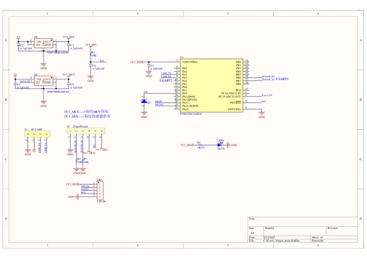
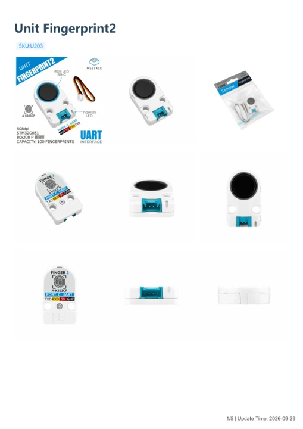

# Unit Fingerprint2

**M5Stack** · Source collection

Revision: Unverified source identity

Coverage: Manufacturer references available; physical pinout and complete connector review are tracked separately

[Browse all manufacturers](../../../../BROWSE.md) · [Devices & IoT](../../../../DEVICES.md) · [Open in the browser guide](https://valleytech-black-wire-guide.pages.dev/?board=source-board-6f6f329bfe576d3657)

## Datasheets and original documentation

Board datasheet: **not yet recorded**. Visual reference: **available**.

[Manufacturer model documentation](https://docs.m5stack.com/en/unit/Unit_Fingerprint2)

- **schematic / board**: [Unit Fingerprint2 Schematics PDF — schematic](https://m5stack-doc.oss-cn-shenzhen.aliyuncs.com/1186/SCH_Unit_Fingerprint2_SCH_MAIN_V1.0_20250822_2025_09_22_14_45_23.pdf) · [saved document](../../../../library/media/db0091ab764cf01a862addf0ac1b807562b0ca6d7278408d078006e7e965ab17.pdf)
- **hardware-guide / board**: [Unit Fingerprint2 — manufacturer hardware guide](https://m5stack.oss-cn-shenzhen.aliyuncs.com/resource/docs/static/pdf/static/en/unit/Unit_Fingerprint2.pdf) · [saved document](../../../../library/media/2a94e6e1b6ededd38b65d88fbf51a65f659d34c0f792611b889626ec665fee70.pdf)

A chip datasheet, schematic and board datasheet have different scopes. Match the exact hardware revision.

[Documentation coverage and remaining gaps](../../../../DOCUMENTATION.md)

## Dimensions

**source reference** · Unreviewed source · PNG

[Open original reference](../../../../library/media/6df4ed5e63c580a660278da2731de90a1268bc73df6381fa45ce670061b631f7.png)

**Credit and rights:** Source rights not yet established. Source/manufacturer: M5Stack.

[Source 1](https://m5stack-doc.oss-cn-shenzhen.aliyuncs.com/1186/U203-MODEL-SIZE-unit-2sma_page_01.png) · [Source 2](https://docs.m5stack.com/en/unit/Unit_Fingerprint2)

Original source index: Dimensions. This file is searchable but has not been promoted to a reviewed physical board pinout.

Image revision: Not identified

SHA-256: `6df4ed5e63c580a660278da2731de90a1268bc73df6381fa45ce670061b631f7`

## Unit Fingerprint2 Schematics PDF — schematic

**reference PDF** · Source model/link and PDF signature/title checked; individual pin assignments and electrical validation pending · PDF

[Open original reference](../../../../library/media/db0091ab764cf01a862addf0ac1b807562b0ca6d7278408d078006e7e965ab17.pdf)

**Credit and rights:** Original publisher/manufacturer artwork; redistribution and print rights not established. Attribution is not a license grant.. Source/manufacturer: M5Stack.

[Source 1](https://m5stack-doc.oss-cn-shenzhen.aliyuncs.com/1186/SCH_Unit_Fingerprint2_SCH_MAIN_V1.0_20250822_2025_09_22_14_45_23.pdf) · [Source 2](https://docs.m5stack.com/en/unit/Unit_Fingerprint2)

Original document linked from this model’s manufacturer page. Preserve the document’s exact revision and named subassembly scope; a linked accessory schematic is not a whole-device pinout. This is a circuit schematic, not a physical board pinout.

Image revision: Use the revision printed in the original document; do not assume all hardware revisions are interchangeable

SHA-256: `db0091ab764cf01a862addf0ac1b807562b0ca6d7278408d078006e7e965ab17`

## Unit Fingerprint2 — manufacturer hardware guide

**reference PDF** · Source model/link and PDF signature/title checked; individual pin assignments and electrical validation pending · PDF

[Open original reference](../../../../library/media/2a94e6e1b6ededd38b65d88fbf51a65f659d34c0f792611b889626ec665fee70.pdf)

**Credit and rights:** Original publisher/manufacturer artwork; redistribution and print rights not established. Attribution is not a license grant.. Source/manufacturer: M5Stack.

[Source 1](https://m5stack.oss-cn-shenzhen.aliyuncs.com/resource/docs/static/pdf/static/en/unit/Unit_Fingerprint2.pdf) · [Source 2](https://docs.m5stack.com/en/unit/Unit_Fingerprint2)

Original document linked from this model’s manufacturer page. Preserve the document’s exact revision and named subassembly scope; a linked accessory schematic is not a whole-device pinout. This is a hardware manual, not a separately classified board datasheet.

Image revision: Use the revision printed in the original document; do not assume all hardware revisions are interchangeable

SHA-256: `2a94e6e1b6ededd38b65d88fbf51a65f659d34c0f792611b889626ec665fee70`

Pin assignments have not been independently electrically verified. Check board revision before wiring.
