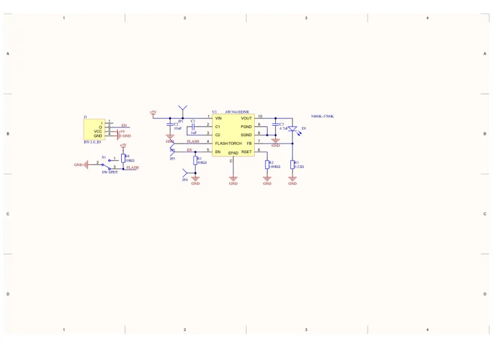
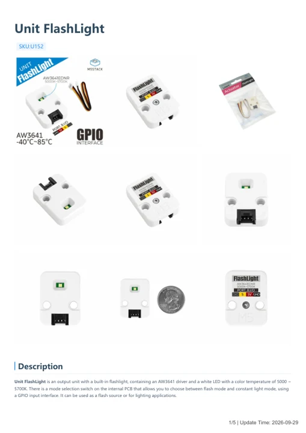

# Unit FlashLight

**M5Stack** · Source collection

Revision: Unverified source identity

Coverage: Manufacturer references available; physical pinout and complete connector review are tracked separately

[Browse all manufacturers](../../../../BROWSE.md) · [Devices & IoT](../../../../DEVICES.md) · [Open in the browser guide](https://valleytech-black-wire-guide.pages.dev/?board=source-board-c41af7f5f00e2de084)

## Datasheets and original documentation

Board datasheet: **not yet recorded**. Visual reference: **available**.

[Manufacturer model documentation](https://docs.m5stack.com/en/unit/FlashLight)

- **schematic / board**: [Unit FlashLight Schematics PDF — schematic](https://m5stack-doc.oss-cn-shenzhen.aliyuncs.com/606/UNIT-FlashLight.pdf) · [saved document](../../../../library/media/821ef3e7393f92f91ee565c6f43a6dce5e92d085c744edf88dbd69e2bb3b43cf.pdf)
- **hardware-guide / board**: [Unit FlashLight — manufacturer hardware guide](https://m5stack.oss-cn-shenzhen.aliyuncs.com/resource/docs/static/pdf/static/en/unit/Unit_FlashLight.pdf) · [saved document](../../../../library/media/5d611bb5f83656eb2f3501d58258dab291e23be1cad3e2d452007369a49f2fe4.pdf)

A chip datasheet, schematic and board datasheet have different scopes. Match the exact hardware revision.

[Documentation coverage and remaining gaps](../../../../DOCUMENTATION.md)

## Dimensions

**source reference** · Unreviewed source · PNG

[Open original reference](../../../../library/media/2c7039106bc7ee426dde8e2a33b17ff79b0ed2181ef13fb1c3e671b5a346e1e5.png)

**Credit and rights:** Source rights not yet established. Source/manufacturer: M5Stack.

[Source 1](https://static-cdn.m5stack.com/resource/docs/products/unit/FlashLight/img-f88ae770-4c7a-402a-b238-9b5fdc85d992.png) · [Source 2](https://docs.m5stack.com/en/unit/FlashLight)

Original source index: Dimensions. This file is searchable but has not been promoted to a reviewed physical board pinout.

Image revision: Not identified

SHA-256: `2c7039106bc7ee426dde8e2a33b17ff79b0ed2181ef13fb1c3e671b5a346e1e5`

## Unit FlashLight Schematics PDF — schematic

**reference PDF** · Source model/link and PDF signature/title checked; individual pin assignments and electrical validation pending · PDF

[Open original reference](../../../../library/media/821ef3e7393f92f91ee565c6f43a6dce5e92d085c744edf88dbd69e2bb3b43cf.pdf)

**Credit and rights:** Original publisher/manufacturer artwork; redistribution and print rights not established. Attribution is not a license grant.. Source/manufacturer: M5Stack.

[Source 1](https://m5stack-doc.oss-cn-shenzhen.aliyuncs.com/606/UNIT-FlashLight.pdf) · [Source 2](https://docs.m5stack.com/en/unit/FlashLight)

Original document linked from this model’s manufacturer page. Preserve the document’s exact revision and named subassembly scope; a linked accessory schematic is not a whole-device pinout. This is a circuit schematic, not a physical board pinout.

Image revision: Use the revision printed in the original document; do not assume all hardware revisions are interchangeable

SHA-256: `821ef3e7393f92f91ee565c6f43a6dce5e92d085c744edf88dbd69e2bb3b43cf`

## Unit FlashLight — manufacturer hardware guide

**reference PDF** · Source model/link and PDF signature/title checked; individual pin assignments and electrical validation pending · PDF

[Open original reference](../../../../library/media/5d611bb5f83656eb2f3501d58258dab291e23be1cad3e2d452007369a49f2fe4.pdf)

**Credit and rights:** Original publisher/manufacturer artwork; redistribution and print rights not established. Attribution is not a license grant.. Source/manufacturer: M5Stack.

[Source 1](https://m5stack.oss-cn-shenzhen.aliyuncs.com/resource/docs/static/pdf/static/en/unit/Unit_FlashLight.pdf) · [Source 2](https://docs.m5stack.com/en/unit/FlashLight)

Original document linked from this model’s manufacturer page. Preserve the document’s exact revision and named subassembly scope; a linked accessory schematic is not a whole-device pinout. This is a hardware manual, not a separately classified board datasheet.

Image revision: Use the revision printed in the original document; do not assume all hardware revisions are interchangeable

SHA-256: `5d611bb5f83656eb2f3501d58258dab291e23be1cad3e2d452007369a49f2fe4`

Pin assignments have not been independently electrically verified. Check board revision before wiring.
