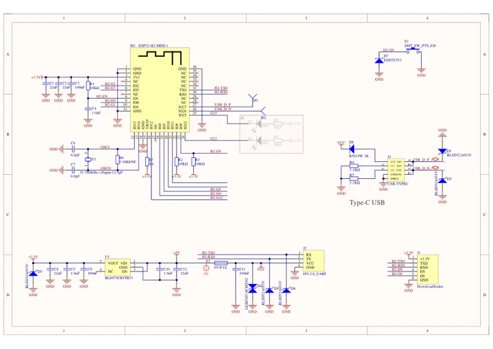
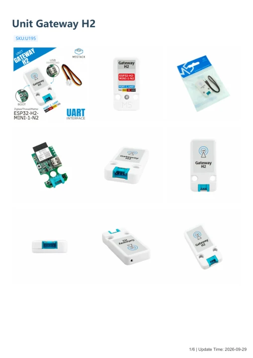

# Unit Gateway H2

**M5Stack** · Source collection

Revision: Unverified source identity

Coverage: Manufacturer references available; physical pinout and complete connector review are tracked separately

[Browse all manufacturers](../../../../BROWSE.md) · [Devices & IoT](../../../../DEVICES.md) · [Open in the browser guide](https://valleytech-black-wire-guide.pages.dev/?board=source-board-19e3832e05505eee62)

## Datasheets and original documentation

Board datasheet: **not yet recorded**. Visual reference: **available**.

[Manufacturer model documentation](https://docs.m5stack.com/en/unit/Unit%20Gateway%20H2)

- **schematic / board**: [Unit Gateway H2 Schematics PDF — schematic](https://m5stack-doc.oss-cn-shenzhen.aliyuncs.com/1128/U195_Sch_Unit_Gateway_H2_v0.3.pdf) · [saved document](../../../../library/media/e5428fd6d007d853db0cc8145ed1acdd09abad7afce7110ec2502d1f25216a19.pdf)
- **hardware-guide / board**: [Unit Gateway H2 — manufacturer hardware guide](https://m5stack.oss-cn-shenzhen.aliyuncs.com/resource/docs/static/pdf/static/en/unit/Unit_Gateway_H2.pdf) · [saved document](../../../../library/media/63194a6919693e9b2f02fb6c0e5a7b5993f5bfed556f8bad5b978c794fb96a09.pdf)

A chip datasheet, schematic and board datasheet have different scopes. Match the exact hardware revision.

[Documentation coverage and remaining gaps](../../../../DOCUMENTATION.md)

## Dimensions

**source reference** · Unreviewed source · JPG

[Open original reference](../../../../library/media/807c99afe25bd183b39a698b6f54cc4b6f3611f0d7a4357bdc57b04faac9efb9.jpg)

**Credit and rights:** Source rights not yet established. Source/manufacturer: M5Stack.

[Source 1](https://m5stack-doc.oss-cn-shenzhen.aliyuncs.com/1128/U195_Model_Size.jpg) · [Source 2](https://docs.m5stack.com/en/unit/Unit%20Gateway%20H2)

Original source index: Dimensions. This file is searchable but has not been promoted to a reviewed physical board pinout.

Image revision: Not identified

SHA-256: `807c99afe25bd183b39a698b6f54cc4b6f3611f0d7a4357bdc57b04faac9efb9`

## Unit Gateway H2 Schematics PDF — schematic

**reference PDF** · Source model/link and PDF signature/title checked; individual pin assignments and electrical validation pending · PDF

[Open original reference](../../../../library/media/e5428fd6d007d853db0cc8145ed1acdd09abad7afce7110ec2502d1f25216a19.pdf)

**Credit and rights:** Original publisher/manufacturer artwork; redistribution and print rights not established. Attribution is not a license grant.. Source/manufacturer: M5Stack.

[Source 1](https://m5stack-doc.oss-cn-shenzhen.aliyuncs.com/1128/U195_Sch_Unit_Gateway_H2_v0.3.pdf) · [Source 2](https://docs.m5stack.com/en/unit/Unit%20Gateway%20H2)

Original document linked from this model’s manufacturer page. Preserve the document’s exact revision and named subassembly scope; a linked accessory schematic is not a whole-device pinout. This is a circuit schematic, not a physical board pinout.

Image revision: Use the revision printed in the original document; do not assume all hardware revisions are interchangeable

SHA-256: `e5428fd6d007d853db0cc8145ed1acdd09abad7afce7110ec2502d1f25216a19`

## Unit Gateway H2 — manufacturer hardware guide

**reference PDF** · Source model/link and PDF signature/title checked; individual pin assignments and electrical validation pending · PDF

[Open original reference](../../../../library/media/63194a6919693e9b2f02fb6c0e5a7b5993f5bfed556f8bad5b978c794fb96a09.pdf)

**Credit and rights:** Original publisher/manufacturer artwork; redistribution and print rights not established. Attribution is not a license grant.. Source/manufacturer: M5Stack.

[Source 1](https://m5stack.oss-cn-shenzhen.aliyuncs.com/resource/docs/static/pdf/static/en/unit/Unit_Gateway_H2.pdf) · [Source 2](https://docs.m5stack.com/en/unit/Unit%20Gateway%20H2)

Original document linked from this model’s manufacturer page. Preserve the document’s exact revision and named subassembly scope; a linked accessory schematic is not a whole-device pinout. This is a hardware manual, not a separately classified board datasheet.

Image revision: Use the revision printed in the original document; do not assume all hardware revisions are interchangeable

SHA-256: `63194a6919693e9b2f02fb6c0e5a7b5993f5bfed556f8bad5b978c794fb96a09`

Pin assignments have not been independently electrically verified. Check board revision before wiring.
