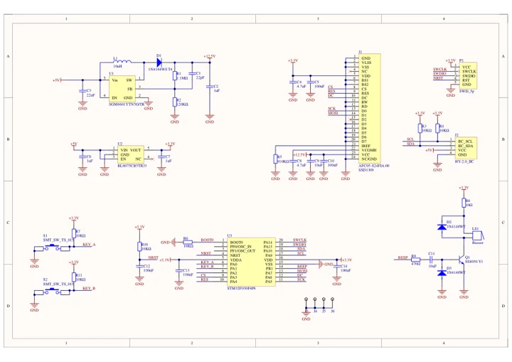
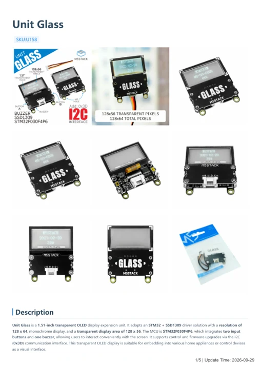

# Unit Glass

**M5Stack** · Source collection

Revision: Unverified source identity

Coverage: Manufacturer references available; physical pinout and complete connector review are tracked separately

[Browse all manufacturers](../../../../BROWSE.md) · [Devices & IoT](../../../../DEVICES.md) · [Open in the browser guide](https://valleytech-black-wire-guide.pages.dev/?board=source-board-0f797f4fc6408ab69e)

## Datasheets and original documentation

Board datasheet: **not yet recorded**. Visual reference: **available**.

[Manufacturer model documentation](https://docs.m5stack.com/en/unit/Glass%20Unit)

- **schematic / board**: [Unit Glass Schematics PDF — schematic](https://m5stack-doc.oss-cn-shenzhen.aliyuncs.com/612/Sch_UNIT-GLASS.pdf) · [saved document](../../../../library/media/4f41e0de23cb9dc743b8c780d2d6015b5883560727848b4cc3f478089bfb90bf.pdf)
- **hardware-guide / board**: [Unit Glass — manufacturer hardware guide](https://m5stack.oss-cn-shenzhen.aliyuncs.com/resource/docs/static/pdf/static/en/unit/Unit_Glass.pdf) · [saved document](../../../../library/media/022e95061499e15fe9a1e7271adbff7c6855d120df213d84e3ecf662147387cd.pdf)

A chip datasheet, schematic and board datasheet have different scopes. Match the exact hardware revision.

[Documentation coverage and remaining gaps](../../../../DOCUMENTATION.md)

## Dimensions

**source reference** · Unreviewed source · PNG

[Open original reference](../../../../library/media/95c02b8ed4ef21808f226672664f579d89bb504c7d719d7b2365655d0e0db2a3.png)

**Credit and rights:** Source rights not yet established. Source/manufacturer: M5Stack.

[Source 1](https://static-cdn.m5stack.com/resource/docs/products/unit/Glass Unit/img-81ef47d6-593a-4f70-96c8-1cedd6038c53.png) · [Source 2](https://docs.m5stack.com/en/unit/Glass%20Unit)

Original source index: Dimensions. This file is searchable but has not been promoted to a reviewed physical board pinout.

Image revision: Not identified

SHA-256: `95c02b8ed4ef21808f226672664f579d89bb504c7d719d7b2365655d0e0db2a3`

## Unit Glass Schematics PDF — schematic

**reference PDF** · Source model/link and PDF signature/title checked; individual pin assignments and electrical validation pending · PDF

[Open original reference](../../../../library/media/4f41e0de23cb9dc743b8c780d2d6015b5883560727848b4cc3f478089bfb90bf.pdf)

**Credit and rights:** Original publisher/manufacturer artwork; redistribution and print rights not established. Attribution is not a license grant.. Source/manufacturer: M5Stack.

[Source 1](https://m5stack-doc.oss-cn-shenzhen.aliyuncs.com/612/Sch_UNIT-GLASS.pdf) · [Source 2](https://docs.m5stack.com/en/unit/Glass%20Unit)

Original document linked from this model’s manufacturer page. Preserve the document’s exact revision and named subassembly scope; a linked accessory schematic is not a whole-device pinout. This is a circuit schematic, not a physical board pinout.

Image revision: Use the revision printed in the original document; do not assume all hardware revisions are interchangeable

SHA-256: `4f41e0de23cb9dc743b8c780d2d6015b5883560727848b4cc3f478089bfb90bf`

## Unit Glass — manufacturer hardware guide

**reference PDF** · Source model/link and PDF signature/title checked; individual pin assignments and electrical validation pending · PDF

[Open original reference](../../../../library/media/022e95061499e15fe9a1e7271adbff7c6855d120df213d84e3ecf662147387cd.pdf)

**Credit and rights:** Original publisher/manufacturer artwork; redistribution and print rights not established. Attribution is not a license grant.. Source/manufacturer: M5Stack.

[Source 1](https://m5stack.oss-cn-shenzhen.aliyuncs.com/resource/docs/static/pdf/static/en/unit/Unit_Glass.pdf) · [Source 2](https://docs.m5stack.com/en/unit/Glass%20Unit)

Original document linked from this model’s manufacturer page. Preserve the document’s exact revision and named subassembly scope; a linked accessory schematic is not a whole-device pinout. This is a hardware manual, not a separately classified board datasheet.

Image revision: Use the revision printed in the original document; do not assume all hardware revisions are interchangeable

SHA-256: `022e95061499e15fe9a1e7271adbff7c6855d120df213d84e3ecf662147387cd`

Pin assignments have not been independently electrically verified. Check board revision before wiring.
