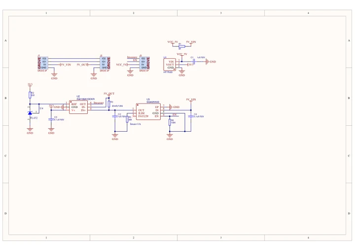
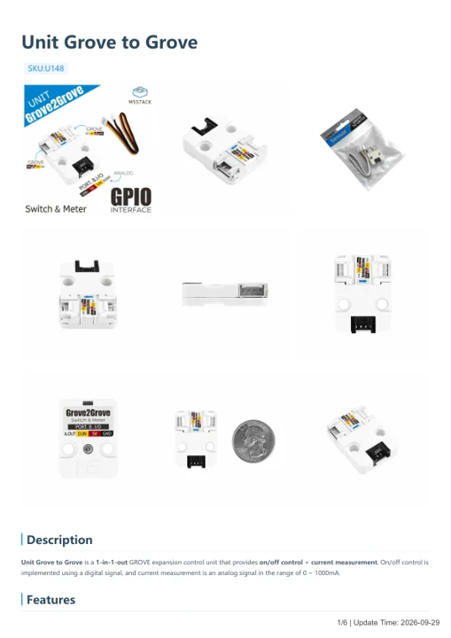

# Unit Grove to Grove

**M5Stack** · Source collection

Revision: Unverified source identity

Coverage: Manufacturer references available; physical pinout and complete connector review are tracked separately

[Browse all manufacturers](../../../../BROWSE.md) · [Devices & IoT](../../../../DEVICES.md) · [Open in the browser guide](https://valleytech-black-wire-guide.pages.dev/?board=source-board-7cb5c281a1564e4e60)

## Datasheets and original documentation

Board datasheet: **not yet recorded**. Visual reference: **available**.

[Manufacturer model documentation](https://docs.m5stack.com/en/unit/unit_grove2grove)

- **schematic / board**: [Unit Grove to Grove Schematics PDF — schematic](https://m5stack-doc.oss-cn-shenzhen.aliyuncs.com/602/Sch_Unit_Grove2Grove_V1.0.pdf) · [saved document](../../../../library/media/f785b19976fc0eb0e7c44af29c00855220116854f4cdb3c912379af84b95dda5.pdf)
- **hardware-guide / board**: [Unit Grove to Grove — manufacturer hardware guide](https://m5stack.oss-cn-shenzhen.aliyuncs.com/resource/docs/static/pdf/static/en/unit/Unit_Grove_to_Grove.pdf) · [saved document](../../../../library/media/2c8270265f1b08ae20373312620efb0bbca40ed2009227386de6eb86a92d9f6a.pdf)

A chip datasheet, schematic and board datasheet have different scopes. Match the exact hardware revision.

[Documentation coverage and remaining gaps](../../../../DOCUMENTATION.md)

## Dimensions

**source reference** · Unreviewed source · JPG

[Open original reference](../../../../library/media/67f8a94797c7f5ff7bb9b811b701e7c96858fe930eb2048f8deb5a16ffbcb612.jpg)

**Credit and rights:** Source rights not yet established. Source/manufacturer: M5Stack.

[Source 1](https://m5stack.oss-cn-shenzhen.aliyuncs.com/resource/docs/products/unit/unit_grove2grove/model%20size.jpg) · [Source 2](https://docs.m5stack.com/en/unit/unit_grove2grove)

Original source index: Dimensions. This file is searchable but has not been promoted to a reviewed physical board pinout.

Image revision: Not identified

SHA-256: `67f8a94797c7f5ff7bb9b811b701e7c96858fe930eb2048f8deb5a16ffbcb612`

## Unit Grove to Grove Schematics PDF — schematic

**reference PDF** · Source model/link and PDF signature/title checked; individual pin assignments and electrical validation pending · PDF

[Open original reference](../../../../library/media/f785b19976fc0eb0e7c44af29c00855220116854f4cdb3c912379af84b95dda5.pdf)

**Credit and rights:** Original publisher/manufacturer artwork; redistribution and print rights not established. Attribution is not a license grant.. Source/manufacturer: M5Stack.

[Source 1](https://m5stack-doc.oss-cn-shenzhen.aliyuncs.com/602/Sch_Unit_Grove2Grove_V1.0.pdf) · [Source 2](https://docs.m5stack.com/en/unit/unit_grove2grove)

Original document linked from this model’s manufacturer page. Preserve the document’s exact revision and named subassembly scope; a linked accessory schematic is not a whole-device pinout. This is a circuit schematic, not a physical board pinout.

Image revision: Use the revision printed in the original document; do not assume all hardware revisions are interchangeable

SHA-256: `f785b19976fc0eb0e7c44af29c00855220116854f4cdb3c912379af84b95dda5`

## Unit Grove to Grove — manufacturer hardware guide

**reference PDF** · Source model/link and PDF signature/title checked; individual pin assignments and electrical validation pending · PDF

[Open original reference](../../../../library/media/2c8270265f1b08ae20373312620efb0bbca40ed2009227386de6eb86a92d9f6a.pdf)

**Credit and rights:** Original publisher/manufacturer artwork; redistribution and print rights not established. Attribution is not a license grant.. Source/manufacturer: M5Stack.

[Source 1](https://m5stack.oss-cn-shenzhen.aliyuncs.com/resource/docs/static/pdf/static/en/unit/Unit_Grove_to_Grove.pdf) · [Source 2](https://docs.m5stack.com/en/unit/unit_grove2grove)

Original document linked from this model’s manufacturer page. Preserve the document’s exact revision and named subassembly scope; a linked accessory schematic is not a whole-device pinout. This is a hardware manual, not a separately classified board datasheet.

Image revision: Use the revision printed in the original document; do not assume all hardware revisions are interchangeable

SHA-256: `2c8270265f1b08ae20373312620efb0bbca40ed2009227386de6eb86a92d9f6a`

Pin assignments have not been independently electrically verified. Check board revision before wiring.
