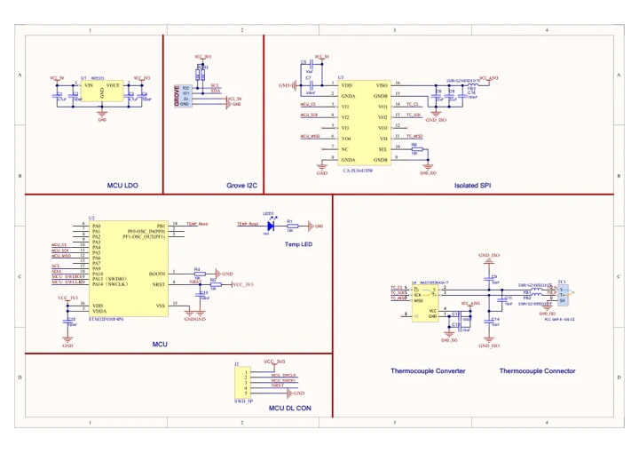
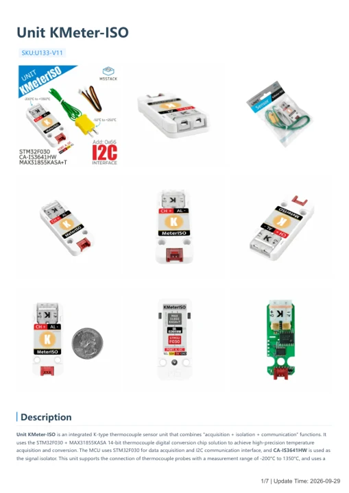

# Unit KMeter-ISO

**M5Stack** · Source collection

Revision: Unverified source identity

Coverage: Manufacturer references available; physical pinout and complete connector review are tracked separately

[Browse all manufacturers](../../../../BROWSE.md) · [Devices & IoT](../../../../DEVICES.md) · [Open in the browser guide](https://valleytech-black-wire-guide.pages.dev/?board=source-board-37fa4c27be8e1e21b0)

## Datasheets and original documentation

Board datasheet: **not yet recorded**. Visual reference: **available**.

[Manufacturer model documentation](https://docs.m5stack.com/en/unit/KMeterISO%20Unit)

- **schematic / board**: [Unit KMeter-ISO Schematics PDF — schematic](https://m5stack-doc.oss-cn-shenzhen.aliyuncs.com/596/Sch_UNIT-KMeter_ISO.pdf) · [saved document](../../../../library/media/c6d2f083db90197ed062a63c60c6cc696af13517fceb7ef55cf37aa7313bc28a.pdf)
- **hardware-guide / board**: [Unit KMeter-ISO — manufacturer hardware guide](https://m5stack.oss-cn-shenzhen.aliyuncs.com/resource/docs/static/pdf/static/en/unit/Unit_KMeter-ISO.pdf) · [saved document](../../../../library/media/8ed7351b7a96ddd451603de0db84c11348a0ed7ecdbdbd9ae781268c6523d742.pdf)

A chip datasheet, schematic and board datasheet have different scopes. Match the exact hardware revision.

[Documentation coverage and remaining gaps](../../../../DOCUMENTATION.md)

## Dimensions

**source reference** · Unreviewed source · PNG

[Open original reference](../../../../library/media/524cb5d3baef7cc3a6ac6a7e2a588e80557fc9494c1788e148f427c43a30a9d2.png)

**Credit and rights:** Source rights not yet established. Source/manufacturer: M5Stack.

[Source 1](https://static-cdn.m5stack.com/resource/docs/products/unit/KMeterISO Unit/img-b09b086d-a26c-40d3-9ef5-f5f24a4e6028.png) · [Source 2](https://docs.m5stack.com/en/unit/KMeterISO%20Unit)

Original source index: Dimensions. This file is searchable but has not been promoted to a reviewed physical board pinout.

Image revision: Not identified

SHA-256: `524cb5d3baef7cc3a6ac6a7e2a588e80557fc9494c1788e148f427c43a30a9d2`

## Unit KMeter-ISO Schematics PDF — schematic

**reference PDF** · Source model/link and PDF signature/title checked; individual pin assignments and electrical validation pending · PDF

[Open original reference](../../../../library/media/c6d2f083db90197ed062a63c60c6cc696af13517fceb7ef55cf37aa7313bc28a.pdf)

**Credit and rights:** Original publisher/manufacturer artwork; redistribution and print rights not established. Attribution is not a license grant.. Source/manufacturer: M5Stack.

[Source 1](https://m5stack-doc.oss-cn-shenzhen.aliyuncs.com/596/Sch_UNIT-KMeter_ISO.pdf) · [Source 2](https://docs.m5stack.com/en/unit/KMeterISO%20Unit)

Original document linked from this model’s manufacturer page. Preserve the document’s exact revision and named subassembly scope; a linked accessory schematic is not a whole-device pinout. This is a circuit schematic, not a physical board pinout.

Image revision: Use the revision printed in the original document; do not assume all hardware revisions are interchangeable

SHA-256: `c6d2f083db90197ed062a63c60c6cc696af13517fceb7ef55cf37aa7313bc28a`

## Unit KMeter-ISO — manufacturer hardware guide

**reference PDF** · Source model/link and PDF signature/title checked; individual pin assignments and electrical validation pending · PDF

[Open original reference](../../../../library/media/8ed7351b7a96ddd451603de0db84c11348a0ed7ecdbdbd9ae781268c6523d742.pdf)

**Credit and rights:** Original publisher/manufacturer artwork; redistribution and print rights not established. Attribution is not a license grant.. Source/manufacturer: M5Stack.

[Source 1](https://m5stack.oss-cn-shenzhen.aliyuncs.com/resource/docs/static/pdf/static/en/unit/Unit_KMeter-ISO.pdf) · [Source 2](https://docs.m5stack.com/en/unit/KMeterISO%20Unit)

Original document linked from this model’s manufacturer page. Preserve the document’s exact revision and named subassembly scope; a linked accessory schematic is not a whole-device pinout. This is a hardware manual, not a separately classified board datasheet.

Image revision: Use the revision printed in the original document; do not assume all hardware revisions are interchangeable

SHA-256: `8ed7351b7a96ddd451603de0db84c11348a0ed7ecdbdbd9ae781268c6523d742`

Pin assignments have not been independently electrically verified. Check board revision before wiring.
