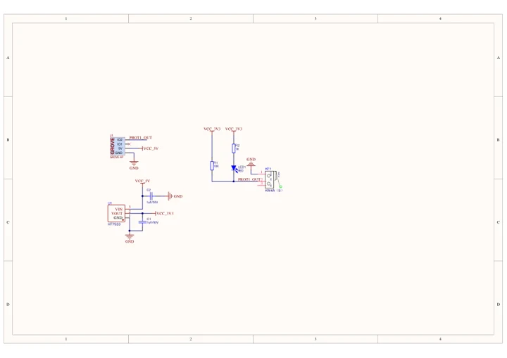
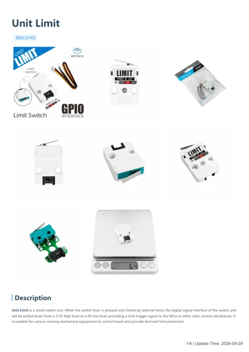

# Unit Limit

**M5Stack** · Source collection

Revision: Unverified source identity

Coverage: Manufacturer references available; physical pinout and complete connector review are tracked separately

[Browse all manufacturers](../../../../BROWSE.md) · [Devices & IoT](../../../../DEVICES.md) · [Open in the browser guide](https://valleytech-black-wire-guide.pages.dev/?board=source-board-2527d2ea1ad559d94d)

## Datasheets and original documentation

Board datasheet: **not yet recorded**. Visual reference: **available**.

[Manufacturer model documentation](https://docs.m5stack.com/en/unit/Unit%20Limit)

- **schematic / board**: [Unit Limit Schematics PDF — schematic](https://m5stack-doc.oss-cn-shenzhen.aliyuncs.com/600/SCH_unitLimit_V1.0.pdf) · [saved document](../../../../library/media/9937d53586a8c45b8521362a87049054d2f7d522bd144e2d35f81dc016d6aed5.pdf)
- **hardware-guide / board**: [Unit Limit — manufacturer hardware guide](https://m5stack.oss-cn-shenzhen.aliyuncs.com/resource/docs/static/pdf/static/en/unit/Unit_Limit.pdf) · [saved document](../../../../library/media/0d712085ed49f40d8f3859798e1142f98e338a6a5f5b20a92054cdf420cc7fe7.pdf)

A chip datasheet, schematic and board datasheet have different scopes. Match the exact hardware revision.

[Documentation coverage and remaining gaps](../../../../DOCUMENTATION.md)

## Dimensions

**source reference** · Unreviewed source · JPG

[Open original reference](../../../../library/media/7e8dd3f916b7eeb798c01df0110e3ad9d404b9e46fe07edaba466f675b231476.jpg)

**Credit and rights:** Source rights not yet established. Source/manufacturer: M5Stack.

[Source 1](https://m5stack.oss-cn-shenzhen.aliyuncs.com/resource/docs/products/unit/Unit%20Limit/%E5%B0%BA%E5%AF%B8%E5%9B%BE.jpg) · [Source 2](https://docs.m5stack.com/en/unit/Unit%20Limit)

Original source index: Dimensions. This file is searchable but has not been promoted to a reviewed physical board pinout.

Image revision: Not identified

SHA-256: `7e8dd3f916b7eeb798c01df0110e3ad9d404b9e46fe07edaba466f675b231476`

## Unit Limit Schematics PDF — schematic

**reference PDF** · Source model/link and PDF signature/title checked; individual pin assignments and electrical validation pending · PDF

[Open original reference](../../../../library/media/9937d53586a8c45b8521362a87049054d2f7d522bd144e2d35f81dc016d6aed5.pdf)

**Credit and rights:** Original publisher/manufacturer artwork; redistribution and print rights not established. Attribution is not a license grant.. Source/manufacturer: M5Stack.

[Source 1](https://m5stack-doc.oss-cn-shenzhen.aliyuncs.com/600/SCH_unitLimit_V1.0.pdf) · [Source 2](https://docs.m5stack.com/en/unit/Unit%20Limit)

Original document linked from this model’s manufacturer page. Preserve the document’s exact revision and named subassembly scope; a linked accessory schematic is not a whole-device pinout. This is a circuit schematic, not a physical board pinout.

Image revision: Use the revision printed in the original document; do not assume all hardware revisions are interchangeable

SHA-256: `9937d53586a8c45b8521362a87049054d2f7d522bd144e2d35f81dc016d6aed5`

## Unit Limit — manufacturer hardware guide

**reference PDF** · Source model/link and PDF signature/title checked; individual pin assignments and electrical validation pending · PDF

[Open original reference](../../../../library/media/0d712085ed49f40d8f3859798e1142f98e338a6a5f5b20a92054cdf420cc7fe7.pdf)

**Credit and rights:** Original publisher/manufacturer artwork; redistribution and print rights not established. Attribution is not a license grant.. Source/manufacturer: M5Stack.

[Source 1](https://m5stack.oss-cn-shenzhen.aliyuncs.com/resource/docs/static/pdf/static/en/unit/Unit_Limit.pdf) · [Source 2](https://docs.m5stack.com/en/unit/Unit%20Limit)

Original document linked from this model’s manufacturer page. Preserve the document’s exact revision and named subassembly scope; a linked accessory schematic is not a whole-device pinout. This is a hardware manual, not a separately classified board datasheet.

Image revision: Use the revision printed in the original document; do not assume all hardware revisions are interchangeable

SHA-256: `0d712085ed49f40d8f3859798e1142f98e338a6a5f5b20a92054cdf420cc7fe7`

Pin assignments have not been independently electrically verified. Check board revision before wiring.
