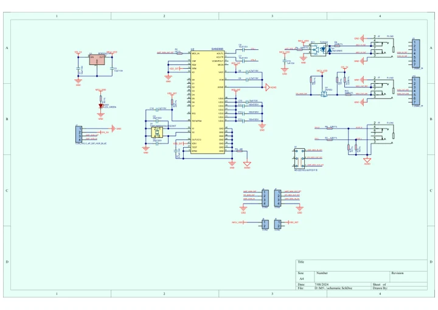
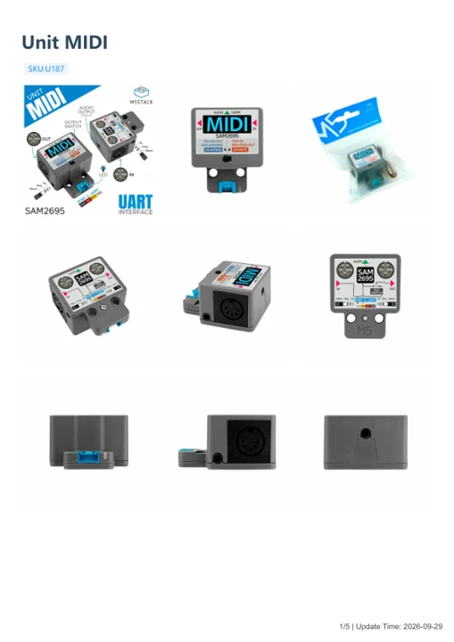

# Unit MIDI

**M5Stack** · Source collection

Revision: Unverified source identity

Coverage: Manufacturer references available; physical pinout and complete connector review are tracked separately

[Browse all manufacturers](../../../../BROWSE.md) · [Devices & IoT](../../../../DEVICES.md) · [Open in the browser guide](https://valleytech-black-wire-guide.pages.dev/?board=source-board-6d9ef7d2c385a09d32)

## Datasheets and original documentation

Board datasheet: **not yet recorded**. Visual reference: **available**.

[Manufacturer model documentation](https://docs.m5stack.com/en/unit/Unit-MIDI)

- **schematic / board**: [Unit MIDI Schematics PDF — schematic](https://m5stack-doc.oss-cn-shenzhen.aliyuncs.com/774/SCH_UnitMIDI_B04_sch_2024_07_08_15_41_29.pdf) · [saved document](../../../../library/media/3c4740d637b9a048a777ca1c54a8c9397d864dba56e4b2d23b3d495a5960154e.pdf)
- **hardware-guide / board**: [Unit MIDI — manufacturer hardware guide](https://m5stack.oss-cn-shenzhen.aliyuncs.com/resource/docs/static/pdf/static/en/unit/Unit_MIDI.pdf) · [saved document](../../../../library/media/5b1491e65292a71cf0496c149772d9035860198fd5b5b1833d4efaea7c33406d.pdf)

A chip datasheet, schematic and board datasheet have different scopes. Match the exact hardware revision.

[Documentation coverage and remaining gaps](../../../../DOCUMENTATION.md)

## Dimensions

**source reference** · Unreviewed source · JPG

[Open original reference](../../../../library/media/442efbdcd92a23a32b7c54d0c9a2976b91a4b1568d55b17ce37a19c31a291b53.jpg)

**Credit and rights:** Source rights not yet established. Source/manufacturer: M5Stack.

[Source 1](https://static-cdn.m5stack.com/resource/docs/products/unit/Unit-MIDI/img-781316ed-8117-4315-bc6f-35cb02fac563.jpg) · [Source 2](https://docs.m5stack.com/en/unit/Unit-MIDI)

Original source index: Dimensions. This file is searchable but has not been promoted to a reviewed physical board pinout.

Image revision: Not identified

SHA-256: `442efbdcd92a23a32b7c54d0c9a2976b91a4b1568d55b17ce37a19c31a291b53`

## Unit MIDI Schematics PDF — schematic

**reference PDF** · Source model/link and PDF signature/title checked; individual pin assignments and electrical validation pending · PDF

[Open original reference](../../../../library/media/3c4740d637b9a048a777ca1c54a8c9397d864dba56e4b2d23b3d495a5960154e.pdf)

**Credit and rights:** Original publisher/manufacturer artwork; redistribution and print rights not established. Attribution is not a license grant.. Source/manufacturer: M5Stack.

[Source 1](https://m5stack-doc.oss-cn-shenzhen.aliyuncs.com/774/SCH_UnitMIDI_B04_sch_2024_07_08_15_41_29.pdf) · [Source 2](https://docs.m5stack.com/en/unit/Unit-MIDI)

Original document linked from this model’s manufacturer page. Preserve the document’s exact revision and named subassembly scope; a linked accessory schematic is not a whole-device pinout. This is a circuit schematic, not a physical board pinout.

Image revision: Use the revision printed in the original document; do not assume all hardware revisions are interchangeable

SHA-256: `3c4740d637b9a048a777ca1c54a8c9397d864dba56e4b2d23b3d495a5960154e`

## Unit MIDI — manufacturer hardware guide

**reference PDF** · Source model/link and PDF signature/title checked; individual pin assignments and electrical validation pending · PDF

[Open original reference](../../../../library/media/5b1491e65292a71cf0496c149772d9035860198fd5b5b1833d4efaea7c33406d.pdf)

**Credit and rights:** Original publisher/manufacturer artwork; redistribution and print rights not established. Attribution is not a license grant.. Source/manufacturer: M5Stack.

[Source 1](https://m5stack.oss-cn-shenzhen.aliyuncs.com/resource/docs/static/pdf/static/en/unit/Unit_MIDI.pdf) · [Source 2](https://docs.m5stack.com/en/unit/Unit-MIDI)

Original document linked from this model’s manufacturer page. Preserve the document’s exact revision and named subassembly scope; a linked accessory schematic is not a whole-device pinout. This is a hardware manual, not a separately classified board datasheet.

Image revision: Use the revision printed in the original document; do not assume all hardware revisions are interchangeable

SHA-256: `5b1491e65292a71cf0496c149772d9035860198fd5b5b1833d4efaea7c33406d`

Pin assignments have not been independently electrically verified. Check board revision before wiring.
