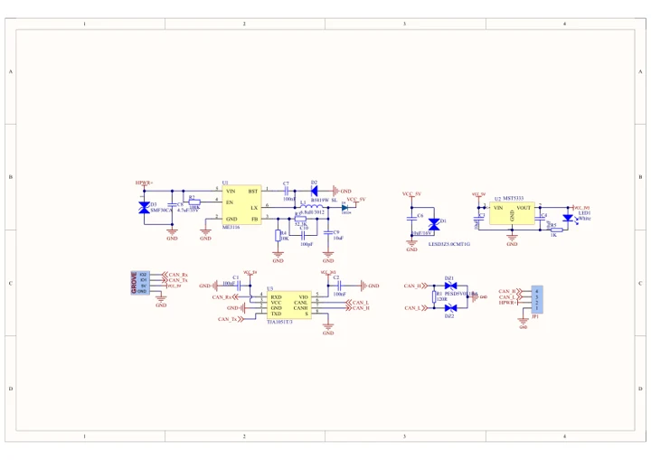
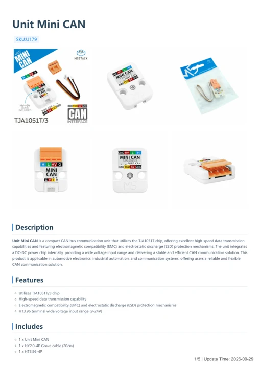

# Unit Mini CAN

**M5Stack** · Source collection

Revision: Unverified source identity

Coverage: Manufacturer references available; physical pinout and complete connector review are tracked separately

[Browse all manufacturers](../../../../BROWSE.md) · [Devices & IoT](../../../../DEVICES.md) · [Open in the browser guide](https://valleytech-black-wire-guide.pages.dev/?board=source-board-3a474e2b3486b9fc9a)

## Datasheets and original documentation

Board datasheet: **not yet recorded**. Visual reference: **available**.

[Manufacturer model documentation](https://docs.m5stack.com/en/unit/Unit-Mini%20CAN)

- **schematic / board**: [Unit Mini CAN Schematics PDF — schematic](https://m5stack-doc.oss-cn-shenzhen.aliyuncs.com/631/SCH_UNIT_Mini_CAN_V1.0.pdf) · [saved document](../../../../library/media/40224697df3b7731a7bb9a25172cf50d1dd044e124e0be2476816656b3c37706.pdf)
- **hardware-guide / board**: [Unit Mini CAN — manufacturer hardware guide](https://m5stack.oss-cn-shenzhen.aliyuncs.com/resource/docs/static/pdf/static/en/unit/Unit_Mini_CAN.pdf) · [saved document](../../../../library/media/0fafa2dd1b718fdc3d92ec58d5abaf63f13a22b1394db1bf8ad35b66aee1762a.pdf)

A chip datasheet, schematic and board datasheet have different scopes. Match the exact hardware revision.

[Documentation coverage and remaining gaps](../../../../DOCUMENTATION.md)

## Dimensions

**source reference** · Unreviewed source · JPG

[Open original reference](../../../../library/media/8563bfd078212dfa3559a6c066e94060424b03671d072aa9d21db96be793698d.jpg)

**Credit and rights:** Source rights not yet established. Source/manufacturer: M5Stack.

[Source 1](https://static-cdn.m5stack.com/resource/docs/products/unit/Unit-Mini CAN/img-098a4216-2c39-44ba-836c-5565299c05d7.jpg) · [Source 2](https://docs.m5stack.com/en/unit/Unit-Mini%20CAN)

Original source index: Dimensions. This file is searchable but has not been promoted to a reviewed physical board pinout.

Image revision: Not identified

SHA-256: `8563bfd078212dfa3559a6c066e94060424b03671d072aa9d21db96be793698d`

## Unit Mini CAN Schematics PDF — schematic

**reference PDF** · Source model/link and PDF signature/title checked; individual pin assignments and electrical validation pending · PDF

[Open original reference](../../../../library/media/40224697df3b7731a7bb9a25172cf50d1dd044e124e0be2476816656b3c37706.pdf)

**Credit and rights:** Original publisher/manufacturer artwork; redistribution and print rights not established. Attribution is not a license grant.. Source/manufacturer: M5Stack.

[Source 1](https://m5stack-doc.oss-cn-shenzhen.aliyuncs.com/631/SCH_UNIT_Mini_CAN_V1.0.pdf) · [Source 2](https://docs.m5stack.com/en/unit/Unit-Mini%20CAN)

Original document linked from this model’s manufacturer page. Preserve the document’s exact revision and named subassembly scope; a linked accessory schematic is not a whole-device pinout. This is a circuit schematic, not a physical board pinout.

Image revision: Use the revision printed in the original document; do not assume all hardware revisions are interchangeable

SHA-256: `40224697df3b7731a7bb9a25172cf50d1dd044e124e0be2476816656b3c37706`

## Unit Mini CAN — manufacturer hardware guide

**reference PDF** · Source model/link and PDF signature/title checked; individual pin assignments and electrical validation pending · PDF

[Open original reference](../../../../library/media/0fafa2dd1b718fdc3d92ec58d5abaf63f13a22b1394db1bf8ad35b66aee1762a.pdf)

**Credit and rights:** Original publisher/manufacturer artwork; redistribution and print rights not established. Attribution is not a license grant.. Source/manufacturer: M5Stack.

[Source 1](https://m5stack.oss-cn-shenzhen.aliyuncs.com/resource/docs/static/pdf/static/en/unit/Unit_Mini_CAN.pdf) · [Source 2](https://docs.m5stack.com/en/unit/Unit-Mini%20CAN)

Original document linked from this model’s manufacturer page. Preserve the document’s exact revision and named subassembly scope; a linked accessory schematic is not a whole-device pinout. This is a hardware manual, not a separately classified board datasheet.

Image revision: Use the revision printed in the original document; do not assume all hardware revisions are interchangeable

SHA-256: `0fafa2dd1b718fdc3d92ec58d5abaf63f13a22b1394db1bf8ad35b66aee1762a`

Pin assignments have not been independently electrically verified. Check board revision before wiring.
