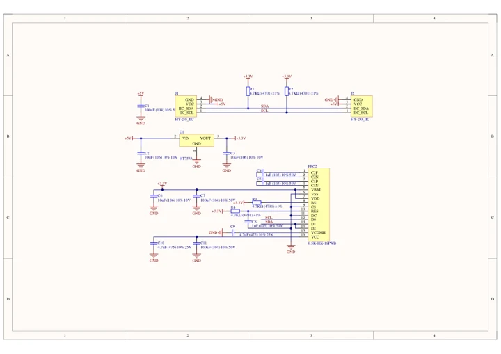
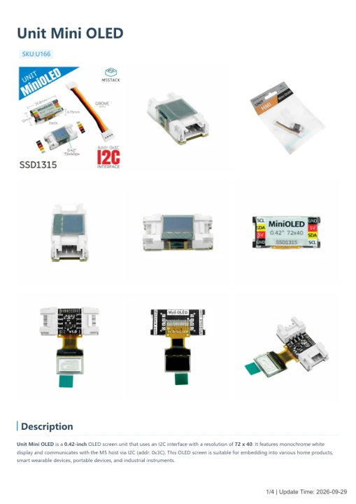

# Unit Mini OLED

**M5Stack** · Source collection

Revision: Unverified source identity

Coverage: Manufacturer references available; physical pinout and complete connector review are tracked separately

[Browse all manufacturers](../../../../BROWSE.md) · [Devices & IoT](../../../../DEVICES.md) · [Open in the browser guide](https://valleytech-black-wire-guide.pages.dev/?board=source-board-006d629d6c06146f9f)

## Datasheets and original documentation

Board datasheet: **not yet recorded**. Visual reference: **available**.

[Manufacturer model documentation](https://docs.m5stack.com/en/unit/MiniOLED%20Unit)

- **schematic / board**: [Unit Mini OLED Schematics PDF — schematic](https://m5stack-doc.oss-cn-shenzhen.aliyuncs.com/621/Sch_UNIT-MiniOLED.pdf) · [saved document](../../../../library/media/1c85db39298a57d9b25f7ec817b8f2d5b87fe4d1542e224c9b3a3c950f5f9f08.pdf)
- **hardware-guide / board**: [Unit Mini OLED — manufacturer hardware guide](https://m5stack.oss-cn-shenzhen.aliyuncs.com/resource/docs/static/pdf/static/en/unit/Unit_Mini_OLED.pdf) · [saved document](../../../../library/media/fcd70b8475cdaf48c6ae67416e48d315cf4e1752284e9fd08da5000d1a73d261.pdf)

A chip datasheet, schematic and board datasheet have different scopes. Match the exact hardware revision.

[Documentation coverage and remaining gaps](../../../../DOCUMENTATION.md)

## Dimensions

**source reference** · Unreviewed source · JPG

[Open original reference](../../../../library/media/2bc616562f18cc3396c39def8059f3d6e2a46594d5f72c09e6d16512435ad75e.jpg)

**Credit and rights:** Source rights not yet established. Source/manufacturer: M5Stack.

[Source 1](https://static-cdn.m5stack.com/resource/docs/products/unit/MiniOLED Unit/img-bd4c16f8-05f0-41d7-98a6-45d6405658ef.jpg) · [Source 2](https://docs.m5stack.com/en/unit/MiniOLED%20Unit)

Original source index: Dimensions. This file is searchable but has not been promoted to a reviewed physical board pinout.

Image revision: Not identified

SHA-256: `2bc616562f18cc3396c39def8059f3d6e2a46594d5f72c09e6d16512435ad75e`

## Unit Mini OLED Schematics PDF — schematic

**reference PDF** · Source model/link and PDF signature/title checked; individual pin assignments and electrical validation pending · PDF

[Open original reference](../../../../library/media/1c85db39298a57d9b25f7ec817b8f2d5b87fe4d1542e224c9b3a3c950f5f9f08.pdf)

**Credit and rights:** Original publisher/manufacturer artwork; redistribution and print rights not established. Attribution is not a license grant.. Source/manufacturer: M5Stack.

[Source 1](https://m5stack-doc.oss-cn-shenzhen.aliyuncs.com/621/Sch_UNIT-MiniOLED.pdf) · [Source 2](https://docs.m5stack.com/en/unit/MiniOLED%20Unit)

Original document linked from this model’s manufacturer page. Preserve the document’s exact revision and named subassembly scope; a linked accessory schematic is not a whole-device pinout. This is a circuit schematic, not a physical board pinout.

Image revision: Use the revision printed in the original document; do not assume all hardware revisions are interchangeable

SHA-256: `1c85db39298a57d9b25f7ec817b8f2d5b87fe4d1542e224c9b3a3c950f5f9f08`

## Unit Mini OLED — manufacturer hardware guide

**reference PDF** · Source model/link and PDF signature/title checked; individual pin assignments and electrical validation pending · PDF

[Open original reference](../../../../library/media/fcd70b8475cdaf48c6ae67416e48d315cf4e1752284e9fd08da5000d1a73d261.pdf)

**Credit and rights:** Original publisher/manufacturer artwork; redistribution and print rights not established. Attribution is not a license grant.. Source/manufacturer: M5Stack.

[Source 1](https://m5stack.oss-cn-shenzhen.aliyuncs.com/resource/docs/static/pdf/static/en/unit/Unit_Mini_OLED.pdf) · [Source 2](https://docs.m5stack.com/en/unit/MiniOLED%20Unit)

Original document linked from this model’s manufacturer page. Preserve the document’s exact revision and named subassembly scope; a linked accessory schematic is not a whole-device pinout. This is a hardware manual, not a separately classified board datasheet.

Image revision: Use the revision printed in the original document; do not assume all hardware revisions are interchangeable

SHA-256: `fcd70b8475cdaf48c6ae67416e48d315cf4e1752284e9fd08da5000d1a73d261`

Pin assignments have not been independently electrically verified. Check board revision before wiring.
