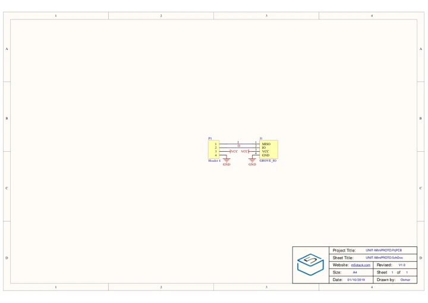
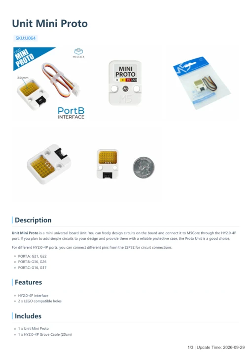

# Unit Mini Proto

**M5Stack** · Source collection

Revision: Unverified source identity

Coverage: Manufacturer references available; physical pinout and complete connector review are tracked separately

[Browse all manufacturers](../../../../BROWSE.md) · [Devices & IoT](../../../../DEVICES.md) · [Open in the browser guide](https://valleytech-black-wire-guide.pages.dev/?board=source-board-d98aa688f305d3abc1)

## Datasheets and original documentation

Board datasheet: **not yet recorded**. Visual reference: **available**.

[Manufacturer model documentation](https://docs.m5stack.com/en/unit/mini-proto)

- **schematic / board**: [Unit Mini Proto Schematics PDF — schematic](https://m5stack-doc.oss-cn-shenzhen.aliyuncs.com/810/U064_UNIT_MiniPROTO_SCHE.pdf) · [saved document](../../../../library/media/9d7133a8875711c8bdb90b93dc40998f27b1f20bb2ac72ff1a72a2efbd0b5a00.pdf)
- **hardware-guide / board**: [Unit Mini Proto — manufacturer hardware guide](https://m5stack.oss-cn-shenzhen.aliyuncs.com/resource/docs/static/pdf/static/en/unit/Unit_Mini_Proto.pdf) · [saved document](../../../../library/media/cce23b0460eb6e810c49a7cf69f12e1537ca19d56c757eb095a56283cb3460d0.pdf)

A chip datasheet, schematic and board datasheet have different scopes. Match the exact hardware revision.

[Documentation coverage and remaining gaps](../../../../DOCUMENTATION.md)

## Dimensions

**source reference** · Unreviewed source · PNG

[Open original reference](../../../../library/media/f81af1802b946995f299dafa2e5e4d3c21f3cd26bb13564f6845011e6258251a.png)

**Credit and rights:** Source rights not yet established. Source/manufacturer: M5Stack.

[Source 1](https://m5stack-doc.oss-cn-shenzhen.aliyuncs.com/810/U064_miniproto_page_01.png) · [Source 2](https://docs.m5stack.com/en/unit/mini-proto)

Original source index: Dimensions. This file is searchable but has not been promoted to a reviewed physical board pinout.

Image revision: Not identified

SHA-256: `f81af1802b946995f299dafa2e5e4d3c21f3cd26bb13564f6845011e6258251a`

## Unit Mini Proto Schematics PDF — schematic

**reference PDF** · Source model/link and PDF signature/title checked; individual pin assignments and electrical validation pending · PDF

[Open original reference](../../../../library/media/9d7133a8875711c8bdb90b93dc40998f27b1f20bb2ac72ff1a72a2efbd0b5a00.pdf)

**Credit and rights:** Original publisher/manufacturer artwork; redistribution and print rights not established. Attribution is not a license grant.. Source/manufacturer: M5Stack.

[Source 1](https://m5stack-doc.oss-cn-shenzhen.aliyuncs.com/810/U064_UNIT_MiniPROTO_SCHE.pdf) · [Source 2](https://docs.m5stack.com/en/unit/mini-proto)

Original document linked from this model’s manufacturer page. Preserve the document’s exact revision and named subassembly scope; a linked accessory schematic is not a whole-device pinout. This is a circuit schematic, not a physical board pinout.

Image revision: Use the revision printed in the original document; do not assume all hardware revisions are interchangeable

SHA-256: `9d7133a8875711c8bdb90b93dc40998f27b1f20bb2ac72ff1a72a2efbd0b5a00`

## Unit Mini Proto — manufacturer hardware guide

**reference PDF** · Source model/link and PDF signature/title checked; individual pin assignments and electrical validation pending · PDF

[Open original reference](../../../../library/media/cce23b0460eb6e810c49a7cf69f12e1537ca19d56c757eb095a56283cb3460d0.pdf)

**Credit and rights:** Original publisher/manufacturer artwork; redistribution and print rights not established. Attribution is not a license grant.. Source/manufacturer: M5Stack.

[Source 1](https://m5stack.oss-cn-shenzhen.aliyuncs.com/resource/docs/static/pdf/static/en/unit/Unit_Mini_Proto.pdf) · [Source 2](https://docs.m5stack.com/en/unit/mini-proto)

Original document linked from this model’s manufacturer page. Preserve the document’s exact revision and named subassembly scope; a linked accessory schematic is not a whole-device pinout. This is a hardware manual, not a separately classified board datasheet.

Image revision: Use the revision printed in the original document; do not assume all hardware revisions are interchangeable

SHA-256: `cce23b0460eb6e810c49a7cf69f12e1537ca19d56c757eb095a56283cb3460d0`

Pin assignments have not been independently electrically verified. Check board revision before wiring.
