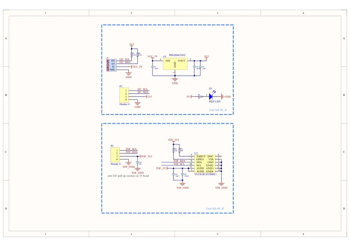
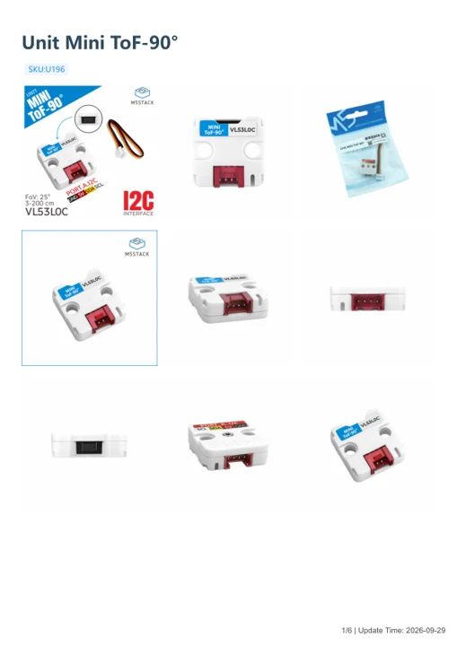

# Unit Mini ToF-90°

**M5Stack** · Source collection

Revision: Unverified source identity

Coverage: Manufacturer references available; physical pinout and complete connector review are tracked separately

[Browse all manufacturers](../../../../BROWSE.md) · [Devices & IoT](../../../../DEVICES.md) · [Open in the browser guide](https://valleytech-black-wire-guide.pages.dev/?board=source-board-ae1823dbebbc124a83)

## Datasheets and original documentation

Board datasheet: **not yet recorded**. Visual reference: **available**.

[Manufacturer model documentation](https://docs.m5stack.com/en/unit/Unit%20Mini%20ToF-90)

- **schematic / board**: [Unit Mini ToF-90° Schematics PDF — schematic](https://m5stack-doc.oss-cn-shenzhen.aliyuncs.com/1143/U196_SCH.pdf) · [saved document](../../../../library/media/39b18f4bc6c64601645b6e053ef26666cf3125166da4e6b162e83bf3fd6530d9.pdf)
- **hardware-guide / board**: [Unit Mini ToF-90 — manufacturer hardware guide](https://m5stack.oss-cn-shenzhen.aliyuncs.com/resource/docs/static/pdf/static/en/unit/Unit_Mini_ToF-90.pdf) · [saved document](../../../../library/media/446f519a57a683897dc9d00299a02a51d29609cf156606d2b155a0f8a2c23132.pdf)

A chip datasheet, schematic and board datasheet have different scopes. Match the exact hardware revision.

[Documentation coverage and remaining gaps](../../../../DOCUMENTATION.md)

## Dimensions

**source reference** · Unreviewed source · PNG

[Open original reference](../../../../library/media/74c8ab686aa7b57cd266b09a87cb566202f072269043e24ac0bb37835e4094ca.png)

**Credit and rights:** Source rights not yet established. Source/manufacturer: M5Stack.

[Source 1](https://m5stack-doc.oss-cn-shenzhen.aliyuncs.com/1143/U196_size.png) · [Source 2](https://docs.m5stack.com/en/unit/Unit%20Mini%20ToF-90)

Original source index: Dimensions. This file is searchable but has not been promoted to a reviewed physical board pinout.

Image revision: Not identified

SHA-256: `74c8ab686aa7b57cd266b09a87cb566202f072269043e24ac0bb37835e4094ca`

## Unit Mini ToF-90° Schematics PDF — schematic

**reference PDF** · Source model/link and PDF signature/title checked; individual pin assignments and electrical validation pending · PDF

[Open original reference](../../../../library/media/39b18f4bc6c64601645b6e053ef26666cf3125166da4e6b162e83bf3fd6530d9.pdf)

**Credit and rights:** Original publisher/manufacturer artwork; redistribution and print rights not established. Attribution is not a license grant.. Source/manufacturer: M5Stack.

[Source 1](https://m5stack-doc.oss-cn-shenzhen.aliyuncs.com/1143/U196_SCH.pdf) · [Source 2](https://docs.m5stack.com/en/unit/Unit%20Mini%20ToF-90)

Original document linked from this model’s manufacturer page. Preserve the document’s exact revision and named subassembly scope; a linked accessory schematic is not a whole-device pinout. This is a circuit schematic, not a physical board pinout.

Image revision: Use the revision printed in the original document; do not assume all hardware revisions are interchangeable

SHA-256: `39b18f4bc6c64601645b6e053ef26666cf3125166da4e6b162e83bf3fd6530d9`

## Unit Mini ToF-90 — manufacturer hardware guide

**reference PDF** · Source model/link and PDF signature/title checked; individual pin assignments and electrical validation pending · PDF

[Open original reference](../../../../library/media/446f519a57a683897dc9d00299a02a51d29609cf156606d2b155a0f8a2c23132.pdf)

**Credit and rights:** Original publisher/manufacturer artwork; redistribution and print rights not established. Attribution is not a license grant.. Source/manufacturer: M5Stack.

[Source 1](https://m5stack.oss-cn-shenzhen.aliyuncs.com/resource/docs/static/pdf/static/en/unit/Unit_Mini_ToF-90.pdf) · [Source 2](https://docs.m5stack.com/en/unit/Unit%20Mini%20ToF-90)

Original document linked from this model’s manufacturer page. Preserve the document’s exact revision and named subassembly scope; a linked accessory schematic is not a whole-device pinout. This is a hardware manual, not a separately classified board datasheet.

Image revision: Use the revision printed in the original document; do not assume all hardware revisions are interchangeable

SHA-256: `446f519a57a683897dc9d00299a02a51d29609cf156606d2b155a0f8a2c23132`

Pin assignments have not been independently electrically verified. Check board revision before wiring.
