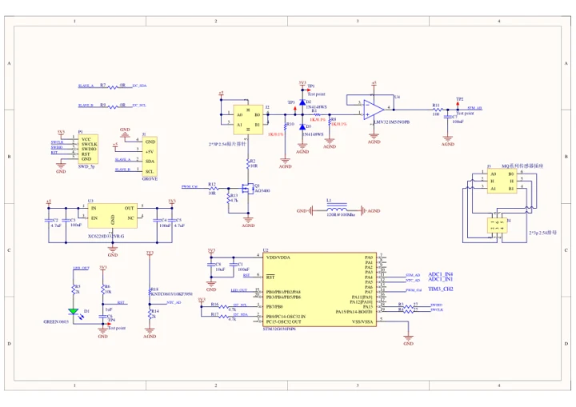
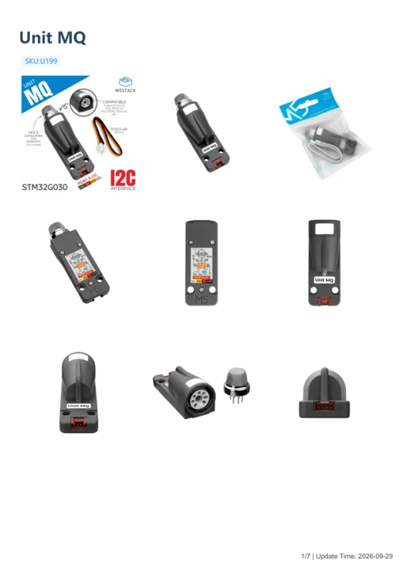

# Unit MQ

**M5Stack** · Source collection

Revision: Unverified source identity

Coverage: Manufacturer references available; physical pinout and complete connector review are tracked separately

[Browse all manufacturers](../../../../BROWSE.md) · [Devices & IoT](../../../../DEVICES.md) · [Open in the browser guide](https://valleytech-black-wire-guide.pages.dev/?board=source-board-30f44e0d1f3cddc27a)

## Datasheets and original documentation

Board datasheet: **not yet recorded**. Visual reference: **available**.

[Manufacturer model documentation](https://docs.m5stack.com/en/unit/Unit_MQ)

- **schematic / board**: [Unit MQ Schematics PDF — schematic](https://m5stack-doc.oss-cn-shenzhen.aliyuncs.com/1168/UnitMQ_SCH_MAIN_V1.0_20250716_2025_07_16_11_13_24.pdf) · [saved document](../../../../library/media/2454bb6dd8fd3c4cd99242425666dd7a8535fb7af859e415e0ed4bcacb9679b7.pdf)
- **hardware-guide / board**: [Unit MQ — manufacturer hardware guide](https://m5stack.oss-cn-shenzhen.aliyuncs.com/resource/docs/static/pdf/static/en/unit/Unit_MQ.pdf) · [saved document](../../../../library/media/b37854fc521f42c31aa78b9a2adee95d63f57f202391585961daff7b9d23de45.pdf)

A chip datasheet, schematic and board datasheet have different scopes. Match the exact hardware revision.

[Documentation coverage and remaining gaps](../../../../DOCUMENTATION.md)

## Dimensions

**source reference** · Unreviewed source · PNG

[Open original reference](../../../../library/media/6d7e44ec67a8de93b04705685229bbb5ceabfd5d3682d5110cfceb4c1bc5d304.png)

**Credit and rights:** Source rights not yet established. Source/manufacturer: M5Stack.

[Source 1](https://m5stack-doc.oss-cn-shenzhen.aliyuncs.com/1168/UNIT-MQ_page_01.png) · [Source 2](https://docs.m5stack.com/en/unit/Unit_MQ)

Original source index: Dimensions. This file is searchable but has not been promoted to a reviewed physical board pinout.

Image revision: Not identified

SHA-256: `6d7e44ec67a8de93b04705685229bbb5ceabfd5d3682d5110cfceb4c1bc5d304`

## Unit MQ Schematics PDF — schematic

**reference PDF** · Source model/link and PDF signature/title checked; individual pin assignments and electrical validation pending · PDF

[Open original reference](../../../../library/media/2454bb6dd8fd3c4cd99242425666dd7a8535fb7af859e415e0ed4bcacb9679b7.pdf)

**Credit and rights:** Original publisher/manufacturer artwork; redistribution and print rights not established. Attribution is not a license grant.. Source/manufacturer: M5Stack.

[Source 1](https://m5stack-doc.oss-cn-shenzhen.aliyuncs.com/1168/UnitMQ_SCH_MAIN_V1.0_20250716_2025_07_16_11_13_24.pdf) · [Source 2](https://docs.m5stack.com/en/unit/Unit_MQ)

Original document linked from this model’s manufacturer page. Preserve the document’s exact revision and named subassembly scope; a linked accessory schematic is not a whole-device pinout. This is a circuit schematic, not a physical board pinout.

Image revision: Use the revision printed in the original document; do not assume all hardware revisions are interchangeable

SHA-256: `2454bb6dd8fd3c4cd99242425666dd7a8535fb7af859e415e0ed4bcacb9679b7`

## Unit MQ — manufacturer hardware guide

**reference PDF** · Source model/link and PDF signature/title checked; individual pin assignments and electrical validation pending · PDF

[Open original reference](../../../../library/media/b37854fc521f42c31aa78b9a2adee95d63f57f202391585961daff7b9d23de45.pdf)

**Credit and rights:** Original publisher/manufacturer artwork; redistribution and print rights not established. Attribution is not a license grant.. Source/manufacturer: M5Stack.

[Source 1](https://m5stack.oss-cn-shenzhen.aliyuncs.com/resource/docs/static/pdf/static/en/unit/Unit_MQ.pdf) · [Source 2](https://docs.m5stack.com/en/unit/Unit_MQ)

Original document linked from this model’s manufacturer page. Preserve the document’s exact revision and named subassembly scope; a linked accessory schematic is not a whole-device pinout. This is a hardware manual, not a separately classified board datasheet.

Image revision: Use the revision printed in the original document; do not assume all hardware revisions are interchangeable

SHA-256: `b37854fc521f42c31aa78b9a2adee95d63f57f202391585961daff7b9d23de45`

Pin assignments have not been independently electrically verified. Check board revision before wiring.
