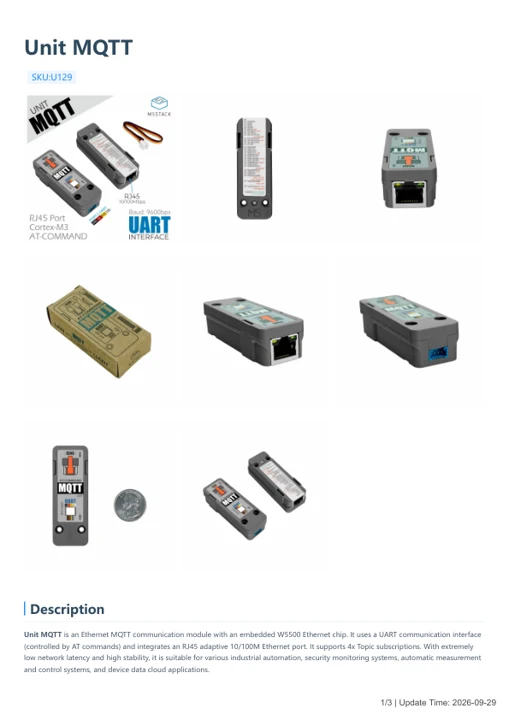

# Unit MQTT

**M5Stack** · Source collection

Revision: Unverified source identity

Coverage: Manufacturer references available; physical pinout and complete connector review are tracked separately

[Browse all manufacturers](../../../../BROWSE.md) · [Devices & IoT](../../../../DEVICES.md) · [Open in the browser guide](https://valleytech-black-wire-guide.pages.dev/?board=source-board-5b1db598f87b36cea5)

## Datasheets and original documentation

Board datasheet: **not yet recorded**. Visual reference: **available**.

[Manufacturer model documentation](https://docs.m5stack.com/en/unit/mqtt)

- **hardware-guide / board**: [Unit MQTT — manufacturer hardware guide](https://m5stack.oss-cn-shenzhen.aliyuncs.com/resource/docs/static/pdf/static/en/unit/Unit_MQTT.pdf) · [saved document](../../../../library/media/25e45af79d09388dc53b2ca0a7e8cf0011e235eed82e830b4b2bd818fd562527.pdf)

A chip datasheet, schematic and board datasheet have different scopes. Match the exact hardware revision.

[Documentation coverage and remaining gaps](../../../../DOCUMENTATION.md)

## Dimensions

**source reference** · Unreviewed source · PNG

[Open original reference](../../../../library/media/2781fc3818b29fec2526ab8a016e1f6449f1822e51906a83e5336f3b0e0c094c.png)

**Credit and rights:** Source rights not yet established. Source/manufacturer: M5Stack.

[Source 1](https://m5stack-doc.oss-cn-shenzhen.aliyuncs.com/829/U129_Model_Size_page_01.png) · [Source 2](https://docs.m5stack.com/en/unit/mqtt)

Original source index: Dimensions. This file is searchable but has not been promoted to a reviewed physical board pinout.

Image revision: Not identified

SHA-256: `2781fc3818b29fec2526ab8a016e1f6449f1822e51906a83e5336f3b0e0c094c`

## Unit MQTT — manufacturer hardware guide

**reference PDF** · Source model/link and PDF signature/title checked; individual pin assignments and electrical validation pending · PDF

[Open original reference](../../../../library/media/25e45af79d09388dc53b2ca0a7e8cf0011e235eed82e830b4b2bd818fd562527.pdf)

**Credit and rights:** Original publisher/manufacturer artwork; redistribution and print rights not established. Attribution is not a license grant.. Source/manufacturer: M5Stack.

[Source 1](https://m5stack.oss-cn-shenzhen.aliyuncs.com/resource/docs/static/pdf/static/en/unit/Unit_MQTT.pdf) · [Source 2](https://docs.m5stack.com/en/unit/mqtt)

Original document linked from this model’s manufacturer page. Preserve the document’s exact revision and named subassembly scope; a linked accessory schematic is not a whole-device pinout. This is a hardware manual, not a separately classified board datasheet.

Image revision: Use the revision printed in the original document; do not assume all hardware revisions are interchangeable

SHA-256: `25e45af79d09388dc53b2ca0a7e8cf0011e235eed82e830b4b2bd818fd562527`

Pin assignments have not been independently electrically verified. Check board revision before wiring.
