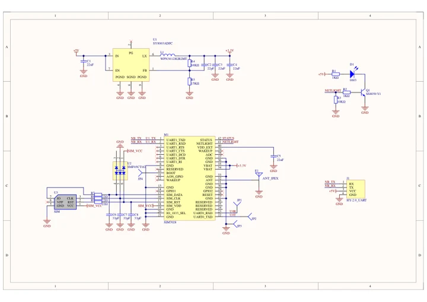
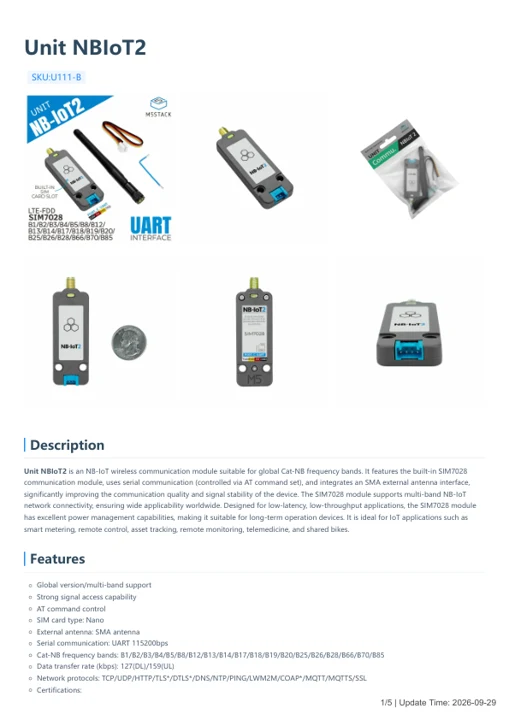

# Unit NBIoT2

**M5Stack** · Source collection

Revision: Unverified source identity

Coverage: Manufacturer references available; physical pinout and complete connector review are tracked separately

[Browse all manufacturers](../../../../BROWSE.md) · [Devices & IoT](../../../../DEVICES.md) · [Open in the browser guide](https://valleytech-black-wire-guide.pages.dev/?board=source-board-1e341275ea454a4761)

## Datasheets and original documentation

Board datasheet: **not yet recorded**. Visual reference: **available**.

[Manufacturer model documentation](https://docs.m5stack.com/en/unit/Unit%20NB-IoT2(SIM7028))

- **schematic / board**: [Unit NBIoT2 Schematics PDF — schematic](https://m5stack-doc.oss-cn-shenzhen.aliyuncs.com/593/Sch_UNIT-NB-IoT2.pdf) · [saved document](../../../../library/media/43f07f9845e75e866473094fd07e84d568e34e86342f78f9834a166aa0d87101.pdf)
- **hardware-guide / board**: [Unit NBIoT2 — manufacturer hardware guide](https://m5stack.oss-cn-shenzhen.aliyuncs.com/resource/docs/static/pdf/static/en/unit/Unit_NBIoT2.pdf) · [saved document](../../../../library/media/8b756197dce9d176234922cf281b12a823a24ad019d0965bbcd00b42595b5bc4.pdf)

A chip datasheet, schematic and board datasheet have different scopes. Match the exact hardware revision.

[Documentation coverage and remaining gaps](../../../../DOCUMENTATION.md)

## Dimensions

**source reference** · Unreviewed source · JPG

[Open original reference](../../../../library/media/55bcdffe8860434bd903595563dc2bacb98af3c54700bb1145fd916f4f196bd3.jpg)

**Credit and rights:** Source rights not yet established. Source/manufacturer: M5Stack.

[Source 1](https://m5stack.oss-cn-shenzhen.aliyuncs.com/resource/docs/products/unit/Unit%20NB-IoT2%20(SIM7028)/%E5%B0%BA%E5%AF%B8%E5%9B%BE.jpg) · [Source 2](https://docs.m5stack.com/en/unit/Unit%20NB-IoT2(SIM7028))

Original source index: Dimensions. This file is searchable but has not been promoted to a reviewed physical board pinout.

Image revision: Not identified

SHA-256: `55bcdffe8860434bd903595563dc2bacb98af3c54700bb1145fd916f4f196bd3`

## Unit NBIoT2 Schematics PDF — schematic

**reference PDF** · Source model/link and PDF signature/title checked; individual pin assignments and electrical validation pending · PDF

[Open original reference](../../../../library/media/43f07f9845e75e866473094fd07e84d568e34e86342f78f9834a166aa0d87101.pdf)

**Credit and rights:** Original publisher/manufacturer artwork; redistribution and print rights not established. Attribution is not a license grant.. Source/manufacturer: M5Stack.

[Source 1](https://m5stack-doc.oss-cn-shenzhen.aliyuncs.com/593/Sch_UNIT-NB-IoT2.pdf) · [Source 2](https://docs.m5stack.com/en/unit/Unit%20NB-IoT2(SIM7028))

Original document linked from this model’s manufacturer page. Preserve the document’s exact revision and named subassembly scope; a linked accessory schematic is not a whole-device pinout. This is a circuit schematic, not a physical board pinout.

Image revision: Use the revision printed in the original document; do not assume all hardware revisions are interchangeable

SHA-256: `43f07f9845e75e866473094fd07e84d568e34e86342f78f9834a166aa0d87101`

## Unit NBIoT2 — manufacturer hardware guide

**reference PDF** · Source model/link and PDF signature/title checked; individual pin assignments and electrical validation pending · PDF

[Open original reference](../../../../library/media/8b756197dce9d176234922cf281b12a823a24ad019d0965bbcd00b42595b5bc4.pdf)

**Credit and rights:** Original publisher/manufacturer artwork; redistribution and print rights not established. Attribution is not a license grant.. Source/manufacturer: M5Stack.

[Source 1](https://m5stack.oss-cn-shenzhen.aliyuncs.com/resource/docs/static/pdf/static/en/unit/Unit_NBIoT2.pdf) · [Source 2](https://docs.m5stack.com/en/unit/Unit%20NB-IoT2(SIM7028))

Original document linked from this model’s manufacturer page. Preserve the document’s exact revision and named subassembly scope; a linked accessory schematic is not a whole-device pinout. This is a hardware manual, not a separately classified board datasheet.

Image revision: Use the revision printed in the original document; do not assume all hardware revisions are interchangeable

SHA-256: `8b756197dce9d176234922cf281b12a823a24ad019d0965bbcd00b42595b5bc4`

Pin assignments have not been independently electrically verified. Check board revision before wiring.
