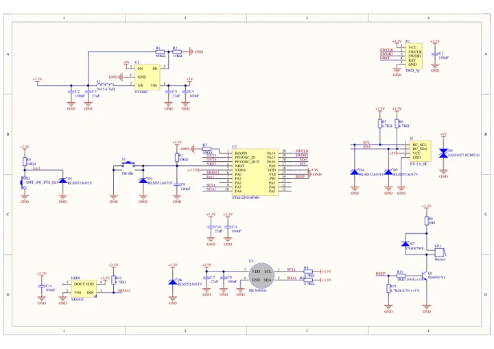
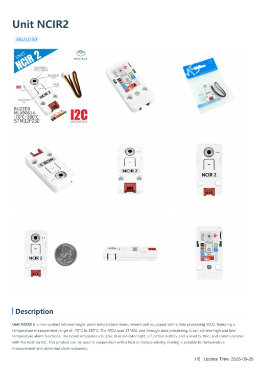

# Unit NCIR2

**M5Stack** · Source collection

Revision: Unverified source identity

Coverage: Manufacturer references available; physical pinout and complete connector review are tracked separately

[Browse all manufacturers](../../../../BROWSE.md) · [Devices & IoT](../../../../DEVICES.md) · [Open in the browser guide](https://valleytech-black-wire-guide.pages.dev/?board=source-board-41bab4646e04facc82)

## Datasheets and original documentation

Board datasheet: **not yet recorded**. Visual reference: **available**.

[Manufacturer model documentation](https://docs.m5stack.com/en/unit/NCIR2)

- **schematic / board**: [Unit NCIR2 Schematics PDF — schematic](https://m5stack-doc.oss-cn-shenzhen.aliyuncs.com/604/Sch_UNIT-NCIR2.pdf) · [saved document](../../../../library/media/b2d3e26c6395b88884dadc884c5a8e3f58b011aaaa366060a7e3e330b69dc6ff.pdf)
- **hardware-guide / board**: [Unit NCIR2 — manufacturer hardware guide](https://m5stack.oss-cn-shenzhen.aliyuncs.com/resource/docs/static/pdf/static/en/unit/Unit_NCIR2.pdf) · [saved document](../../../../library/media/0852071ceafe3dbfb5f4f1eb9f7da33f3eba9db2452f6969f8ce3767e057fe1e.pdf)

A chip datasheet, schematic and board datasheet have different scopes. Match the exact hardware revision.

[Documentation coverage and remaining gaps](../../../../DOCUMENTATION.md)

## Dimensions

**source reference** · Unreviewed source · PNG

[Open original reference](../../../../library/media/06668ce8fed7c0638f7f731a5c40e97144c7fc5371d61a5e87bbf8d046f5e764.png)

**Credit and rights:** Source rights not yet established. Source/manufacturer: M5Stack.

[Source 1](https://static-cdn.m5stack.com/resource/docs/products/unit/NCIR2/img-2917ac6d-78f5-414a-a3a5-dc3e10b4068a.png) · [Source 2](https://docs.m5stack.com/en/unit/NCIR2)

Original source index: Dimensions. This file is searchable but has not been promoted to a reviewed physical board pinout.

Image revision: Not identified

SHA-256: `06668ce8fed7c0638f7f731a5c40e97144c7fc5371d61a5e87bbf8d046f5e764`

## Unit NCIR2 Schematics PDF — schematic

**reference PDF** · Source model/link and PDF signature/title checked; individual pin assignments and electrical validation pending · PDF

[Open original reference](../../../../library/media/b2d3e26c6395b88884dadc884c5a8e3f58b011aaaa366060a7e3e330b69dc6ff.pdf)

**Credit and rights:** Original publisher/manufacturer artwork; redistribution and print rights not established. Attribution is not a license grant.. Source/manufacturer: M5Stack.

[Source 1](https://m5stack-doc.oss-cn-shenzhen.aliyuncs.com/604/Sch_UNIT-NCIR2.pdf) · [Source 2](https://docs.m5stack.com/en/unit/NCIR2)

Original document linked from this model’s manufacturer page. Preserve the document’s exact revision and named subassembly scope; a linked accessory schematic is not a whole-device pinout. This is a circuit schematic, not a physical board pinout.

Image revision: Use the revision printed in the original document; do not assume all hardware revisions are interchangeable

SHA-256: `b2d3e26c6395b88884dadc884c5a8e3f58b011aaaa366060a7e3e330b69dc6ff`

## Unit NCIR2 — manufacturer hardware guide

**reference PDF** · Source model/link and PDF signature/title checked; individual pin assignments and electrical validation pending · PDF

[Open original reference](../../../../library/media/0852071ceafe3dbfb5f4f1eb9f7da33f3eba9db2452f6969f8ce3767e057fe1e.pdf)

**Credit and rights:** Original publisher/manufacturer artwork; redistribution and print rights not established. Attribution is not a license grant.. Source/manufacturer: M5Stack.

[Source 1](https://m5stack.oss-cn-shenzhen.aliyuncs.com/resource/docs/static/pdf/static/en/unit/Unit_NCIR2.pdf) · [Source 2](https://docs.m5stack.com/en/unit/NCIR2)

Original document linked from this model’s manufacturer page. Preserve the document’s exact revision and named subassembly scope; a linked accessory schematic is not a whole-device pinout. This is a hardware manual, not a separately classified board datasheet.

Image revision: Use the revision printed in the original document; do not assume all hardware revisions are interchangeable

SHA-256: `0852071ceafe3dbfb5f4f1eb9f7da33f3eba9db2452f6969f8ce3767e057fe1e`

Pin assignments have not been independently electrically verified. Check board revision before wiring.
