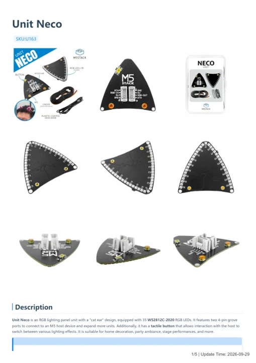
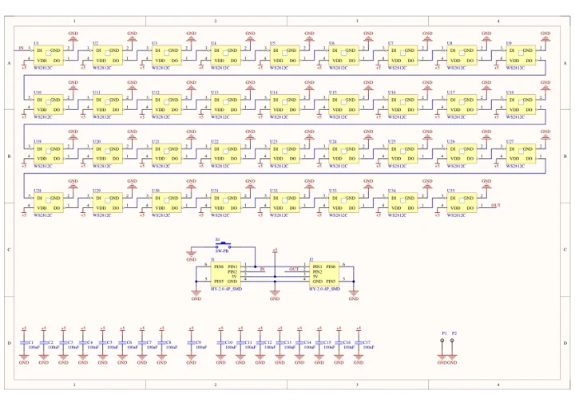

# Unit Neco

**M5Stack** · Source collection

Revision: Unverified source identity

Coverage: Manufacturer references available; physical pinout and complete connector review are tracked separately

[Browse all manufacturers](../../../../BROWSE.md) · [Devices & IoT](../../../../DEVICES.md) · [Open in the browser guide](https://valleytech-black-wire-guide.pages.dev/?board=source-board-70d2c75f72335b6063)

## Datasheets and original documentation

Board datasheet: **not yet recorded**. Visual reference: **available**.

[Manufacturer model documentation](https://docs.m5stack.com/en/unit/Neco%20Unit)

- **hardware-guide / board**: [Unit Neco — manufacturer hardware guide](https://m5stack.oss-cn-shenzhen.aliyuncs.com/resource/docs/static/pdf/static/en/unit/Unit_Neco.pdf) · [saved document](../../../../library/media/ecad027b39d1577f250e28484a5128e15b5fce4dd89d8bec8fbd92bb8b84b263.pdf)
- **schematic / board**: [Unit Neco Schematics PDF — schematic](https://m5stack-doc.oss-cn-shenzhen.aliyuncs.com/618/Sch_neco-unit.pdf) · [saved document](../../../../library/media/9f3df7508654832aba7fc60db9b0151c8ac1f7aa321d5b2a9dccfffd926e79d9.pdf)

A chip datasheet, schematic and board datasheet have different scopes. Match the exact hardware revision.

[Documentation coverage and remaining gaps](../../../../DOCUMENTATION.md)

## Dimensions

**source reference** · Unreviewed source · PNG

[Open original reference](../../../../library/media/477a757107ef3532bd46bcf4cdb791090027fc5cd0c3b09e1d65e394cf6d22be.png)

**Credit and rights:** Source rights not yet established. Source/manufacturer: M5Stack.

[Source 1](https://m5stack-doc.oss-cn-shenzhen.aliyuncs.com/767/U163_Model_Size_sch_01.png) · [Source 2](https://docs.m5stack.com/en/unit/Neco%20Unit)

Original source index: Dimensions. This file is searchable but has not been promoted to a reviewed physical board pinout.

Image revision: Not identified

SHA-256: `477a757107ef3532bd46bcf4cdb791090027fc5cd0c3b09e1d65e394cf6d22be`

## Unit Neco — manufacturer hardware guide

**reference PDF** · Source model/link and PDF signature/title checked; individual pin assignments and electrical validation pending · PDF

[Open original reference](../../../../library/media/ecad027b39d1577f250e28484a5128e15b5fce4dd89d8bec8fbd92bb8b84b263.pdf)

**Credit and rights:** Original publisher/manufacturer artwork; redistribution and print rights not established. Attribution is not a license grant.. Source/manufacturer: M5Stack.

[Source 1](https://m5stack.oss-cn-shenzhen.aliyuncs.com/resource/docs/static/pdf/static/en/unit/Unit_Neco.pdf) · [Source 2](https://docs.m5stack.com/en/unit/Neco%20Unit)

Original document linked from this model’s manufacturer page. Preserve the document’s exact revision and named subassembly scope; a linked accessory schematic is not a whole-device pinout. This is a hardware manual, not a separately classified board datasheet.

Image revision: Use the revision printed in the original document; do not assume all hardware revisions are interchangeable

SHA-256: `ecad027b39d1577f250e28484a5128e15b5fce4dd89d8bec8fbd92bb8b84b263`

## Unit Neco Schematics PDF — schematic

**reference PDF** · Source model/link and PDF signature/title checked; individual pin assignments and electrical validation pending · PDF

[Open original reference](../../../../library/media/9f3df7508654832aba7fc60db9b0151c8ac1f7aa321d5b2a9dccfffd926e79d9.pdf)

**Credit and rights:** Original publisher/manufacturer artwork; redistribution and print rights not established. Attribution is not a license grant.. Source/manufacturer: M5Stack.

[Source 1](https://m5stack-doc.oss-cn-shenzhen.aliyuncs.com/618/Sch_neco-unit.pdf) · [Source 2](https://docs.m5stack.com/en/unit/Neco%20Unit)

Original document linked from this model’s manufacturer page. Preserve the document’s exact revision and named subassembly scope; a linked accessory schematic is not a whole-device pinout. This is a circuit schematic, not a physical board pinout.

Image revision: Use the revision printed in the original document; do not assume all hardware revisions are interchangeable

SHA-256: `9f3df7508654832aba7fc60db9b0151c8ac1f7aa321d5b2a9dccfffd926e79d9`

Pin assignments have not been independently electrically verified. Check board revision before wiring.
