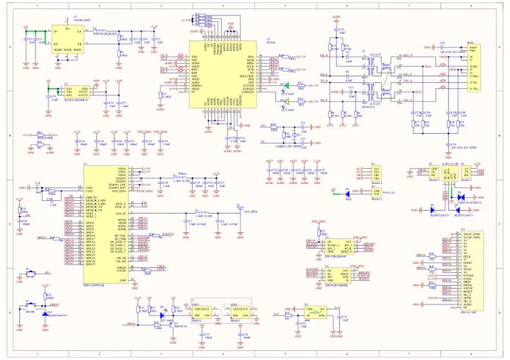
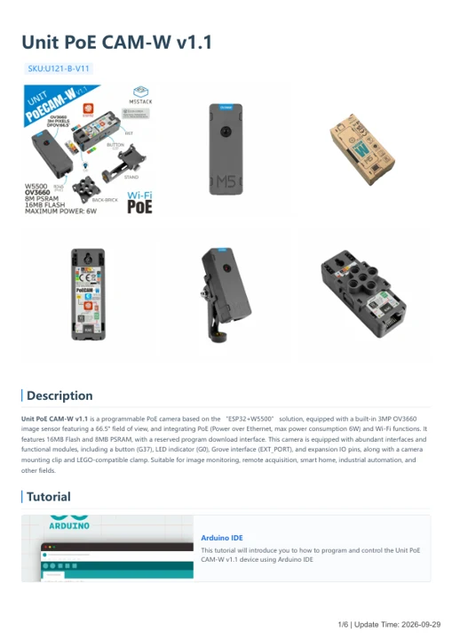

# Unit PoE CAM-W v1.1

**M5Stack** · Source collection

Revision: Unverified source identity

Coverage: Manufacturer references available; physical pinout and complete connector review are tracked separately

[Browse all manufacturers](../../../../BROWSE.md) · [Devices & IoT](../../../../DEVICES.md) · [Open in the browser guide](https://valleytech-black-wire-guide.pages.dev/?board=source-board-2477653d0c88e3be88)

## Datasheets and original documentation

Board datasheet: **not yet recorded**. Visual reference: **available**.

[Manufacturer model documentation](https://docs.m5stack.com/en/unit/M5PoECAM-W%20V1.1)

- **schematic / board**: [Unit PoE CAM-W v1.1 Schematics PDF — schematic](https://m5stack-doc.oss-cn-shenzhen.aliyuncs.com/595/Sch_M5PoECAM-W.pdf) · [saved document](../../../../library/media/5bd4b163b7d731e6203e7e2b6846855486daf8ff3cb696627944616bdf6d5aec.pdf)
- **hardware-guide / board**: [Unit PoE CAM-W v1.1 — manufacturer hardware guide](https://m5stack.oss-cn-shenzhen.aliyuncs.com/resource/docs/static/pdf/static/en/unit/Unit_PoE_CAM-W_v1.1.pdf) · [saved document](../../../../library/media/abe3b4598bd7ce1634188dc48c48f99168e7e53c61d5662223d059eb44255ce7.pdf)

A chip datasheet, schematic and board datasheet have different scopes. Match the exact hardware revision.

[Documentation coverage and remaining gaps](../../../../DOCUMENTATION.md)

## Dimensions

**source reference** · Unreviewed source · PNG

[Open original reference](../../../../library/media/1031551255b3fa9b751454c6eadea1248c74b1e6b26ba5781e4050681e0f1ab8.png)

**Credit and rights:** Source rights not yet established. Source/manufacturer: M5Stack.

[Source 1](https://static-cdn.m5stack.com/resource/docs/products/unit/M5PoECAM-W V1.1/img-40419f43-5f2d-40e8-92e9-bceec6908475.png) · [Source 2](https://docs.m5stack.com/en/unit/M5PoECAM-W%20V1.1)

Original source index: Dimensions. This file is searchable but has not been promoted to a reviewed physical board pinout.

Image revision: Not identified

SHA-256: `1031551255b3fa9b751454c6eadea1248c74b1e6b26ba5781e4050681e0f1ab8`

## Unit PoE CAM-W v1.1 Schematics PDF — schematic

**reference PDF** · Source model/link and PDF signature/title checked; individual pin assignments and electrical validation pending · PDF

[Open original reference](../../../../library/media/5bd4b163b7d731e6203e7e2b6846855486daf8ff3cb696627944616bdf6d5aec.pdf)

**Credit and rights:** Original publisher/manufacturer artwork; redistribution and print rights not established. Attribution is not a license grant.. Source/manufacturer: M5Stack.

[Source 1](https://m5stack-doc.oss-cn-shenzhen.aliyuncs.com/595/Sch_M5PoECAM-W.pdf) · [Source 2](https://docs.m5stack.com/en/unit/M5PoECAM-W%20V1.1)

Original document linked from this model’s manufacturer page. Preserve the document’s exact revision and named subassembly scope; a linked accessory schematic is not a whole-device pinout. This is a circuit schematic, not a physical board pinout.

Image revision: Use the revision printed in the original document; do not assume all hardware revisions are interchangeable

SHA-256: `5bd4b163b7d731e6203e7e2b6846855486daf8ff3cb696627944616bdf6d5aec`

## Unit PoE CAM-W v1.1 — manufacturer hardware guide

**reference PDF** · Source model/link and PDF signature/title checked; individual pin assignments and electrical validation pending · PDF

[Open original reference](../../../../library/media/abe3b4598bd7ce1634188dc48c48f99168e7e53c61d5662223d059eb44255ce7.pdf)

**Credit and rights:** Original publisher/manufacturer artwork; redistribution and print rights not established. Attribution is not a license grant.. Source/manufacturer: M5Stack.

[Source 1](https://m5stack.oss-cn-shenzhen.aliyuncs.com/resource/docs/static/pdf/static/en/unit/Unit_PoE_CAM-W_v1.1.pdf) · [Source 2](https://docs.m5stack.com/en/unit/M5PoECAM-W%20V1.1)

Original document linked from this model’s manufacturer page. Preserve the document’s exact revision and named subassembly scope; a linked accessory schematic is not a whole-device pinout. This is a hardware manual, not a separately classified board datasheet.

Image revision: Use the revision printed in the original document; do not assume all hardware revisions are interchangeable

SHA-256: `abe3b4598bd7ce1634188dc48c48f99168e7e53c61d5662223d059eb44255ce7`

Pin assignments have not been independently electrically verified. Check board revision before wiring.
