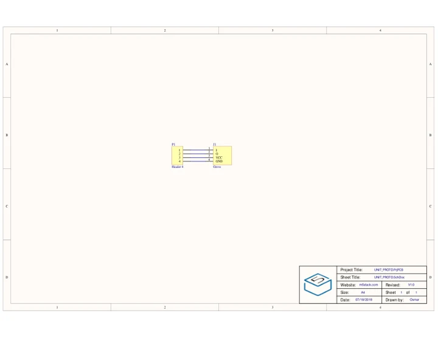
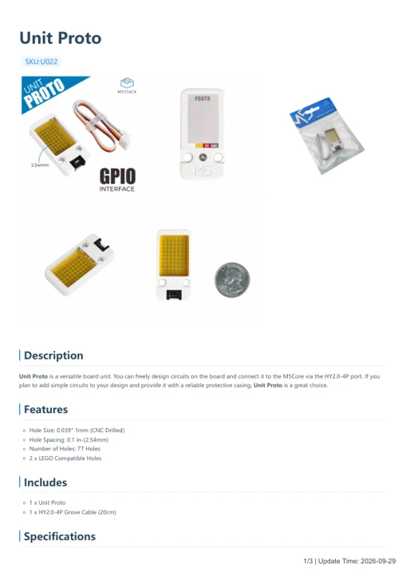

# Unit Proto

**M5Stack** · Source collection

Revision: Unverified source identity

Coverage: Manufacturer references available; physical pinout and complete connector review are tracked separately

[Browse all manufacturers](../../../../BROWSE.md) · [Devices & IoT](../../../../DEVICES.md) · [Open in the browser guide](https://valleytech-black-wire-guide.pages.dev/?board=source-board-7ef12a9cd3c02d0fcf)

## Datasheets and original documentation

Board datasheet: **not yet recorded**. Visual reference: **available**.

[Manufacturer model documentation](https://docs.m5stack.com/en/unit/proto)

- **schematic / board**: [Unit Proto Schematics PDF — schematic](https://m5stack-doc.oss-cn-shenzhen.aliyuncs.com/809/U022_UNIT_PROTO_SCHE.pdf) · [saved document](../../../../library/media/a1296cd2cdd6d99b30f51035ee04a467ba6c22e1c1663443a2ad36ebf3ed1431.pdf)
- **hardware-guide / board**: [Unit Proto — manufacturer hardware guide](https://m5stack.oss-cn-shenzhen.aliyuncs.com/resource/docs/static/pdf/static/en/unit/Unit_Proto.pdf) · [saved document](../../../../library/media/fed208f6dd2e39d412cb0365efe15950b5f0b4fe7a5e6e770e8cb6d40d8f9530.pdf)

A chip datasheet, schematic and board datasheet have different scopes. Match the exact hardware revision.

[Documentation coverage and remaining gaps](../../../../DOCUMENTATION.md)

## Dimensions

**source reference** · Unreviewed source · PNG

[Open original reference](../../../../library/media/26bcc54db6d789429dfd9fa8aee21e40b6290c88222a7e46e89d7fed31ee15f0.png)

**Credit and rights:** Source rights not yet established. Source/manufacturer: M5Stack.

[Source 1](https://m5stack-doc.oss-cn-shenzhen.aliyuncs.com/809/U022_UNIT-Proto_page_01.png) · [Source 2](https://docs.m5stack.com/en/unit/proto)

Original source index: Dimensions. This file is searchable but has not been promoted to a reviewed physical board pinout.

Image revision: Not identified

SHA-256: `26bcc54db6d789429dfd9fa8aee21e40b6290c88222a7e46e89d7fed31ee15f0`

## Unit Proto Schematics PDF — schematic

**reference PDF** · Source model/link and PDF signature/title checked; individual pin assignments and electrical validation pending · PDF

[Open original reference](../../../../library/media/a1296cd2cdd6d99b30f51035ee04a467ba6c22e1c1663443a2ad36ebf3ed1431.pdf)

**Credit and rights:** Original publisher/manufacturer artwork; redistribution and print rights not established. Attribution is not a license grant.. Source/manufacturer: M5Stack.

[Source 1](https://m5stack-doc.oss-cn-shenzhen.aliyuncs.com/809/U022_UNIT_PROTO_SCHE.pdf) · [Source 2](https://docs.m5stack.com/en/unit/proto)

Original document linked from this model’s manufacturer page. Preserve the document’s exact revision and named subassembly scope; a linked accessory schematic is not a whole-device pinout. This is a circuit schematic, not a physical board pinout.

Image revision: Use the revision printed in the original document; do not assume all hardware revisions are interchangeable

SHA-256: `a1296cd2cdd6d99b30f51035ee04a467ba6c22e1c1663443a2ad36ebf3ed1431`

## Unit Proto — manufacturer hardware guide

**reference PDF** · Source model/link and PDF signature/title checked; individual pin assignments and electrical validation pending · PDF

[Open original reference](../../../../library/media/fed208f6dd2e39d412cb0365efe15950b5f0b4fe7a5e6e770e8cb6d40d8f9530.pdf)

**Credit and rights:** Original publisher/manufacturer artwork; redistribution and print rights not established. Attribution is not a license grant.. Source/manufacturer: M5Stack.

[Source 1](https://m5stack.oss-cn-shenzhen.aliyuncs.com/resource/docs/static/pdf/static/en/unit/Unit_Proto.pdf) · [Source 2](https://docs.m5stack.com/en/unit/proto)

Original document linked from this model’s manufacturer page. Preserve the document’s exact revision and named subassembly scope; a linked accessory schematic is not a whole-device pinout. This is a hardware manual, not a separately classified board datasheet.

Image revision: Use the revision printed in the original document; do not assume all hardware revisions are interchangeable

SHA-256: `fed208f6dd2e39d412cb0365efe15950b5f0b4fe7a5e6e770e8cb6d40d8f9530`

Pin assignments have not been independently electrically verified. Check board revision before wiring.
