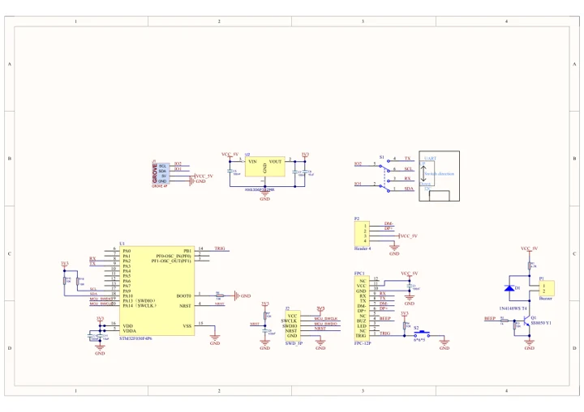
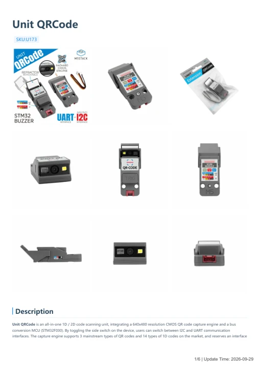

# Unit QRCode

**M5Stack** · Source collection

Revision: Unverified source identity

Coverage: Manufacturer references available; physical pinout and complete connector review are tracked separately

[Browse all manufacturers](../../../../BROWSE.md) · [Devices & IoT](../../../../DEVICES.md) · [Open in the browser guide](https://valleytech-black-wire-guide.pages.dev/?board=source-board-1ca67ec53bf2a3ce3a)

## Datasheets and original documentation

Board datasheet: **not yet recorded**. Visual reference: **available**.

[Manufacturer model documentation](https://docs.m5stack.com/en/unit/Unit-QRCode)

- **schematic / board**: [Unit QRCode Schematics PDF — schematic](https://m5stack-doc.oss-cn-shenzhen.aliyuncs.com/627/SCH_UNIT_QRCODE_V1.0.pdf) · [saved document](../../../../library/media/c9dabf32572e726e2304276c18b8a739c37745b05e64e6fd538cecfd885b36f2.pdf)
- **hardware-guide / board**: [Unit QRCode — manufacturer hardware guide](https://m5stack.oss-cn-shenzhen.aliyuncs.com/resource/docs/static/pdf/static/en/unit/Unit_QRCode.pdf) · [saved document](../../../../library/media/ebb70f8b658532de2f200861f8ce2ccc4861c610c692241626811eea9a83b782.pdf)

A chip datasheet, schematic and board datasheet have different scopes. Match the exact hardware revision.

[Documentation coverage and remaining gaps](../../../../DOCUMENTATION.md)

## Dimensions

**source reference** · Unreviewed source · JPG

[Open original reference](../../../../library/media/1fd125abe3fae7ec5b664f8a311634ce585d8f483afcf31780fecbfd8fcebfb1.jpg)

**Credit and rights:** Source rights not yet established. Source/manufacturer: M5Stack.

[Source 1](https://static-cdn.m5stack.com/resource/docs/products/unit/Unit-QRCode/img-3bc3b2bd-e524-40fa-93e9-e82489c050c3.jpg) · [Source 2](https://docs.m5stack.com/en/unit/Unit-QRCode)

Original source index: Dimensions. This file is searchable but has not been promoted to a reviewed physical board pinout.

Image revision: Not identified

SHA-256: `1fd125abe3fae7ec5b664f8a311634ce585d8f483afcf31780fecbfd8fcebfb1`

## Unit QRCode Schematics PDF — schematic

**reference PDF** · Source model/link and PDF signature/title checked; individual pin assignments and electrical validation pending · PDF

[Open original reference](../../../../library/media/c9dabf32572e726e2304276c18b8a739c37745b05e64e6fd538cecfd885b36f2.pdf)

**Credit and rights:** Original publisher/manufacturer artwork; redistribution and print rights not established. Attribution is not a license grant.. Source/manufacturer: M5Stack.

[Source 1](https://m5stack-doc.oss-cn-shenzhen.aliyuncs.com/627/SCH_UNIT_QRCODE_V1.0.pdf) · [Source 2](https://docs.m5stack.com/en/unit/Unit-QRCode)

Original document linked from this model’s manufacturer page. Preserve the document’s exact revision and named subassembly scope; a linked accessory schematic is not a whole-device pinout. This is a circuit schematic, not a physical board pinout.

Image revision: Use the revision printed in the original document; do not assume all hardware revisions are interchangeable

SHA-256: `c9dabf32572e726e2304276c18b8a739c37745b05e64e6fd538cecfd885b36f2`

## Unit QRCode — manufacturer hardware guide

**reference PDF** · Source model/link and PDF signature/title checked; individual pin assignments and electrical validation pending · PDF

[Open original reference](../../../../library/media/ebb70f8b658532de2f200861f8ce2ccc4861c610c692241626811eea9a83b782.pdf)

**Credit and rights:** Original publisher/manufacturer artwork; redistribution and print rights not established. Attribution is not a license grant.. Source/manufacturer: M5Stack.

[Source 1](https://m5stack.oss-cn-shenzhen.aliyuncs.com/resource/docs/static/pdf/static/en/unit/Unit_QRCode.pdf) · [Source 2](https://docs.m5stack.com/en/unit/Unit-QRCode)

Original document linked from this model’s manufacturer page. Preserve the document’s exact revision and named subassembly scope; a linked accessory schematic is not a whole-device pinout. This is a hardware manual, not a separately classified board datasheet.

Image revision: Use the revision printed in the original document; do not assume all hardware revisions are interchangeable

SHA-256: `ebb70f8b658532de2f200861f8ce2ccc4861c610c692241626811eea9a83b782`

Pin assignments have not been independently electrically verified. Check board revision before wiring.
