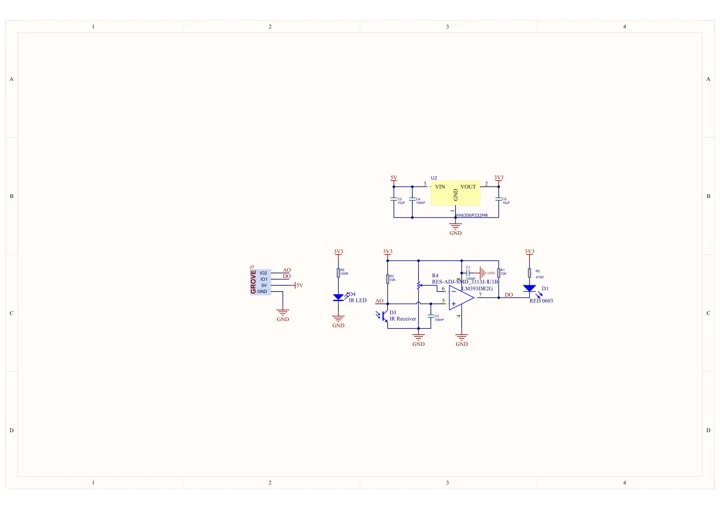
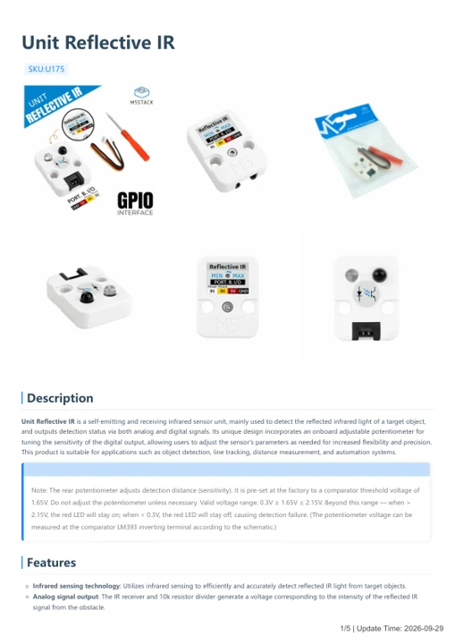

# Unit Reflective IR

**M5Stack** · Source collection

Revision: Unverified source identity

Coverage: Manufacturer references available; physical pinout and complete connector review are tracked separately

[Browse all manufacturers](../../../../BROWSE.md) · [Devices & IoT](../../../../DEVICES.md) · [Open in the browser guide](https://valleytech-black-wire-guide.pages.dev/?board=source-board-3d09118d5e48953680)

## Datasheets and original documentation

Board datasheet: **not yet recorded**. Visual reference: **available**.

[Manufacturer model documentation](https://docs.m5stack.com/en/unit/Unit-Reflective%20IR)

- **schematic / board**: [Unit Reflective IR Schematics PDF — schematic](https://m5stack-doc.oss-cn-shenzhen.aliyuncs.com/628/SCH_UNIT_Reflective_IR_V1.0.pdf) · [saved document](../../../../library/media/3b22b82e316218aa1b6d0b392e643aa5c2ba34bb5872050708b006c260102d59.pdf)
- **hardware-guide / board**: [Unit Reflective IR — manufacturer hardware guide](https://m5stack.oss-cn-shenzhen.aliyuncs.com/resource/docs/static/pdf/static/en/unit/Unit_Reflective_IR.pdf) · [saved document](../../../../library/media/649bffefdc5b853188e28af2e2c948bfc323881c734d89584946588164609bf0.pdf)

A chip datasheet, schematic and board datasheet have different scopes. Match the exact hardware revision.

[Documentation coverage and remaining gaps](../../../../DOCUMENTATION.md)

## Dimensions

**source reference** · Unreviewed source · JPG

[Open original reference](../../../../library/media/209dd32dae1a4f5fc1f4e92ec80554bfdf87bf55f6e5a0ca6d326f1630145725.jpg)

**Credit and rights:** Source rights not yet established. Source/manufacturer: M5Stack.

[Source 1](https://static-cdn.m5stack.com/resource/docs/products/unit/Unit-Reflective IR/img-9dca38e0-16f9-4657-aecf-5c1c22cc1889.jpg) · [Source 2](https://docs.m5stack.com/en/unit/Unit-Reflective%20IR)

Original source index: Dimensions. This file is searchable but has not been promoted to a reviewed physical board pinout.

Image revision: Not identified

SHA-256: `209dd32dae1a4f5fc1f4e92ec80554bfdf87bf55f6e5a0ca6d326f1630145725`

## Unit Reflective IR Schematics PDF — schematic

**reference PDF** · Source model/link and PDF signature/title checked; individual pin assignments and electrical validation pending · PDF

[Open original reference](../../../../library/media/3b22b82e316218aa1b6d0b392e643aa5c2ba34bb5872050708b006c260102d59.pdf)

**Credit and rights:** Original publisher/manufacturer artwork; redistribution and print rights not established. Attribution is not a license grant.. Source/manufacturer: M5Stack.

[Source 1](https://m5stack-doc.oss-cn-shenzhen.aliyuncs.com/628/SCH_UNIT_Reflective_IR_V1.0.pdf) · [Source 2](https://docs.m5stack.com/en/unit/Unit-Reflective%20IR)

Original document linked from this model’s manufacturer page. Preserve the document’s exact revision and named subassembly scope; a linked accessory schematic is not a whole-device pinout. This is a circuit schematic, not a physical board pinout.

Image revision: Use the revision printed in the original document; do not assume all hardware revisions are interchangeable

SHA-256: `3b22b82e316218aa1b6d0b392e643aa5c2ba34bb5872050708b006c260102d59`

## Unit Reflective IR — manufacturer hardware guide

**reference PDF** · Source model/link and PDF signature/title checked; individual pin assignments and electrical validation pending · PDF

[Open original reference](../../../../library/media/649bffefdc5b853188e28af2e2c948bfc323881c734d89584946588164609bf0.pdf)

**Credit and rights:** Original publisher/manufacturer artwork; redistribution and print rights not established. Attribution is not a license grant.. Source/manufacturer: M5Stack.

[Source 1](https://m5stack.oss-cn-shenzhen.aliyuncs.com/resource/docs/static/pdf/static/en/unit/Unit_Reflective_IR.pdf) · [Source 2](https://docs.m5stack.com/en/unit/Unit-Reflective%20IR)

Original document linked from this model’s manufacturer page. Preserve the document’s exact revision and named subassembly scope; a linked accessory schematic is not a whole-device pinout. This is a hardware manual, not a separately classified board datasheet.

Image revision: Use the revision printed in the original document; do not assume all hardware revisions are interchangeable

SHA-256: `649bffefdc5b853188e28af2e2c948bfc323881c734d89584946588164609bf0`

Pin assignments have not been independently electrically verified. Check board revision before wiring.
