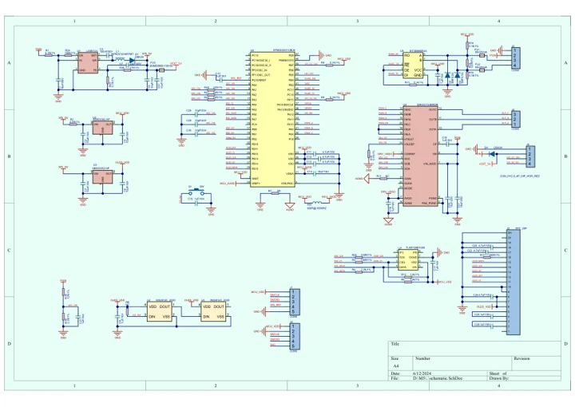
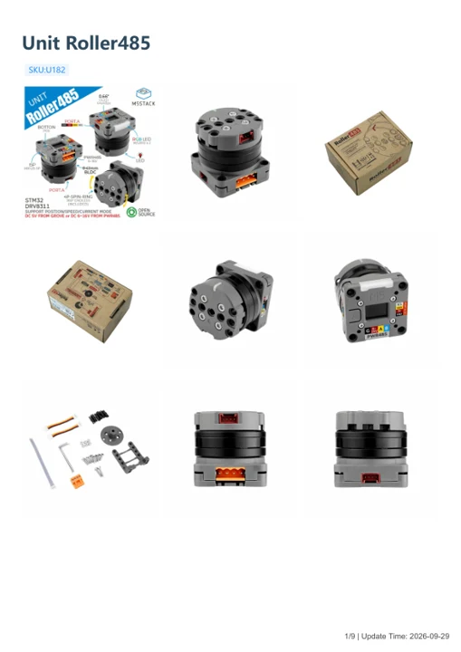

# Unit Roller485

**M5Stack** · Source collection

Revision: Unverified source identity

Coverage: Manufacturer references available; physical pinout and complete connector review are tracked separately

[Browse all manufacturers](../../../../BROWSE.md) · [Devices & IoT](../../../../DEVICES.md) · [Open in the browser guide](https://valleytech-black-wire-guide.pages.dev/?board=source-board-2f8863fd57f131c6f0)

## Datasheets and original documentation

Board datasheet: **not yet recorded**. Visual reference: **available**.

[Manufacturer model documentation](https://docs.m5stack.com/en/unit/Unit-Roller485)

- **schematic / board**: [Unit Roller485 Main Board Schematics PDF — schematic](https://m5stack-doc.oss-cn-shenzhen.aliyuncs.com/776/sch_Unit-Roller485_V1.0.pdf) · [saved document](../../../../library/media/b4ba7cd1b8dd4696d2853b5ea6d1ea376f8a824b5dcdbca3463abb0f9672a59a.pdf)
- **hardware-guide / board**: [Unit Roller485 — manufacturer hardware guide](https://m5stack.oss-cn-shenzhen.aliyuncs.com/resource/docs/static/pdf/static/en/unit/Unit_Roller485.pdf) · [saved document](../../../../library/media/f71ab0b1676321c16146200403b960dda6bd00f5fa97c44b5d74ceed8990bb7e.pdf)

A chip datasheet, schematic and board datasheet have different scopes. Match the exact hardware revision.

[Documentation coverage and remaining gaps](../../../../DOCUMENTATION.md)

## Dimensions

**source reference** · Unreviewed source · JPG

[Open original reference](../../../../library/media/b9410bc2bcbb79cf438222af9b2138fb11db22e055ac36b25be42585793095a9.jpg)

**Credit and rights:** Source rights not yet established. Source/manufacturer: M5Stack.

[Source 1](https://m5stack.oss-cn-shenzhen.aliyuncs.com/resource/docs/products/unit/Unit-Roller485/%E5%B0%BA%E5%AF%B8%E5%9B%BE2.jpg) · [Source 2](https://docs.m5stack.com/en/unit/Unit-Roller485)

Original source index: Dimensions. This file is searchable but has not been promoted to a reviewed physical board pinout.

Image revision: Not identified

SHA-256: `b9410bc2bcbb79cf438222af9b2138fb11db22e055ac36b25be42585793095a9`

## Dimensions

**source reference** · Unreviewed source · JPG

[Open original reference](../../../../library/media/7c3cabf5f5de0fd772d98d51b86b09f51022ee27d2350fd31a6a1eb26cd794e7.jpg)

**Credit and rights:** Source rights not yet established. Source/manufacturer: M5Stack.

[Source 1](https://m5stack.oss-cn-shenzhen.aliyuncs.com/resource/docs/products/unit/Unit-Roller485/%E5%B0%BA%E5%AF%B8%E5%9B%BE3.jpg) · [Source 2](https://docs.m5stack.com/en/unit/Unit-Roller485)

Original source index: Dimensions. This file is searchable but has not been promoted to a reviewed physical board pinout.

Image revision: Not identified

SHA-256: `7c3cabf5f5de0fd772d98d51b86b09f51022ee27d2350fd31a6a1eb26cd794e7`

## Dimensions

**source reference** · Unreviewed source · PNG

[Open original reference](../../../../library/media/e3f8ee409fc06d487e4ae316b9270aeb7252c9c15a32a3a341f1d9552c5a22d6.png)

**Credit and rights:** Source rights not yet established. Source/manufacturer: M5Stack.

[Source 1](https://m5stack-doc.oss-cn-shenzhen.aliyuncs.com/776/modelsize_01.png) · [Source 2](https://docs.m5stack.com/en/unit/Unit-Roller485)

Original source index: Dimensions. This file is searchable but has not been promoted to a reviewed physical board pinout.

Image revision: Not identified

SHA-256: `e3f8ee409fc06d487e4ae316b9270aeb7252c9c15a32a3a341f1d9552c5a22d6`

## Dimensions

**source reference** · Unreviewed source · JPG

[Open original reference](../../../../library/media/443997d6d9d6a1d303edfb7892531c9c838962f692c3085604b63a9115d34873.jpg)

**Credit and rights:** Source rights not yet established. Source/manufacturer: M5Stack.

[Source 1](https://m5stack.oss-cn-shenzhen.aliyuncs.com/resource/docs/products/unit/Unit-Roller485/%E5%B0%BA%E5%AF%B8%E5%9B%BE.jpg) · [Source 2](https://docs.m5stack.com/en/unit/Unit-Roller485)

Original source index: Dimensions. This file is searchable but has not been promoted to a reviewed physical board pinout.

Image revision: Not identified

SHA-256: `443997d6d9d6a1d303edfb7892531c9c838962f692c3085604b63a9115d34873`

## Unit Roller485 Main Board Schematics PDF — schematic

**reference PDF** · Source model/link and PDF signature/title checked; individual pin assignments and electrical validation pending · PDF

[Open original reference](../../../../library/media/b4ba7cd1b8dd4696d2853b5ea6d1ea376f8a824b5dcdbca3463abb0f9672a59a.pdf)

**Credit and rights:** Original publisher/manufacturer artwork; redistribution and print rights not established. Attribution is not a license grant.. Source/manufacturer: M5Stack.

[Source 1](https://m5stack-doc.oss-cn-shenzhen.aliyuncs.com/776/sch_Unit-Roller485_V1.0.pdf) · [Source 2](https://docs.m5stack.com/en/unit/Unit-Roller485)

Original document linked from this model’s manufacturer page. Preserve the document’s exact revision and named subassembly scope; a linked accessory schematic is not a whole-device pinout. This is a circuit schematic, not a physical board pinout.

Image revision: Use the revision printed in the original document; do not assume all hardware revisions are interchangeable

SHA-256: `b4ba7cd1b8dd4696d2853b5ea6d1ea376f8a824b5dcdbca3463abb0f9672a59a`

## Unit Roller485 — manufacturer hardware guide

**reference PDF** · Source model/link and PDF signature/title checked; individual pin assignments and electrical validation pending · PDF

[Open original reference](../../../../library/media/f71ab0b1676321c16146200403b960dda6bd00f5fa97c44b5d74ceed8990bb7e.pdf)

**Credit and rights:** Original publisher/manufacturer artwork; redistribution and print rights not established. Attribution is not a license grant.. Source/manufacturer: M5Stack.

[Source 1](https://m5stack.oss-cn-shenzhen.aliyuncs.com/resource/docs/static/pdf/static/en/unit/Unit_Roller485.pdf) · [Source 2](https://docs.m5stack.com/en/unit/Unit-Roller485)

Original document linked from this model’s manufacturer page. Preserve the document’s exact revision and named subassembly scope; a linked accessory schematic is not a whole-device pinout. This is a hardware manual, not a separately classified board datasheet.

Image revision: Use the revision printed in the original document; do not assume all hardware revisions are interchangeable

SHA-256: `f71ab0b1676321c16146200403b960dda6bd00f5fa97c44b5d74ceed8990bb7e`

Pin assignments have not been independently electrically verified. Check board revision before wiring.
