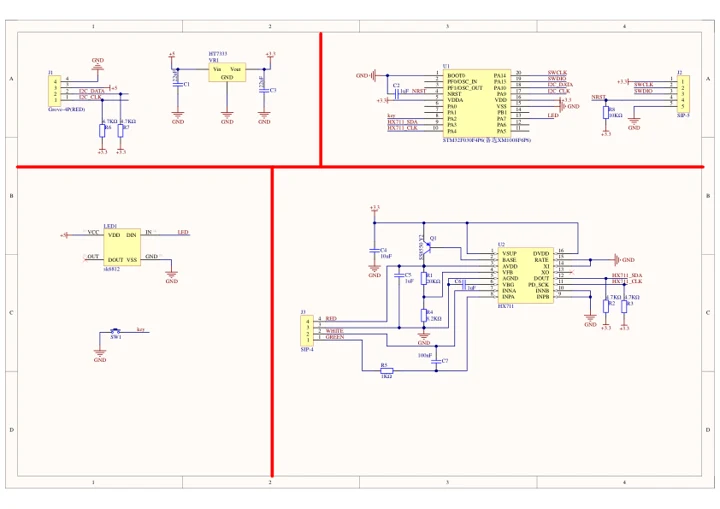
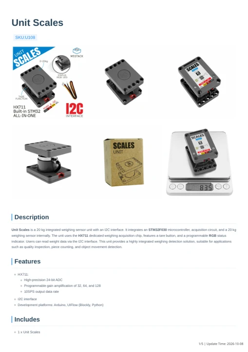

# Unit Scales

**M5Stack** · Source collection

Revision: Unverified source identity

Coverage: Manufacturer references available; physical pinout and complete connector review are tracked separately

[Browse all manufacturers](../../../../BROWSE.md) · [Devices & IoT](../../../../DEVICES.md) · [Open in the browser guide](https://valleytech-black-wire-guide.pages.dev/?board=source-board-5b205f64cb5a1f17ef)

## Datasheets and original documentation

Board datasheet: **not yet recorded**. Visual reference: **available**.

[Manufacturer model documentation](https://docs.m5stack.com/en/unit/UNIT%20Scales)

- **schematic / board**: [Unit Scales Schematics PDF — schematic](https://m5stack-doc.oss-cn-shenzhen.aliyuncs.com/592/Sch_UNIT-Scales.pdf) · [saved document](../../../../library/media/14f9db4f2e77370e98c45d6b07740b8b1a7efb032c3d95d4a03cb0b9c2090be3.pdf)
- **hardware-guide / board**: [Unit Scales — manufacturer hardware guide](https://m5stack.oss-cn-shenzhen.aliyuncs.com/resource/docs/static/pdf/static/en/unit/Unit_Scales.pdf) · [saved document](../../../../library/media/eb077997893c79f7c6d14613013c8db87f86634535a021da0afe1adba57b94dd.pdf)

A chip datasheet, schematic and board datasheet have different scopes. Match the exact hardware revision.

[Documentation coverage and remaining gaps](../../../../DOCUMENTATION.md)

## Dimensions

**source reference** · Unreviewed source · PNG

[Open original reference](../../../../library/media/88d15726550eb8b1219b7cdfa7a14521c329f68abdfc92ac55b899c379dfc130.png)

**Credit and rights:** Source rights not yet established. Source/manufacturer: M5Stack.

[Source 1](https://static-cdn.m5stack.com/resource/docs/products/unit/UNIT Scales/img-18e45241-a9b7-4d70-ab63-ba93b7473f18.png) · [Source 2](https://docs.m5stack.com/en/unit/UNIT%20Scales)

Original source index: Dimensions. This file is searchable but has not been promoted to a reviewed physical board pinout.

Image revision: Not identified

SHA-256: `88d15726550eb8b1219b7cdfa7a14521c329f68abdfc92ac55b899c379dfc130`

## Unit Scales Schematics PDF — schematic

**reference PDF** · Source model/link and PDF signature/title checked; individual pin assignments and electrical validation pending · PDF

[Open original reference](../../../../library/media/14f9db4f2e77370e98c45d6b07740b8b1a7efb032c3d95d4a03cb0b9c2090be3.pdf)

**Credit and rights:** Original publisher/manufacturer artwork; redistribution and print rights not established. Attribution is not a license grant.. Source/manufacturer: M5Stack.

[Source 1](https://m5stack-doc.oss-cn-shenzhen.aliyuncs.com/592/Sch_UNIT-Scales.pdf) · [Source 2](https://docs.m5stack.com/en/unit/UNIT%20Scales)

Original document linked from this model’s manufacturer page. Preserve the document’s exact revision and named subassembly scope; a linked accessory schematic is not a whole-device pinout. This is a circuit schematic, not a physical board pinout.

Image revision: Use the revision printed in the original document; do not assume all hardware revisions are interchangeable

SHA-256: `14f9db4f2e77370e98c45d6b07740b8b1a7efb032c3d95d4a03cb0b9c2090be3`

## Unit Scales — manufacturer hardware guide

**reference PDF** · Source model/link and PDF signature/title checked; individual pin assignments and electrical validation pending · PDF

[Open original reference](../../../../library/media/eb077997893c79f7c6d14613013c8db87f86634535a021da0afe1adba57b94dd.pdf)

**Credit and rights:** Original publisher/manufacturer artwork; redistribution and print rights not established. Attribution is not a license grant.. Source/manufacturer: M5Stack.

[Source 1](https://m5stack.oss-cn-shenzhen.aliyuncs.com/resource/docs/static/pdf/static/en/unit/Unit_Scales.pdf) · [Source 2](https://docs.m5stack.com/en/unit/UNIT%20Scales)

Original document linked from this model’s manufacturer page. Preserve the document’s exact revision and named subassembly scope; a linked accessory schematic is not a whole-device pinout. This is a hardware manual, not a separately classified board datasheet.

Image revision: Use the revision printed in the original document; do not assume all hardware revisions are interchangeable

SHA-256: `eb077997893c79f7c6d14613013c8db87f86634535a021da0afe1adba57b94dd`

Pin assignments have not been independently electrically verified. Check board revision before wiring.
