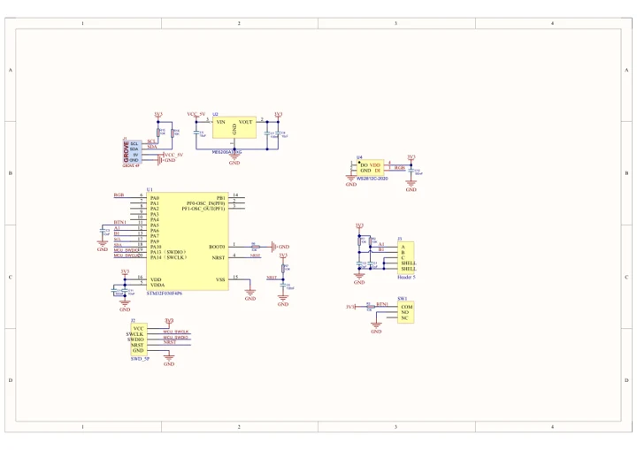
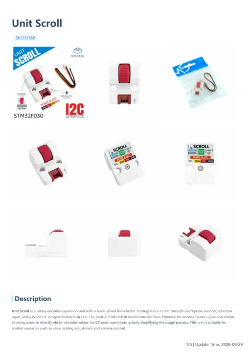

# Unit Scroll

**M5Stack** · Source collection

Revision: Unverified source identity

Coverage: Manufacturer references available; physical pinout and complete connector review are tracked separately

[Browse all manufacturers](../../../../BROWSE.md) · [Devices & IoT](../../../../DEVICES.md) · [Open in the browser guide](https://valleytech-black-wire-guide.pages.dev/?board=source-board-be68305d414b05d2df)

## Datasheets and original documentation

Board datasheet: **not yet recorded**. Visual reference: **available**.

[Manufacturer model documentation](https://docs.m5stack.com/en/unit/UNIT-Scroll)

- **schematic / board**: [Unit Scroll Schematics PDF — schematic](https://m5stack-doc.oss-cn-shenzhen.aliyuncs.com/773/U186_SCH_SCH_UNIT_Scroll_V1.0_2024_07_01_18_29_10.pdf) · [saved document](../../../../library/media/70551d28f89f9c9e9bb057c24cf11f61ba6baf6038d2df42c075f62057118cd0.pdf)
- **hardware-guide / board**: [Unit Scroll — manufacturer hardware guide](https://m5stack.oss-cn-shenzhen.aliyuncs.com/resource/docs/static/pdf/static/en/unit/Unit_Scroll.pdf) · [saved document](../../../../library/media/21e00ef95ce0ce3f4f8e692b6ccd342fbda5234fcdf8da78cb9475afb1a80b14.pdf)

A chip datasheet, schematic and board datasheet have different scopes. Match the exact hardware revision.

[Documentation coverage and remaining gaps](../../../../DOCUMENTATION.md)

## Dimensions

**source reference** · Unreviewed source · JPG

[Open original reference](../../../../library/media/abc5f5ea99f9d9de25bd430a43f371c7bd2514c9ba31acf01dd7cf97ade7bce9.jpg)

**Credit and rights:** Source rights not yet established. Source/manufacturer: M5Stack.

[Source 1](https://static-cdn.m5stack.com/resource/docs/products/unit/UNIT-Scroll/img-4ec8cc89-5f89-401c-80a9-4e0c27c9f36e.jpg) · [Source 2](https://docs.m5stack.com/en/unit/UNIT-Scroll)

Original source index: Dimensions. This file is searchable but has not been promoted to a reviewed physical board pinout.

Image revision: Not identified

SHA-256: `abc5f5ea99f9d9de25bd430a43f371c7bd2514c9ba31acf01dd7cf97ade7bce9`

## Unit Scroll Schematics PDF — schematic

**reference PDF** · Source model/link and PDF signature/title checked; individual pin assignments and electrical validation pending · PDF

[Open original reference](../../../../library/media/70551d28f89f9c9e9bb057c24cf11f61ba6baf6038d2df42c075f62057118cd0.pdf)

**Credit and rights:** Original publisher/manufacturer artwork; redistribution and print rights not established. Attribution is not a license grant.. Source/manufacturer: M5Stack.

[Source 1](https://m5stack-doc.oss-cn-shenzhen.aliyuncs.com/773/U186_SCH_SCH_UNIT_Scroll_V1.0_2024_07_01_18_29_10.pdf) · [Source 2](https://docs.m5stack.com/en/unit/UNIT-Scroll)

Original document linked from this model’s manufacturer page. Preserve the document’s exact revision and named subassembly scope; a linked accessory schematic is not a whole-device pinout. This is a circuit schematic, not a physical board pinout.

Image revision: Use the revision printed in the original document; do not assume all hardware revisions are interchangeable

SHA-256: `70551d28f89f9c9e9bb057c24cf11f61ba6baf6038d2df42c075f62057118cd0`

## Unit Scroll — manufacturer hardware guide

**reference PDF** · Source model/link and PDF signature/title checked; individual pin assignments and electrical validation pending · PDF

[Open original reference](../../../../library/media/21e00ef95ce0ce3f4f8e692b6ccd342fbda5234fcdf8da78cb9475afb1a80b14.pdf)

**Credit and rights:** Original publisher/manufacturer artwork; redistribution and print rights not established. Attribution is not a license grant.. Source/manufacturer: M5Stack.

[Source 1](https://m5stack.oss-cn-shenzhen.aliyuncs.com/resource/docs/static/pdf/static/en/unit/Unit_Scroll.pdf) · [Source 2](https://docs.m5stack.com/en/unit/UNIT-Scroll)

Original document linked from this model’s manufacturer page. Preserve the document’s exact revision and named subassembly scope; a linked accessory schematic is not a whole-device pinout. This is a hardware manual, not a separately classified board datasheet.

Image revision: Use the revision printed in the original document; do not assume all hardware revisions are interchangeable

SHA-256: `21e00ef95ce0ce3f4f8e692b6ccd342fbda5234fcdf8da78cb9475afb1a80b14`

Pin assignments have not been independently electrically verified. Check board revision before wiring.
