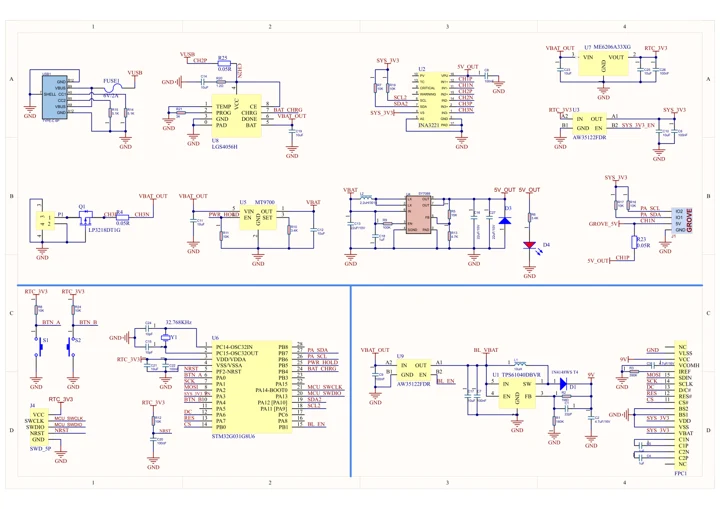
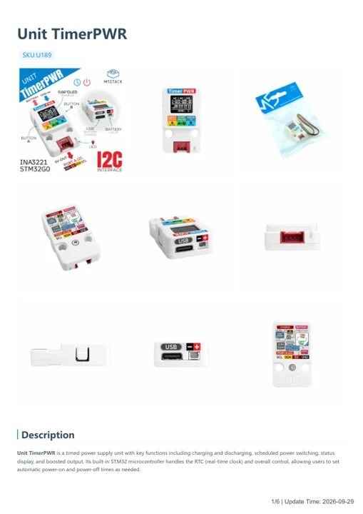

# Unit TimerPWR

**M5Stack** · Source collection

Revision: Unverified source identity

Coverage: Manufacturer references available; physical pinout and complete connector review are tracked separately

[Browse all manufacturers](../../../../BROWSE.md) · [Devices & IoT](../../../../DEVICES.md) · [Open in the browser guide](https://valleytech-black-wire-guide.pages.dev/?board=source-board-d3430af2798820c2fa)

## Datasheets and original documentation

Board datasheet: **not yet recorded**. Visual reference: **available**.

[Manufacturer model documentation](https://docs.m5stack.com/en/unit/Unit-TimerPWR)

- **schematic / board**: [Unit TimerPWR Schematics PDF — schematic](https://m5stack-doc.oss-cn-shenzhen.aliyuncs.com/780/U189_SCH_UNIT_TimerPwr_V1.0.pdf) · [saved document](../../../../library/media/d8b5c5b54f988730b4ec9d86cb9bb95b37a316b46ec9d49a0ad5565833dfadee.pdf)
- **hardware-guide / board**: [Unit TimerPWR — manufacturer hardware guide](https://m5stack.oss-cn-shenzhen.aliyuncs.com/resource/docs/static/pdf/static/en/unit/Unit_TimerPWR.pdf) · [saved document](../../../../library/media/6e8b4c530681985ba9cb2456e7f85c0a4ef9105a628394d98b06a80b688621c6.pdf)

A chip datasheet, schematic and board datasheet have different scopes. Match the exact hardware revision.

[Documentation coverage and remaining gaps](../../../../DOCUMENTATION.md)

## Dimensions

**source reference** · Unreviewed source · JPG

[Open original reference](../../../../library/media/3f4cf1d13664fd0bbe15f4322e92f5e41e0f5a8bddf3f421c4cda831ae4e6f80.jpg)

**Credit and rights:** Source rights not yet established. Source/manufacturer: M5Stack.

[Source 1](https://m5stack.oss-cn-shenzhen.aliyuncs.com/resource/docs/products/unit/Unit-TimerPWR/%E5%B0%BA%E5%AF%B8%E5%9B%BE.jpg) · [Source 2](https://docs.m5stack.com/en/unit/Unit-TimerPWR)

Original source index: Dimensions. This file is searchable but has not been promoted to a reviewed physical board pinout.

Image revision: Not identified

SHA-256: `3f4cf1d13664fd0bbe15f4322e92f5e41e0f5a8bddf3f421c4cda831ae4e6f80`

## Unit TimerPWR Schematics PDF — schematic

**reference PDF** · Source model/link and PDF signature/title checked; individual pin assignments and electrical validation pending · PDF

[Open original reference](../../../../library/media/d8b5c5b54f988730b4ec9d86cb9bb95b37a316b46ec9d49a0ad5565833dfadee.pdf)

**Credit and rights:** Original publisher/manufacturer artwork; redistribution and print rights not established. Attribution is not a license grant.. Source/manufacturer: M5Stack.

[Source 1](https://m5stack-doc.oss-cn-shenzhen.aliyuncs.com/780/U189_SCH_UNIT_TimerPwr_V1.0.pdf) · [Source 2](https://docs.m5stack.com/en/unit/Unit-TimerPWR)

Original document linked from this model’s manufacturer page. Preserve the document’s exact revision and named subassembly scope; a linked accessory schematic is not a whole-device pinout. This is a circuit schematic, not a physical board pinout.

Image revision: Use the revision printed in the original document; do not assume all hardware revisions are interchangeable

SHA-256: `d8b5c5b54f988730b4ec9d86cb9bb95b37a316b46ec9d49a0ad5565833dfadee`

## Unit TimerPWR — manufacturer hardware guide

**reference PDF** · Source model/link and PDF signature/title checked; individual pin assignments and electrical validation pending · PDF

[Open original reference](../../../../library/media/6e8b4c530681985ba9cb2456e7f85c0a4ef9105a628394d98b06a80b688621c6.pdf)

**Credit and rights:** Original publisher/manufacturer artwork; redistribution and print rights not established. Attribution is not a license grant.. Source/manufacturer: M5Stack.

[Source 1](https://m5stack.oss-cn-shenzhen.aliyuncs.com/resource/docs/static/pdf/static/en/unit/Unit_TimerPWR.pdf) · [Source 2](https://docs.m5stack.com/en/unit/Unit-TimerPWR)

Original document linked from this model’s manufacturer page. Preserve the document’s exact revision and named subassembly scope; a linked accessory schematic is not a whole-device pinout. This is a hardware manual, not a separately classified board datasheet.

Image revision: Use the revision printed in the original document; do not assume all hardware revisions are interchangeable

SHA-256: `6e8b4c530681985ba9cb2456e7f85c0a4ef9105a628394d98b06a80b688621c6`

Pin assignments have not been independently electrically verified. Check board revision before wiring.
