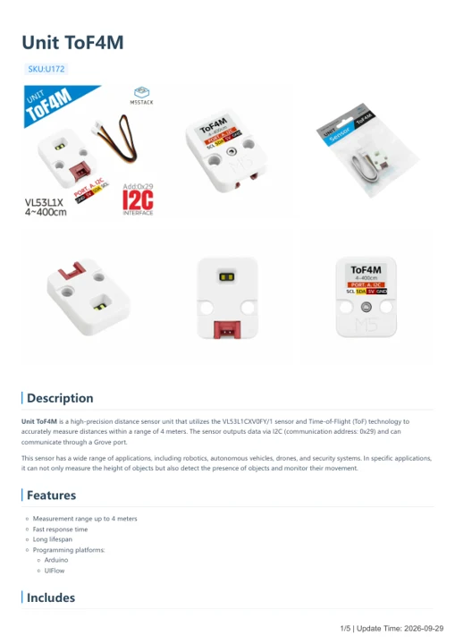
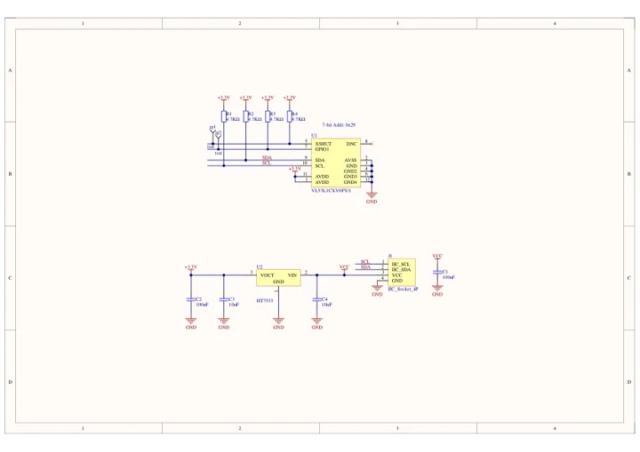

# Unit ToF4M

**M5Stack** · Source collection

Revision: Unverified source identity

Coverage: Manufacturer references available; physical pinout and complete connector review are tracked separately

[Browse all manufacturers](../../../../BROWSE.md) · [Devices & IoT](../../../../DEVICES.md) · [Open in the browser guide](https://valleytech-black-wire-guide.pages.dev/?board=source-board-e19808c11c1b09dfd3)

## Datasheets and original documentation

Board datasheet: **not yet recorded**. Visual reference: **available**.

[Manufacturer model documentation](https://docs.m5stack.com/en/unit/Unit-ToF4M)

- **hardware-guide / board**: [Unit ToF4M — manufacturer hardware guide](https://m5stack.oss-cn-shenzhen.aliyuncs.com/resource/docs/static/pdf/static/en/unit/Unit_ToF4M.pdf) · [saved document](../../../../library/media/b87c0b9ba2b80c9cb2814f3081609edd4a4f89179d05eb9bbb5a4d9e54e32d58.pdf)
- **schematic / board**: [Unit ToF4M Schematics PDF — schematic](https://m5stack-doc.oss-cn-shenzhen.aliyuncs.com/626/UNIT-ToF4M.pdf) · [saved document](../../../../library/media/97aa841d6ccba1ed4b58621d11e7d3bbb52e5c9fc6de76b4736971532817663a.pdf)

A chip datasheet, schematic and board datasheet have different scopes. Match the exact hardware revision.

[Documentation coverage and remaining gaps](../../../../DOCUMENTATION.md)

## Dimensions

**source reference** · Unreviewed source · JPG

[Open original reference](../../../../library/media/61a719ce9529adc62ffb00e9551688d5913f2deef37b0b4f518b46e7e065a2b4.jpg)

**Credit and rights:** Source rights not yet established. Source/manufacturer: M5Stack.

[Source 1](https://static-cdn.m5stack.com/resource/docs/products/unit/Unit-ToF4M/img-0c360975-630d-412d-a109-8f9f7e672f85.jpg) · [Source 2](https://docs.m5stack.com/en/unit/Unit-ToF4M)

Original source index: Dimensions. This file is searchable but has not been promoted to a reviewed physical board pinout.

Image revision: Not identified

SHA-256: `61a719ce9529adc62ffb00e9551688d5913f2deef37b0b4f518b46e7e065a2b4`

## Unit ToF4M — manufacturer hardware guide

**reference PDF** · Source model/link and PDF signature/title checked; individual pin assignments and electrical validation pending · PDF

[Open original reference](../../../../library/media/b87c0b9ba2b80c9cb2814f3081609edd4a4f89179d05eb9bbb5a4d9e54e32d58.pdf)

**Credit and rights:** Original publisher/manufacturer artwork; redistribution and print rights not established. Attribution is not a license grant.. Source/manufacturer: M5Stack.

[Source 1](https://m5stack.oss-cn-shenzhen.aliyuncs.com/resource/docs/static/pdf/static/en/unit/Unit_ToF4M.pdf) · [Source 2](https://docs.m5stack.com/en/unit/Unit-ToF4M)

Original document linked from this model’s manufacturer page. Preserve the document’s exact revision and named subassembly scope; a linked accessory schematic is not a whole-device pinout. This is a hardware manual, not a separately classified board datasheet.

Image revision: Use the revision printed in the original document; do not assume all hardware revisions are interchangeable

SHA-256: `b87c0b9ba2b80c9cb2814f3081609edd4a4f89179d05eb9bbb5a4d9e54e32d58`

## Unit ToF4M Schematics PDF — schematic

**reference PDF** · Source model/link and PDF signature/title checked; individual pin assignments and electrical validation pending · PDF

[Open original reference](../../../../library/media/97aa841d6ccba1ed4b58621d11e7d3bbb52e5c9fc6de76b4736971532817663a.pdf)

**Credit and rights:** Original publisher/manufacturer artwork; redistribution and print rights not established. Attribution is not a license grant.. Source/manufacturer: M5Stack.

[Source 1](https://m5stack-doc.oss-cn-shenzhen.aliyuncs.com/626/UNIT-ToF4M.pdf) · [Source 2](https://docs.m5stack.com/en/unit/Unit-ToF4M)

Original document linked from this model’s manufacturer page. Preserve the document’s exact revision and named subassembly scope; a linked accessory schematic is not a whole-device pinout. This is a circuit schematic, not a physical board pinout.

Image revision: Use the revision printed in the original document; do not assume all hardware revisions are interchangeable

SHA-256: `97aa841d6ccba1ed4b58621d11e7d3bbb52e5c9fc6de76b4736971532817663a`

Pin assignments have not been independently electrically verified. Check board revision before wiring.
