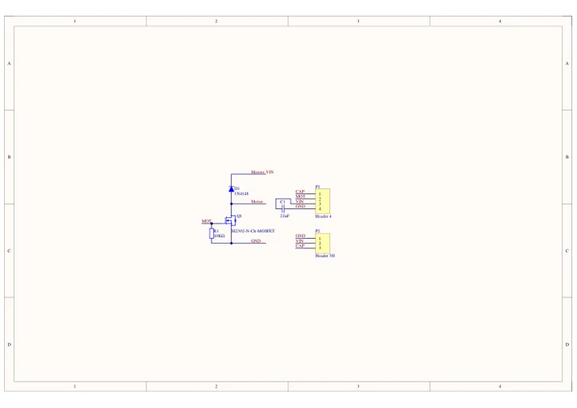
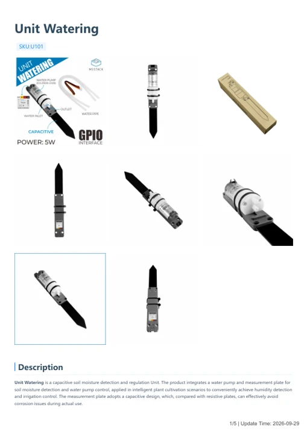

# Unit Watering

**M5Stack** · Source collection

Revision: Unverified source identity

Coverage: Manufacturer references available; physical pinout and complete connector review are tracked separately

[Browse all manufacturers](../../../../BROWSE.md) · [Devices & IoT](../../../../DEVICES.md) · [Open in the browser guide](https://valleytech-black-wire-guide.pages.dev/?board=source-board-4828539aa387945544)

## Datasheets and original documentation

Board datasheet: **not yet recorded**. Visual reference: **available**.

[Manufacturer model documentation](https://docs.m5stack.com/en/unit/watering)

- **schematic / board**: [Unit Watering Schematics PDF — schematic](https://m5stack-doc.oss-cn-shenzhen.aliyuncs.com/729/U101_Unit-Watering_SCH.pdf) · [saved document](../../../../library/media/fcd3df7679087b62c2bbd159ecd1094a8a4e328476ae243257a4c5f9103d24b4.pdf)
- **hardware-guide / board**: [Unit Watering — manufacturer hardware guide](https://m5stack.oss-cn-shenzhen.aliyuncs.com/resource/docs/static/pdf/static/en/unit/Unit_Watering.pdf) · [saved document](../../../../library/media/206b227d77910f24db266d348edd468520c75d85640f57bb7671c27949a4a513.pdf)

A chip datasheet, schematic and board datasheet have different scopes. Match the exact hardware revision.

[Documentation coverage and remaining gaps](../../../../DOCUMENTATION.md)

## Dimensions

**source reference** · Unreviewed source · JPG

[Open original reference](../../../../library/media/d463f7a09c66c01969b9554d4c842dca9814876e7d01c19d4cdeb7496b864adf.jpg)

**Credit and rights:** Source rights not yet established. Source/manufacturer: M5Stack.

[Source 1](https://m5stack.oss-cn-shenzhen.aliyuncs.com/resource/docs/products/unit/watering/module_size.jpg) · [Source 2](https://docs.m5stack.com/en/unit/watering)

Original source index: Dimensions. This file is searchable but has not been promoted to a reviewed physical board pinout.

Image revision: Not identified

SHA-256: `d463f7a09c66c01969b9554d4c842dca9814876e7d01c19d4cdeb7496b864adf`

## Unit Watering Schematics PDF — schematic

**reference PDF** · Source model/link and PDF signature/title checked; individual pin assignments and electrical validation pending · PDF

[Open original reference](../../../../library/media/fcd3df7679087b62c2bbd159ecd1094a8a4e328476ae243257a4c5f9103d24b4.pdf)

**Credit and rights:** Original publisher/manufacturer artwork; redistribution and print rights not established. Attribution is not a license grant.. Source/manufacturer: M5Stack.

[Source 1](https://m5stack-doc.oss-cn-shenzhen.aliyuncs.com/729/U101_Unit-Watering_SCH.pdf) · [Source 2](https://docs.m5stack.com/en/unit/watering)

Original document linked from this model’s manufacturer page. Preserve the document’s exact revision and named subassembly scope; a linked accessory schematic is not a whole-device pinout. This is a circuit schematic, not a physical board pinout.

Image revision: Use the revision printed in the original document; do not assume all hardware revisions are interchangeable

SHA-256: `fcd3df7679087b62c2bbd159ecd1094a8a4e328476ae243257a4c5f9103d24b4`

## Unit Watering — manufacturer hardware guide

**reference PDF** · Source model/link and PDF signature/title checked; individual pin assignments and electrical validation pending · PDF

[Open original reference](../../../../library/media/206b227d77910f24db266d348edd468520c75d85640f57bb7671c27949a4a513.pdf)

**Credit and rights:** Original publisher/manufacturer artwork; redistribution and print rights not established. Attribution is not a license grant.. Source/manufacturer: M5Stack.

[Source 1](https://m5stack.oss-cn-shenzhen.aliyuncs.com/resource/docs/static/pdf/static/en/unit/Unit_Watering.pdf) · [Source 2](https://docs.m5stack.com/en/unit/watering)

Original document linked from this model’s manufacturer page. Preserve the document’s exact revision and named subassembly scope; a linked accessory schematic is not a whole-device pinout. This is a hardware manual, not a separately classified board datasheet.

Image revision: Use the revision printed in the original document; do not assume all hardware revisions are interchangeable

SHA-256: `206b227d77910f24db266d348edd468520c75d85640f57bb7671c27949a4a513`

Pin assignments have not been independently electrically verified. Check board revision before wiring.
