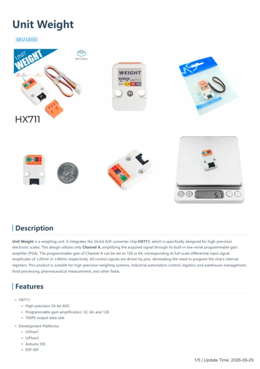
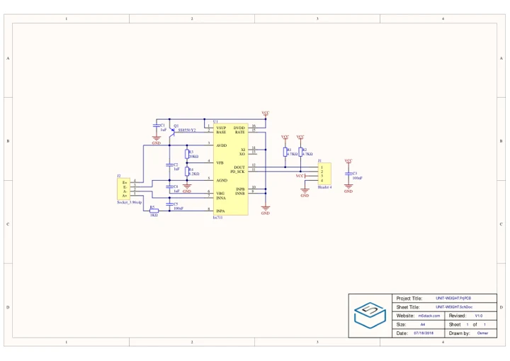

# Unit Weight

**M5Stack** · Source collection

Revision: Unverified source identity

Coverage: Manufacturer references available; physical pinout and complete connector review are tracked separately

[Browse all manufacturers](../../../../BROWSE.md) · [Devices & IoT](../../../../DEVICES.md) · [Open in the browser guide](https://valleytech-black-wire-guide.pages.dev/?board=source-board-12e23574aab03d88d0)

## Datasheets and original documentation

Board datasheet: **not yet recorded**. Visual reference: **available**.

[Manufacturer model documentation](https://docs.m5stack.com/en/unit/WEIGHT)

- **hardware-guide / board**: [Unit Weight — manufacturer hardware guide](https://m5stack.oss-cn-shenzhen.aliyuncs.com/resource/docs/static/pdf/static/en/unit/Unit_Weight.pdf) · [saved document](../../../../library/media/0ecaff9532c201e1b69f2a6e4e4090343dc8f81d6689df3ccc1697c7e4129aab.pdf)
- **schematic / board**: [Unit Weight Schematics PDF — schematic](https://m5stack-doc.oss-cn-shenzhen.aliyuncs.com/704/U030-UNIT_WEIGHT-weight.pdf) · [saved document](../../../../library/media/a0036257269516c4b79ab7761b3f74388e7bc5a6dfbc882be30d4a740ce7d3cd.pdf)

A chip datasheet, schematic and board datasheet have different scopes. Match the exact hardware revision.

[Documentation coverage and remaining gaps](../../../../DOCUMENTATION.md)

## Dimensions

**source reference** · Unreviewed source · JPG

[Open original reference](../../../../library/media/4743a95b0d5dd16030b2aaf16eaefeb625c5abc1b9522c76e249cedfb0ccc992.jpg)

**Credit and rights:** Source rights not yet established. Source/manufacturer: M5Stack.

[Source 1](https://m5stack.oss-cn-shenzhen.aliyuncs.com/resource/docs/products/unit/WEIGHT/%E5%B0%BA%E5%AF%B8%E5%9B%BE.jpg) · [Source 2](https://docs.m5stack.com/en/unit/WEIGHT)

Original source index: Dimensions. This file is searchable but has not been promoted to a reviewed physical board pinout.

Image revision: Not identified

SHA-256: `4743a95b0d5dd16030b2aaf16eaefeb625c5abc1b9522c76e249cedfb0ccc992`

## Unit Weight — manufacturer hardware guide

**reference PDF** · Source model/link and PDF signature/title checked; individual pin assignments and electrical validation pending · PDF

[Open original reference](../../../../library/media/0ecaff9532c201e1b69f2a6e4e4090343dc8f81d6689df3ccc1697c7e4129aab.pdf)

**Credit and rights:** Original publisher/manufacturer artwork; redistribution and print rights not established. Attribution is not a license grant.. Source/manufacturer: M5Stack.

[Source 1](https://m5stack.oss-cn-shenzhen.aliyuncs.com/resource/docs/static/pdf/static/en/unit/Unit_Weight.pdf) · [Source 2](https://docs.m5stack.com/en/unit/WEIGHT)

Original document linked from this model’s manufacturer page. Preserve the document’s exact revision and named subassembly scope; a linked accessory schematic is not a whole-device pinout. This is a hardware manual, not a separately classified board datasheet.

Image revision: Use the revision printed in the original document; do not assume all hardware revisions are interchangeable

SHA-256: `0ecaff9532c201e1b69f2a6e4e4090343dc8f81d6689df3ccc1697c7e4129aab`

## Unit Weight Schematics PDF — schematic

**reference PDF** · Source model/link and PDF signature/title checked; individual pin assignments and electrical validation pending · PDF

[Open original reference](../../../../library/media/a0036257269516c4b79ab7761b3f74388e7bc5a6dfbc882be30d4a740ce7d3cd.pdf)

**Credit and rights:** Original publisher/manufacturer artwork; redistribution and print rights not established. Attribution is not a license grant.. Source/manufacturer: M5Stack.

[Source 1](https://m5stack-doc.oss-cn-shenzhen.aliyuncs.com/704/U030-UNIT_WEIGHT-weight.pdf) · [Source 2](https://docs.m5stack.com/en/unit/WEIGHT)

Original document linked from this model’s manufacturer page. Preserve the document’s exact revision and named subassembly scope; a linked accessory schematic is not a whole-device pinout. This is a circuit schematic, not a physical board pinout.

Image revision: Use the revision printed in the original document; do not assume all hardware revisions are interchangeable

SHA-256: `a0036257269516c4b79ab7761b3f74388e7bc5a6dfbc882be30d4a740ce7d3cd`

Pin assignments have not been independently electrically verified. Check board revision before wiring.
