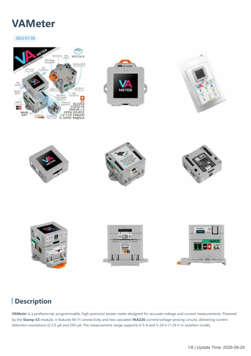
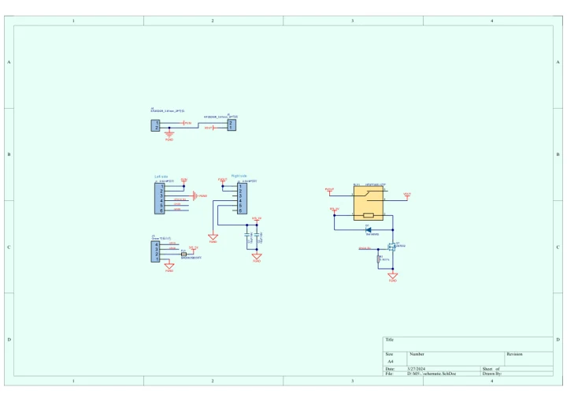

# VAMeter

**M5Stack** · Source collection

Revision: Unverified source identity

Coverage: Manufacturer references available; physical pinout and complete connector review are tracked separately

[Browse all manufacturers](../../../../BROWSE.md) · [Devices & IoT](../../../../DEVICES.md) · [Open in the browser guide](https://valleytech-black-wire-guide.pages.dev/?board=source-board-e1d2f2e92df36ccd92)

## Datasheets and original documentation

Board datasheet: **not yet recorded**. Visual reference: **available**.

[Manufacturer model documentation](https://docs.m5stack.com/en/core/VA%20Meter)

- **hardware-guide / board**: [VAMeter — manufacturer hardware guide](https://m5stack.oss-cn-shenzhen.aliyuncs.com/resource/docs/static/pdf/static/en/core/VAMeter.pdf) · [saved document](../../../../library/media/5119e0dc618f6b11820fdc89a4b651f8549ebd83c8b4de45b2662452aa4a589e.pdf)
- **schematic / board**: [VAMeter Base Schematics PDF — schematic](https://m5stack-doc.oss-cn-shenzhen.aliyuncs.com/518/Sch_VAMeter_base_V1.0.pdf) · [saved document](../../../../library/media/0d7cbecb4d6dc8349bb48200ede42f68ce3840eb7c85f0d75e155e593277d28c.pdf)

A chip datasheet, schematic and board datasheet have different scopes. Match the exact hardware revision.

[Documentation coverage and remaining gaps](../../../../DOCUMENTATION.md)

## Dimensions

**source reference** · Unreviewed source · PNG

[Open original reference](../../../../library/media/e8b13836ec198143bd3eab19d48e53d98c1b42f513e54bbf1e6db8c8e96f5907.png)

**Credit and rights:** Source rights not yet established. Source/manufacturer: M5Stack.

[Source 1](https://m5stack.oss-cn-shenzhen.aliyuncs.com/resource/docs/products/core/VA%20Meter/7658e330231814126dd64b55760eaea.png) · [Source 2](https://docs.m5stack.com/en/core/VA%20Meter)

Original source index: Dimensions. This file is searchable but has not been promoted to a reviewed physical board pinout.

Image revision: Not identified

SHA-256: `e8b13836ec198143bd3eab19d48e53d98c1b42f513e54bbf1e6db8c8e96f5907`

## VAMeter — manufacturer hardware guide

**reference PDF** · Source model/link and PDF signature/title checked; individual pin assignments and electrical validation pending · PDF

[Open original reference](../../../../library/media/5119e0dc618f6b11820fdc89a4b651f8549ebd83c8b4de45b2662452aa4a589e.pdf)

**Credit and rights:** Original publisher/manufacturer artwork; redistribution and print rights not established. Attribution is not a license grant.. Source/manufacturer: M5Stack.

[Source 1](https://m5stack.oss-cn-shenzhen.aliyuncs.com/resource/docs/static/pdf/static/en/core/VAMeter.pdf) · [Source 2](https://docs.m5stack.com/en/core/VA%20Meter)

Original document linked from this model’s manufacturer page. Preserve the document’s exact revision and named subassembly scope; a linked accessory schematic is not a whole-device pinout. This is a hardware manual, not a separately classified board datasheet.

Image revision: Use the revision printed in the original document; do not assume all hardware revisions are interchangeable

SHA-256: `5119e0dc618f6b11820fdc89a4b651f8549ebd83c8b4de45b2662452aa4a589e`

## VAMeter Base Schematics PDF — schematic

**reference PDF** · Source model/link and PDF signature/title checked; individual pin assignments and electrical validation pending · PDF

[Open original reference](../../../../library/media/0d7cbecb4d6dc8349bb48200ede42f68ce3840eb7c85f0d75e155e593277d28c.pdf)

**Credit and rights:** Original publisher/manufacturer artwork; redistribution and print rights not established. Attribution is not a license grant.. Source/manufacturer: M5Stack.

[Source 1](https://m5stack-doc.oss-cn-shenzhen.aliyuncs.com/518/Sch_VAMeter_base_V1.0.pdf) · [Source 2](https://docs.m5stack.com/en/core/VA%20Meter)

Original document linked from this model’s manufacturer page. Preserve the document’s exact revision and named subassembly scope; a linked accessory schematic is not a whole-device pinout. This is a circuit schematic, not a physical board pinout.

Image revision: Use the revision printed in the original document; do not assume all hardware revisions are interchangeable

SHA-256: `0d7cbecb4d6dc8349bb48200ede42f68ce3840eb7c85f0d75e155e593277d28c`

Pin assignments have not been independently electrically verified. Check board revision before wiring.
