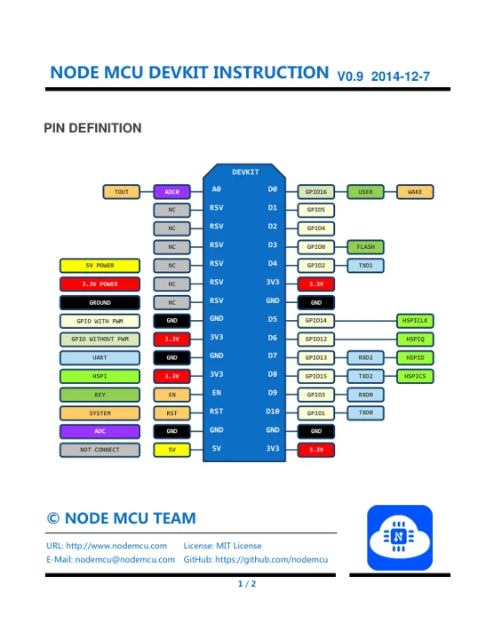
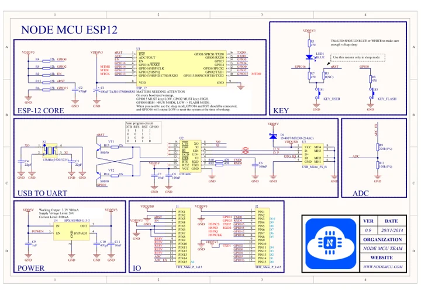

# NodeMCU DevKit 0.9

**NodeMCU** · ESP8266

Revision: Not identified

Coverage: Manufacturer references available; physical pinout and complete connector review are tracked separately

[Browse all manufacturers](../../../../BROWSE.md) · [Devices & IoT](../../../../DEVICES.md) · [Open in the browser guide](https://valleytech-black-wire-guide.pages.dev/?board=nodemcu-esp32-devkit-0-9)

## Datasheets and original documentation

Board datasheet: **not yet recorded**. Visual reference: **available**.

[Manufacturer model documentation](https://github.com/nodemcu/nodemcu-devkit/tree/b0f19d6d1c49b6db4aef56ddba789a7f92f6ecce)

- **hardware-guide / board**: [NodeMCU DevKit 0.9 instructions and pin definitions](https://raw.githubusercontent.com/nodemcu/nodemcu-devkit/b0f19d6d1c49b6db4aef56ddba789a7f92f6ecce/Documents/NODEMCU-DEVKIT-INSTRUCTION-EN.pdf) · [saved document](../../../../library/media/b64df237bef0b121524ead592d13650bec1bc8c4350671e4fd6e1264847af382.pdf)
- **hardware-guide / board**: [Manufacturer specifications and hardware documentation](https://github.com/nodemcu/nodemcu-devkit/tree/b0f19d6d1c49b6db4aef56ddba789a7f92f6ecce) · online
- **schematic / board**: [NodeMCU DevKit 0.9 schematic](https://raw.githubusercontent.com/nodemcu/nodemcu-devkit/b0f19d6d1c49b6db4aef56ddba789a7f92f6ecce/Documents/NODEMCU_ESP12.PDF) · [saved document](../../../../library/media/60aca2a9917ac8ae75277aa48cd37873ab82c67eba83b5dc24d34fe17a0b5e7d.pdf)

A chip datasheet, schematic and board datasheet have different scopes. Match the exact hardware revision.

[Documentation coverage and remaining gaps](../../../../DOCUMENTATION.md)

## Original board pinout

**pinout image** · Reviewed source · PNG

[Open original reference](../../../../library/media/f728c7e66ab0e445d8accec88f0839cd7834b81874323e86f09552996d1ca248.png)

**Credit and rights:** Not established; source attribution retained. Source/manufacturer: NodeMCU.

[Source 1](https://raw.githubusercontent.com/nodemcu/nodemcu-devkit/b0f19d6d1c49b6db4aef56ddba789a7f92f6ecce/Documents/NODEMCU-DEVKIT-INSTRUCTION-EN_BIG.png) · [Source 2](https://github.com/nodemcu/nodemcu-devkit/blob/b0f19d6d1c49b6db4aef56ddba789a7f92f6ecce/Documents/NODEMCU-DEVKIT-INSTRUCTION-EN_BIG.png)

Image revision: Not identified

SHA-256: `f728c7e66ab0e445d8accec88f0839cd7834b81874323e86f09552996d1ca248`

## NodeMCU DevKit 0.9 instructions and pin definitions

**reference PDF** · Visually reviewed for identity and reference scope; independent electrical and all-connector review pending · PDF

[Open original reference](../../../../library/media/b64df237bef0b121524ead592d13650bec1bc8c4350671e4fd6e1264847af382.pdf)

**Credit and rights:** NodeMCU Team; the original document states MIT open license. Preserve the original attribution and applicable license notices.. Source/manufacturer: NodeMCU.

[Source 1](https://raw.githubusercontent.com/nodemcu/nodemcu-devkit/b0f19d6d1c49b6db4aef56ddba789a7f92f6ecce/Documents/NODEMCU-DEVKIT-INSTRUCTION-EN.pdf) · [Source 2](https://github.com/nodemcu/nodemcu-devkit/tree/b0f19d6d1c49b6db4aef56ddba789a7f92f6ecce)

Two-page original instruction sheet with board pin definitions. DevKit 0.9 / ESP8266; not the 1.0 hardware.

Image revision: Not identified

SHA-256: `b64df237bef0b121524ead592d13650bec1bc8c4350671e4fd6e1264847af382`

## NodeMCU DevKit 0.9 schematic

**reference PDF** · Source model/link and PDF signature/title checked; individual pin assignments and electrical validation pending · PDF

[Open original reference](../../../../library/media/60aca2a9917ac8ae75277aa48cd37873ab82c67eba83b5dc24d34fe17a0b5e7d.pdf)

**Credit and rights:** Original publisher/manufacturer artwork; redistribution and print rights not established. Attribution is not a license grant.. Source/manufacturer: NodeMCU.

[Source 1](https://raw.githubusercontent.com/nodemcu/nodemcu-devkit/b0f19d6d1c49b6db4aef56ddba789a7f92f6ecce/Documents/NODEMCU_ESP12.PDF) · [Source 2](https://github.com/nodemcu/nodemcu-devkit/tree/b0f19d6d1c49b6db4aef56ddba789a7f92f6ecce)

Original NodeMCU Team board schematic pinned to its source repository commit. Match DevKit 0.9 versus 1.0; not a generic ESP8266 chip pinout.

Image revision: Use the revision printed in the original document; do not assume all hardware revisions are interchangeable

SHA-256: `60aca2a9917ac8ae75277aa48cd37873ab82c67eba83b5dc24d34fe17a0b5e7d`

Pin assignments have not been independently electrically verified. Check board revision before wiring.
