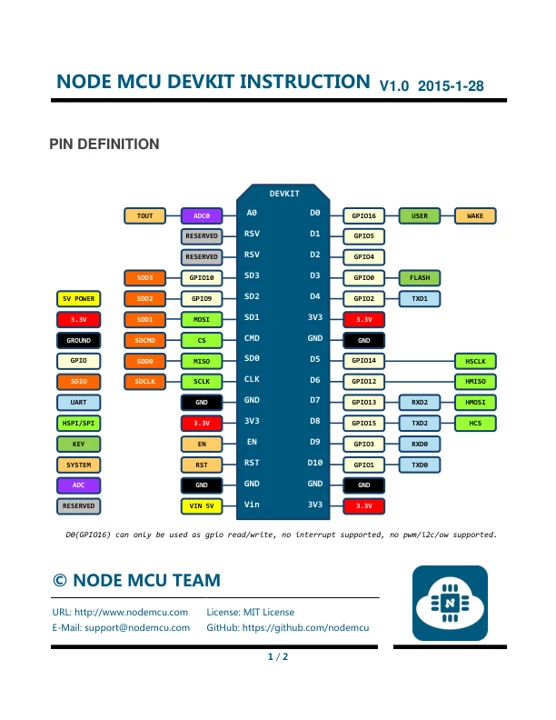
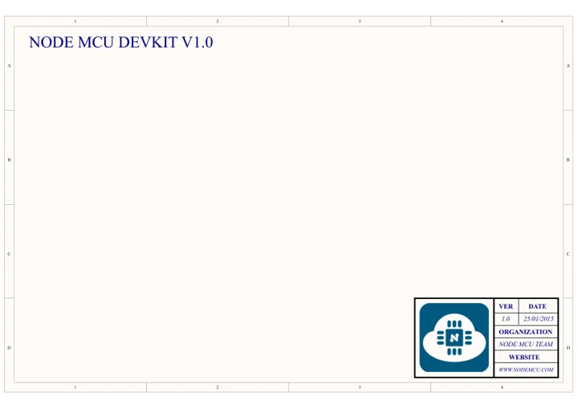

# NodeMCU DevKit 1.0

**NodeMCU** · ESP8266

Revision: Not identified

Coverage: Manufacturer references available; physical pinout and complete connector review are tracked separately

[Browse all manufacturers](../../../../BROWSE.md) · [Devices & IoT](../../../../DEVICES.md) · [Open in the browser guide](https://valleytech-black-wire-guide.pages.dev/?board=nodemcu-esp32-devkit-1-0)

## Datasheets and original documentation

Board datasheet: **not yet recorded**. Visual reference: **available**.

[Manufacturer model documentation](https://github.com/nodemcu/nodemcu-devkit-v1.0/tree/7cb0a330a25fad85e701c768ef46064c17d54446)

- **hardware-guide / board**: [NodeMCU DevKit 1.0 instructions and pin definitions](https://raw.githubusercontent.com/nodemcu/nodemcu-devkit-v1.0/7cb0a330a25fad85e701c768ef46064c17d54446/Documents/NODEMCU-DEVKIT-V1.0-INSTRUCTION-EN.pdf) · [saved document](../../../../library/media/3a3eef92e329f8c6680356b63839b95cc766abe78d330e4e1808aa57c2bd9364.pdf)
- **hardware-guide / board**: [Manufacturer specifications and hardware documentation](https://github.com/nodemcu/nodemcu-devkit-v1.0/tree/7cb0a330a25fad85e701c768ef46064c17d54446) · online
- **schematic / board**: [NodeMCU DevKit 1.0 schematic](https://raw.githubusercontent.com/nodemcu/nodemcu-devkit-v1.0/7cb0a330a25fad85e701c768ef46064c17d54446/NODEMCU_DEVKIT_V1.0.PDF) · [saved document](../../../../library/media/235393563e2bcd8b75e30b36ed710f66882f240df6aac357afbf2de6e79b3d26.pdf)

A chip datasheet, schematic and board datasheet have different scopes. Match the exact hardware revision.

[Documentation coverage and remaining gaps](../../../../DOCUMENTATION.md)

## Original board pinout

**pinout image** · Reviewed source · PNG

[Open original reference](../../../../library/media/6109f3520520ffe961bd0e60aa7c1dfba90046151e3da33eea69d17cb34eaefa.png)

**Credit and rights:** Not established; source attribution retained. Source/manufacturer: NodeMCU.

[Source 1](https://raw.githubusercontent.com/nodemcu/nodemcu-devkit-v1.0/7cb0a330a25fad85e701c768ef46064c17d54446/Documents/NODEMCU_DEVKIT_V1.0_PINMAP.png) · [Source 2](https://github.com/nodemcu/nodemcu-devkit-v1.0/blob/7cb0a330a25fad85e701c768ef46064c17d54446/Documents/NODEMCU_DEVKIT_V1.0_PINMAP.png)

Image revision: Not identified

SHA-256: `6109f3520520ffe961bd0e60aa7c1dfba90046151e3da33eea69d17cb34eaefa`

## NodeMCU DevKit 1.0 instructions and pin definitions

**reference PDF** · Visually reviewed for identity and reference scope; independent electrical and all-connector review pending · PDF

[Open original reference](../../../../library/media/3a3eef92e329f8c6680356b63839b95cc766abe78d330e4e1808aa57c2bd9364.pdf)

**Credit and rights:** NodeMCU Team; the original document states MIT open license. Preserve the original attribution and applicable license notices.. Source/manufacturer: NodeMCU.

[Source 1](https://raw.githubusercontent.com/nodemcu/nodemcu-devkit-v1.0/7cb0a330a25fad85e701c768ef46064c17d54446/Documents/NODEMCU-DEVKIT-V1.0-INSTRUCTION-EN.pdf) · [Source 2](https://github.com/nodemcu/nodemcu-devkit-v1.0/tree/7cb0a330a25fad85e701c768ef46064c17d54446)

Two-page original instruction sheet with board pin definitions. DevKit 1.0 / ESP8266; not the 0.9 hardware.

Image revision: Not identified

SHA-256: `3a3eef92e329f8c6680356b63839b95cc766abe78d330e4e1808aa57c2bd9364`

## NodeMCU DevKit 1.0 schematic

**reference PDF** · Source model/link and PDF signature/title checked; individual pin assignments and electrical validation pending · PDF

[Open original reference](../../../../library/media/235393563e2bcd8b75e30b36ed710f66882f240df6aac357afbf2de6e79b3d26.pdf)

**Credit and rights:** Original publisher/manufacturer artwork; redistribution and print rights not established. Attribution is not a license grant.. Source/manufacturer: NodeMCU.

[Source 1](https://raw.githubusercontent.com/nodemcu/nodemcu-devkit-v1.0/7cb0a330a25fad85e701c768ef46064c17d54446/NODEMCU_DEVKIT_V1.0.PDF) · [Source 2](https://github.com/nodemcu/nodemcu-devkit-v1.0/tree/7cb0a330a25fad85e701c768ef46064c17d54446)

Original NodeMCU Team board schematic pinned to its source repository commit. Match DevKit 0.9 versus 1.0; not a generic ESP8266 chip pinout.

Image revision: Use the revision printed in the original document; do not assume all hardware revisions are interchangeable

SHA-256: `235393563e2bcd8b75e30b36ed710f66882f240df6aac357afbf2de6e79b3d26`

Pin assignments have not been independently electrically verified. Check board revision before wiring.
