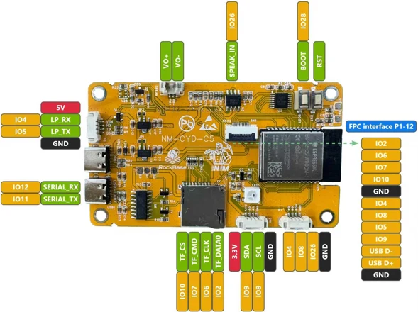
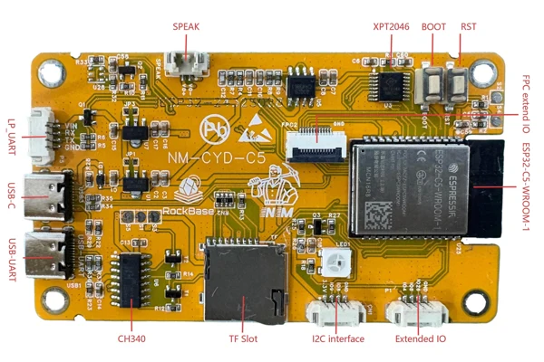
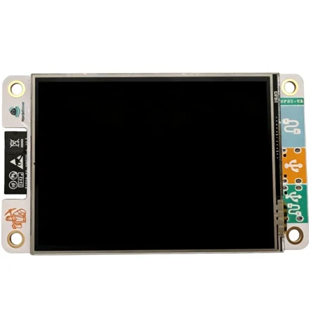
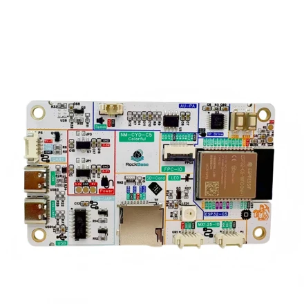

# NM-CYD-C5

**RockBase IoT / NMTech** · ESP32-C5

Revision: Physical PCB revision not identified; v1.0 is the linked schematic document label, not a verified specimen revision.

Coverage: Manufacturer pinout, labeled board views and photographs plus source-backed 2.8-inch ESP32-C5 host: shared display/touch/SD SPI, extension connectors, LP-UART/GPS and FPC signal purposes. Exact specimen revision, FPC cable orientation and electrical qualification remain unverified.

[Browse all manufacturers](../../../../BROWSE.md) · [Devices & IoT](../../../../DEVICES.md) · [Open in the browser guide](https://valleytech-black-wire-guide.pages.dev/?board=rockbase-nmtech-nm-cyd-c5)

Device category: **Displays & HMI**

NM-CYD-C5 assembly: direct expansion FPC plus an additional UART connection; NOT the Classic CYD SD-slot SPI shim. Classic ESP32-2432S028/CYD assembly: SD-slot/TF SPI shim plus the model-specific signal/UART leads. These are different host arrangements: do not follow the combined quick-start TF steps blindly on the C5. Exact FPC mating face, cable orientation, UART endpoints and power routing remain unqualified for a physical specimen.

Architecture: **RISC-V**

## Datasheets and original documentation

Board datasheet: **not yet recorded**. Visual reference: **available**.

[Manufacturer model documentation](https://wiki.rockbaseiot.com/docs/products/nm-cyd-c5/)

- **hardware-guide / board**: [Manufacturer repository — NM-CYD-C5](https://github.com/RockBase-iot/NM-CYD-C5) · online
- **hardware-guide / board**: [Pinned manufacturer README — pin functions, connectors, GPS and variants](https://github.com/RockBase-iot/NM-CYD-C5/blob/a1366c3d63363019371dac476a03a01b821ec5de/README.md) · online
- **schematic / board**: [Pinned C5 schematic v1.0 — display FPC1 and expansion FPC2](https://github.com/RockBase-iot/NM-CYD-C5/blob/a1366c3d63363019371dac476a03a01b821ec5de/Documention/2-sch/SCH_NM-CYD-C5-v1.0.pdf) · online
- **hardware-guide / board**: [Manufacturer wiki — C5 setup and connector tables](https://wiki.rockbaseiot.com/docs/products/nm-cyd-c5/) · online
- **datasheet / component**: [Chip manufacturer — ESP32-C5 capabilities](https://www.espressif.com/en/products/socs/esp32-c5) · online
- **hardware-guide / accessory**: [Compatible accessory — NM-RF-HAT manufacturer documentation](https://github.com/RockBase-iot/NM-RF-HAT/blob/88e943a4b74b999d6a26156e8e8566949e18c646/README.md) · online
- **hardware-guide / assembly**: [Manufacturer combined quick-start — separate C5 versus Classic CYD assembly](https://wiki.rockbaseiot.com/docs/products/nm-rf-hat-quick-start/) · online
- **hardware-guide / assembly**: [Manufacturer assembly photographs and troubleshooting article](https://rockbase.shop/en/blogs/tech-news/nm-rf-hat-quick-start) · online

NM-CYD-C5 assembly: direct expansion FPC plus an additional UART connection; NOT the Classic CYD SD-slot SPI shim. Classic ESP32-2432S028/CYD assembly: SD-slot/TF SPI shim plus the model-specific signal/UART leads. These are different host arrangements: do not follow the combined quick-start TF steps blindly on the C5. Exact FPC mating face, cable orientation, UART endpoints and power routing remain unqualified for a physical specimen. Manufacturer description: ESP32-C5-WROOM-1, 2.8-inch 240×320 ST7789 display, resistive XPT2046 in the pinned README/schematic, shared SPI with touch and microSD, dual USB-C (native USB and CH340 UART), RGB LED, 16 MB flash and 8 MB PSRAM. These are manufacturer specifications, not acceptance-tested specimen measurements. Variants: standard, Colorful and Colorful-Ant; the external-antenna variant is manufacturer-described with IPEX 1 and dual-band antenna, not a qualified replacement-connector recommendation. GPS is an external UART module, not built-in GNSS; the manufacturer gives NM-ATGM336H as an example. IO8/IO9 have R32/R33 pull-ups and appear on multiple interfaces. USB/FPC signals are not generic free GPIO. Source caveats: display FPC1 versus expansion FPC2; 12 listed FPC signals versus a schematic symbol with 14 positions; wiki capacitive-touch versus pinned resistive XPT2046; unsupported Bluetooth Classic wording omitted. No supply-current, battery/charger, backfeed or simultaneous-source limits have been validated. Contributor: JimGat (@jimgat), original summaries and evidence-scoped function tables. Hardware and source-document attribution remains RockBase IoT / NMTech. RockBase IoT / NMTech manufacturer artwork, retained unchanged with source credit. Reuse, redistribution and print rights not established; local review inclusion does not relicense the original. Public submission requires a permissions review. Manufacturer PDFs remain external links. Thumbnails and screen previews are convenience derivatives; original downloaded image bytes and hashes are retained.

[Documentation coverage and remaining gaps](../../../../DOCUMENTATION.md)

## Shared SPI, display and board controls

Manufacturer-source logical reference, not a physically verified connector map.

Source labels/positions only. PCB revision, mating-face numbering, cable contact side and orientation have not been verified.

| Board label / source position | Purpose | Connection notes |
|---|---|---|
| GPIO6 | Shared SPI SCK | ST7789 display, XPT2046 touch and microSD share this clock. |
| GPIO2 | Shared SPI MISO | Host receives display/touch/SD data; also appears on expansion FPC. |
| GPIO7 | Shared SPI MOSI | Host transmits on the shared bus; also appears on expansion FPC. |
| GPIO23 | Display chip select | Independent CS, not the Classic ESP32 CYD pin assignment. |
| GPIO1 | XPT2046 touch chip select | Pinned schematic/README describe resistive touch; wiki wording differs. |
| GPIO10 | microSD chip select | Shared bus requires each peripheral to release MISO when unselected. |
| GPIO24 | TFT D/C (TFT_RS) | Schematic deduction, not a physical-header contact. |
| GPIO3 | Touch interrupt (TP_IRQ) | Schematic net role; manufacturer README IRQ cell is unfilled. |
| GPIO25 | Display backlight control | Manufacturer function, not a safe external load-power output. |
| GPIO27 | WS2812 RGB LED data | Native board LED role; not an accessory-host compatibility ID. |

[Source evidence](https://github.com/RockBase-iot/NM-CYD-C5/blob/a1366c3d63363019371dac476a03a01b821ec5de/Documention/2-sch/SCH_NM-CYD-C5-v1.0.pdf) · Single-page schematic: TFT/TP/TF net assignments, TFT_BL and IO27_2812DIN; corroborating README Shared SPI and backlight tables · Source-backed transcription and schematic deduction; no continuity or functional test claimed. Contributor: JimGat (@jimgat).

## P5 — LP-UART / optional GPS

Optional external GPS LP-UART function reference. This is not a qualification of the additional NM-RF-HAT UART cable.

Source labels/positions only. PCB revision, mating-face numbering, cable contact side and orientation have not been verified.

| Board label / source position | Purpose | Connection notes |
|---|---|---|
| GPIO4 / LP_UART_RXD | ESP32-C5 UART receive | Manufacturer GPS table RX=4; GPS module TX feeds host RX, with common ground. |
| GPIO5 / LP_UART_TXD | ESP32-C5 UART transmit | Manufacturer GPS table TX=5; module receive capability and wiring are module-specific. |
| Power / GND | UART connector power reference | Contact order, voltage suitability and polarity require the exact board/module documentation; not inferred from the two GPIO entries. |

[Source evidence](https://github.com/RockBase-iot/NM-CYD-C5/blob/a1366c3d63363019371dac476a03a01b821ec5de/README.md) · LP-UART (NM-CYD-C5:P5) for GPS Module · Source-backed transcription and schematic deduction; no continuity or functional test claimed. Contributor: JimGat (@jimgat).

## CN1 — manufacturer I2C extension listing

Manufacturer CN1 position list, NOT a mating-face or wire-color map.

Source labels/positions only. PCB revision, mating-face numbering, cable contact side and orientation have not been verified.

| Board label / source position | Purpose | Connection notes |
|---|---|---|
| 3.3V / 1 | Board 3.3 V rail | No available-current rating established. |
| IO9 / 2 | I2C SDA / TEMP_SDA | Schematic net and pull-up R33; shared with other interfaces. |
| IO8 / 3 | I2C SCL / TEMP_SCL | Schematic net and pull-up R32; shared with other interfaces. |
| GND / 4 | Signal reference ground | Physical connector orientation unverified. |

[Source evidence](https://github.com/RockBase-iot/NM-CYD-C5/blob/a1366c3d63363019371dac476a03a01b821ec5de/README.md) · Extend IO for I2C (CN1); schematic TEMP_SCL/TEMP_SDA and R32/R33 · Source-backed transcription and schematic deduction; no continuity or functional test claimed. Contributor: JimGat (@jimgat).

## P1 — extension IO listing

Manufacturer P1 position list; no continuity-test claim.

Source labels/positions only. PCB revision, mating-face numbering, cable contact side and orientation have not been verified.

| Board label / source position | Purpose | Connection notes |
|---|---|---|
| IO4 / 1 | Native GPIO / LP-UART RX role | Shared with P5/FPC; not an independent extra UART. |
| IO8 / 2 | Native GPIO / I2C SCL role | On-board pull-up; shared with CN1/FPC. |
| IO26 / 3 | Native GPIO / SPEAK_IN net | Audio-associated net on the pinned schematic; verify before repurposing. |
| GND / 4 | Signal reference ground | Mating-face orientation unverified. |

[Source evidence](https://github.com/RockBase-iot/NM-CYD-C5/blob/a1366c3d63363019371dac476a03a01b821ec5de/README.md) · Extend IO (NM-CYD-C5:P1); schematic IO26/SPEAK_IN · Source-backed transcription and schematic deduction; no continuity or functional test claimed. Contributor: JimGat (@jimgat).

## Expansion FPC — source FPC2 signal list, NOT a cable pinout

README positional transcription only: 12 listed signals versus 14-position schematic symbol. FPC1 labels the display in the schematic. Do not use this table as a physically verified contact-order or ribbon-orientation map.

Source labels/positions only. PCB revision, mating-face numbering, cable contact side and orientation have not been verified.

| Board label / source position | Purpose | Connection notes |
|---|---|---|
| IO2 / 1 | Shared SPI MISO | Native host GPIO; not HAT GPIO19 by numeric identity. |
| IO6 / 2 | Shared SPI clock | Native host GPIO; endpoint numbering differs from Classic CYD. |
| IO7 / 3 | Shared SPI MOSI | Native host GPIO. |
| IO10 / 4 | microSD chip select / expansion signal | Bus ownership and firmware selection remain model-specific. |
| GND / 5 | Signal ground | No power/current rating inferred. |
| IO4 / 6 | LP-UART RX / GPIO | Additional UART cable is a separate assembly connection; endpoints unqualified. |
| IO8 / 7 | I2C SCL / GPIO | On-board pull-up; shared uses. |
| IO5 / 8 | LP-UART TX / GPIO | Host signal role, not permission to join outputs. |
| IO9 / 9 | I2C SDA / GPIO | On-board pull-up; shared uses. |
| USB D− / 10 | Native USB data negative | Differential USB signal, not a general-purpose supply pin. |
| USB D+ / 11 | Native USB data positive | Differential USB signal; no cable orientation inferred. |
| GND / 12 | Signal ground | The source lists 12 positions; schematic shows 14. Resolve hardware before connection. |

[Source evidence](https://github.com/RockBase-iot/NM-CYD-C5/blob/a1366c3d63363019371dac476a03a01b821ec5de/README.md) · NM Extend IO: 12-Pin FPC Interface (FPC2) · Source-backed transcription and schematic deduction; no continuity or functional test claimed. Contributor: JimGat (@jimgat).

## Manufacturer board pinout — standard NM-CYD-C5

**pinout image** · Manufacturer source identity and visual scope inspected; no independent electrical, transcription or all-connector completeness approval · JPG

[Open original reference](../../../../library/media/c201d6dca6b7c4a46d112fec1a002c1772ea5bb896affa77a232f67669724105.jpg)

**Credit and rights:** RockBase IoT / NMTech manufacturer artwork, retained unchanged with source credit. Reuse, redistribution and print rights not established; local review inclusion does not relicense the original. Public submission requires a permissions review.. Source/manufacturer: RockBase IoT / NMTech.

[Source 1](https://raw.githubusercontent.com/RockBase-iot/NM-CYD-C5/a1366c3d63363019371dac476a03a01b821ec5de/Documention/pics/nm-cyd-c5-pinout.jpg) · [Source 2](https://github.com/RockBase-iot/NM-CYD-C5/blob/a1366c3d63363019371dac476a03a01b821ec5de/README.md) · [Source 3](https://github.com/RockBase-iot/NM-CYD-C5)

Manufacturer-labeled physical board diagram. Source contact labels are preserved, not independently transcribed or electrically verified. Match the pictured revision; FPC mating face and cable orientation remain unqualified. NM-CYD-C5 assembly: direct expansion FPC plus an additional UART connection; NOT the Classic CYD SD-slot SPI shim. Classic ESP32-2432S028/CYD assembly: SD-slot/TF SPI shim plus the model-specific signal/UART leads. These are different host arrangements: do not follow the combined quick-start TF steps blindly on the C5. Exact FPC mating face, cable orientation, UART endpoints and power routing remain unqualified for a physical specimen.

Image revision: Source photograph/diagram revision only; physical specimen PCB revision not established

SHA-256: `c201d6dca6b7c4a46d112fec1a002c1772ea5bb896affa77a232f67669724105`

## Standard NM-CYD-C5 — labeled board overview

**board labeling image** · Manufacturer source identity and visual scope inspected; no independent electrical, transcription or all-connector completeness approval · JPG

[Open original reference](../../../../library/media/e60171f7486005cf313a79b364461767fbe1f301fd853cdfd349f3771a07a394.jpg)

**Credit and rights:** RockBase IoT / NMTech manufacturer artwork, retained unchanged with source credit. Reuse, redistribution and print rights not established; local review inclusion does not relicense the original. Public submission requires a permissions review.. Source/manufacturer: RockBase IoT / NMTech.

[Source 1](https://raw.githubusercontent.com/RockBase-iot/NM-CYD-C5/a1366c3d63363019371dac476a03a01b821ec5de/Documention/pics/nm-cyd-c5-detail.jpg) · [Source 2](https://github.com/RockBase-iot/NM-CYD-C5/blob/a1366c3d63363019371dac476a03a01b821ec5de/README.md) · [Source 3](https://github.com/RockBase-iot/NM-CYD-C5)

Manufacturer component and connector labels on the standard board. This component overview is not an independently approved all-pin wiring map. NM-CYD-C5 assembly: direct expansion FPC plus an additional UART connection; NOT the Classic CYD SD-slot SPI shim. Classic ESP32-2432S028/CYD assembly: SD-slot/TF SPI shim plus the model-specific signal/UART leads. These are different host arrangements: do not follow the combined quick-start TF steps blindly on the C5. Exact FPC mating face, cable orientation, UART endpoints and power routing remain unqualified for a physical specimen.

Image revision: Source photograph/diagram revision only; physical specimen PCB revision not established

SHA-256: `e60171f7486005cf313a79b364461767fbe1f301fd853cdfd349f3771a07a394`

## Colorful Special Edition — display-side photograph

**board photograph** · Manufacturer source identity and visual scope inspected; no independent electrical, transcription or all-connector completeness approval · JPG

[Open original reference](../../../../library/media/698c2a92740b58f67235f98d733f00f60f89dc4da18683b2621a88279de8d3c1.jpg)

**Credit and rights:** RockBase IoT / NMTech manufacturer artwork, retained unchanged with source credit. Reuse, redistribution and print rights not established; local review inclusion does not relicense the original. Public submission requires a permissions review.. Source/manufacturer: RockBase IoT / NMTech.

[Source 1](https://raw.githubusercontent.com/RockBase-iot/NM-CYD-C5/a1366c3d63363019371dac476a03a01b821ec5de/Documention/pics/nm-cyd-c5-color.jpg) · [Source 2](https://github.com/RockBase-iot/NM-CYD-C5/blob/a1366c3d63363019371dac476a03a01b821ec5de/README.md) · [Source 3](https://github.com/RockBase-iot/NM-CYD-C5)

Colorful Special Edition as identified by the pinned manufacturer README. Variant illustration, not proof of a specimen PCB revision or current availability. NM-CYD-C5 assembly: direct expansion FPC plus an additional UART connection; NOT the Classic CYD SD-slot SPI shim. Classic ESP32-2432S028/CYD assembly: SD-slot/TF SPI shim plus the model-specific signal/UART leads. These are different host arrangements: do not follow the combined quick-start TF steps blindly on the C5. Exact FPC mating face, cable orientation, UART endpoints and power routing remain unqualified for a physical specimen.

Image revision: Source photograph/diagram revision only; physical specimen PCB revision not established

SHA-256: `698c2a92740b58f67235f98d733f00f60f89dc4da18683b2621a88279de8d3c1`

## Colorful Special Edition — rear-board photograph

**board photograph** · Manufacturer source identity and visual scope inspected; no independent electrical, transcription or all-connector completeness approval · PNG

[Open original reference](../../../../library/media/5d90e695750a28b0fedf7053e17b68f9063699856d4137c4893eb64da19cb7e8.png)

**Credit and rights:** RockBase IoT / NMTech manufacturer artwork, retained unchanged with source credit. Reuse, redistribution and print rights not established; local review inclusion does not relicense the original. Public submission requires a permissions review.. Source/manufacturer: RockBase IoT / NMTech.

[Source 1](https://raw.githubusercontent.com/RockBase-iot/NM-CYD-C5/a1366c3d63363019371dac476a03a01b821ec5de/Documention/pics/nm-cyd-c5-colorful.png) · [Source 2](https://github.com/RockBase-iot/NM-CYD-C5/blob/a1366c3d63363019371dac476a03a01b821ec5de/README.md) · [Source 3](https://github.com/RockBase-iot/NM-CYD-C5)

Colorful Special Edition as identified by the pinned manufacturer README. Do not confuse this host variant with the separate NM-RF-HAT accessory. NM-CYD-C5 assembly: direct expansion FPC plus an additional UART connection; NOT the Classic CYD SD-slot SPI shim. Classic ESP32-2432S028/CYD assembly: SD-slot/TF SPI shim plus the model-specific signal/UART leads. These are different host arrangements: do not follow the combined quick-start TF steps blindly on the C5. Exact FPC mating face, cable orientation, UART endpoints and power routing remain unqualified for a physical specimen.

Image revision: Source photograph/diagram revision only; physical specimen PCB revision not established

SHA-256: `5d90e695750a28b0fedf7053e17b68f9063699856d4137c4893eb64da19cb7e8`

Pin assignments have not been independently electrically verified. Check board revision before wiring.
