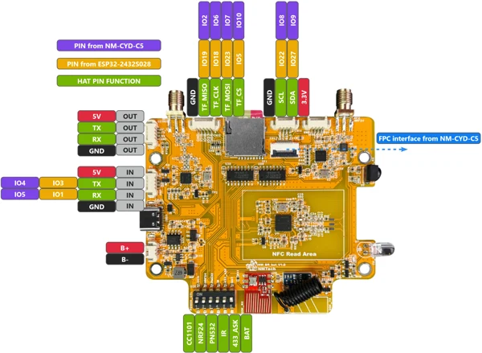
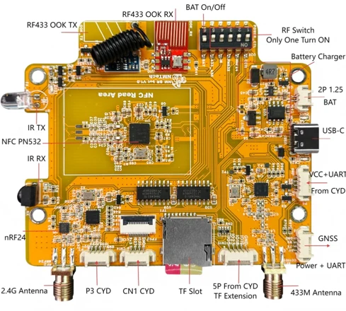
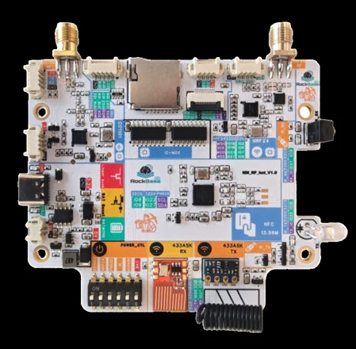
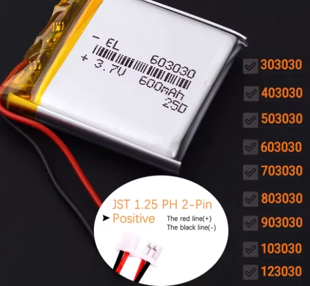

# NM-RF-HAT

**RockBase IoT / NMTech** · Host-controlled RF accessory

Revision: Physical PCB revision not identified; v1.0 is the linked schematic document label, not a verified specimen revision.

Coverage: Separate RF accessory reference: module functions, shared-bus/power selection, host-specific FPC/UART versus Classic CYD SD-SPI-shim assembly. Manufacturer pinout, labeled module view and photographs included; no independent physical/electrical qualification.

[Browse all manufacturers](../../../../BROWSE.md) · [Devices & IoT](../../../../DEVICES.md) · [Open in the browser guide](https://valleytech-black-wire-guide.pages.dev/?board=rockbase-nmtech-nm-rf-hat)

Device category: **Expansion & IO**

NM-CYD-C5 assembly: direct expansion FPC plus an additional UART connection; NOT the Classic CYD SD-slot SPI shim. Classic ESP32-2432S028/CYD assembly: SD-slot/TF SPI shim plus the model-specific signal/UART leads. These are different host arrangements: do not follow the combined quick-start TF steps blindly on the C5. Exact FPC mating face, cable orientation, UART endpoints and power routing remain unqualified for a physical specimen.

Architecture: **Host-dependent**

## Datasheets and original documentation

Board datasheet: **not yet recorded**. Visual reference: **available**.

[Manufacturer model documentation](https://wiki.rockbaseiot.com/docs/products/nm-rf-hat-quick-start/)

- **hardware-guide / board**: [Manufacturer repository — NM-RF-HAT](https://github.com/RockBase-iot/NM-RF-HAT) · online
- **hardware-guide / board**: [Pinned manufacturer README — modules, host support and accessory note](https://github.com/RockBase-iot/NM-RF-HAT/blob/88e943a4b74b999d6a26156e8e8566949e18c646/README.md) · online
- **schematic / board**: [Pinned NM-RF-HAT schematic v1.0 — bus, power and module nets](https://github.com/RockBase-iot/NM-RF-HAT/blob/88e943a4b74b999d6a26156e8e8566949e18c646/Documentation/1-sch/SCH_NM-RF-HAT_v1.0.pdf) · online
- **hardware-guide / board**: [Pinned manufacturer user manual — installation and DIP/power guidance](https://github.com/RockBase-iot/NM-RF-HAT/blob/88e943a4b74b999d6a26156e8e8566949e18c646/Documentation/2-usermanual/NM-RF-HAT-UserMannual.pdf) · online
- **hardware-guide / assembly**: [Manufacturer quick-start — shared host guidance and DIP discrepancy](https://wiki.rockbaseiot.com/docs/products/nm-rf-hat-quick-start/) · online
- **hardware-guide / assembly**: [Manufacturer quick-start article — assembly photographs](https://rockbase.shop/en/blogs/tech-news/nm-rf-hat-quick-start) · online
- **hardware-guide / board**: [Pinned manufacturer FAQ](https://github.com/RockBase-iot/NM-RF-HAT/blob/88e943a4b74b999d6a26156e8e8566949e18c646/NM-RF-HAT%20FAQ.md) · online
- **hardware-guide / accessory**: [Compatible host — NM-CYD-C5 manufacturer documentation](https://github.com/RockBase-iot/NM-CYD-C5/blob/a1366c3d63363019371dac476a03a01b821ec5de/README.md) · online
- **connector-reference / connector**: [Manufacturer C5 host wiki — native GPIO and expansion signals](https://wiki.rockbaseiot.com/docs/products/nm-cyd-c5/) · online

NM-CYD-C5 assembly: direct expansion FPC plus an additional UART connection; NOT the Classic CYD SD-slot SPI shim. Classic ESP32-2432S028/CYD assembly: SD-slot/TF SPI shim plus the model-specific signal/UART leads. These are different host arrangements: do not follow the combined quick-start TF steps blindly on the C5. Exact FPC mating face, cable orientation, UART endpoints and power routing remain unqualified for a physical specimen. Modules: CC1101 sub-1 GHz transceiver, nRF24L01 2.4 GHz transceiver, PN532 NFC, infrared transmit/receive and separate RF433 ASK transmit/receive. The shared host interface and selectable module power do not mean all modules can operate concurrently. Manufacturer manual calls for a single selected function because GPIOs are shared. IMPORTANT DIP source conflict: pinned manual maps position 1=nRF24, 2=CC1101, 3=RF433, 4=IR, 5=PN532; the live quick-start wiki instead maps 1=CC1101, 2=nRF24, 3=PN532, 4=IR, 5=RF433. No numeric switch-setting recipe is certified here; match the actual silkscreen and exact hardware/manual revision. The schematic includes a battery-related sixth switch; polarity, charging current and safe multi-source behavior still require verification. The manual describes 5 V USB input, a nominal 3.7 V battery path, charging/boost and HAT-to-host power considerations; no battery suitability or available-current limit is established. Manufacturer battery connector wording mixes JST/PH and 1.25 mm: treat exact series/mating part as unqualified, and verify polarity rather than trusting wire color. GPS/GNSS is an expansion interface for an external module, not built-in GNSS. RF antennas, firmware compatibility and RF regulatory operation are outside this reference validation. Contributor: JimGat (@jimgat), original summaries and evidence-scoped function tables. Hardware and source-document attribution remains RockBase IoT / NMTech. RockBase IoT / NMTech manufacturer artwork, retained unchanged with source credit. Reuse, redistribution and print rights not established; local review inclusion does not relicense the original. Public submission requires a permissions review. Manufacturer PDFs remain external links. Thumbnails and screen previews are convenience derivatives; original downloaded image bytes and hashes are retained.

[Documentation coverage and remaining gaps](../../../../DOCUMENTATION.md)

## Module signal purposes — not ESP32-C5 native GPIO numbers

Manufacturer-source logical reference, not a physically verified connector map.

Source labels/positions only. PCB revision, mating-face numbering, cable contact side and orientation have not been verified.

| Board label / source position | Purpose | Connection notes |
|---|---|---|
| CC1101: SCK / MOSI / MISO / CSn | Sub-1 GHz SPI interface | Shared host bus; CSn is active low. No RF transmission or functional detection test performed. |
| CC1101: GDO0 | Radio event/data signal | Do not assume a Classic-CYD GPIO number transfers to ESP32-C5. |
| nRF24: SCK / MOSI / MISO / CSN | 2.4 GHz SPI interface | CSN is independent from the CE radio-control signal. |
| nRF24: CE / CE-2 | Radio enable/control routing | Schematic carries CE and CE-2 nets; no external connector position inferred. |
| PN532: NSS/SCL / MISO / SCK | NFC interface nets | Names are module nets; supported bus mode and host firmware must agree. |
| UART_RX_PN532 / UART_TX_PN532 | PN532 UART-side module nets | RX/TX direction is relative to the module; not a verified C5 cable contact map. |
| IR_DR / IR_DT | Infrared receive / transmit control | Schematic IR receiver and emitter driver, not an RF antenna connector. |
| 433_DR / 433_DT | 433 MHz ASK receive / transmit data | Separate RF433 paths, not the same device as CC1101. |

[Source evidence](https://github.com/RockBase-iot/NM-RF-HAT/blob/88e943a4b74b999d6a26156e8e8566949e18c646/Documentation/1-sch/SCH_NM-RF-HAT_v1.0.pdf) · PDF pages 1–6: top-level, CC1101, NRF24, IR, 433 AM and PN532 net labels · Source-backed transcription and schematic deduction; no continuity or functional test claimed. Contributor: JimGat (@jimgat).

## Host connections and expansion — assembly roles

Source-backed connector roles plus contributor-scoped C5-versus-Classic assembly distinction; not a pin-to-pin wiring prescription.

Source labels/positions only. PCB revision, mating-face numbering, cable contact side and orientation have not been verified.

| Board label / source position | Purpose | Connection notes |
|---|---|---|
| C5 expansion FPC + additional UART | NM-CYD-C5 host arrangement | Direct expansion FPC is distinct from the display FPC. Additional UART endpoint/order remains unqualified. |
| Classic CYD TF/SD SPI shim + signal/UART leads | ESP32-2432S028 host arrangement | Classic SD-slot adapter exposes the host SPI bus; not a universal C5 instruction. |
| HAT FPC2 / host IOxx nets | Expansion interconnect on the HAT schematic | The HAT schematic uses legacy IO19/IO18/IO23/IO5 labels. These are not evidence of identically numbered ESP32-C5 GPIO. |
| TF1 | microSD storage interface | Schematic shared SPI/CS path. Storage presence does not make TF shim mandatory on the C5 host. |
| External GPS/GNSS connector | Optional external receiver UART expansion | No GPS receiver or baud rate qualification is claimed here. |
| USB-C / BAT / module rails | Input power, charging/boost and selectable module supply | Do not infer safe current, polarity, battery chemistry suitability or simultaneous-source behavior. |

[Source evidence](https://github.com/RockBase-iot/NM-RF-HAT/blob/88e943a4b74b999d6a26156e8e8566949e18c646/Documentation/2-usermanual/NM-RF-HAT-UserMannual.pdf) · PDF pages 2–8, with top-level schematic and manufacturer README GNSS/TF/battery notes · Source-backed transcription and schematic deduction; no continuity or functional test claimed. Contributor: JimGat (@jimgat).

## Module selection — label-based due to conflicting DIP numbering

Manufacturer-source disagreement is preserved explicitly. No numeric DIP configuration is recommended until actual board/revision is verified.

Source labels/positions only. PCB revision, mating-face numbering, cable contact side and orientation have not been verified.

| Board label / source position | Purpose | Connection notes |
|---|---|---|
| nRF24 | Select only the nRF24 function | Pinned manual position 1; live wiki position 2. Verify actual silkscreen/revision. |
| CC1101 | Select only the CC1101 function | Pinned manual position 2; live wiki position 1. Verify actual silkscreen/revision. |
| RF433 | Select only the separate 433 MHz ASK function | Pinned manual position 3; live wiki position 5. Not the CC1101 path. |
| IR | Select the infrared function | Both cited sources call it position 4; still not bench-verified. |
| PN532 | Select the NFC function | Pinned manual position 5; live wiki position 3. Verify actual silkscreen/revision. |
| Battery switch / sixth position | Battery path selection per exact hardware | No safe charging, isolation or current-limit prescription is inferred. |

[Source evidence](https://github.com/RockBase-iot/NM-RF-HAT/blob/88e943a4b74b999d6a26156e8e8566949e18c646/Documentation/2-usermanual/NM-RF-HAT-UserMannual.pdf) · PDF pages 3–6 for module power; page 8 power precautions. Compare live wiki DIP Switch Basics. · Source-backed transcription and schematic deduction; no continuity or functional test claimed. Contributor: JimGat (@jimgat).

## Manufacturer board pinout — NM-RF-HAT

**pinout image** · Manufacturer source identity and visual scope inspected; no independent electrical, transcription or all-connector completeness approval · PNG

[Open original reference](../../../../library/media/28a95f77c4123a796324d9108f39c8deaff65f879fb98e0a6f29fd3c65fd5dd4.png)

**Credit and rights:** RockBase IoT / NMTech manufacturer artwork, retained unchanged with source credit. Reuse, redistribution and print rights not established; local review inclusion does not relicense the original. Public submission requires a permissions review.. Source/manufacturer: RockBase IoT / NMTech.

[Source 1](https://raw.githubusercontent.com/RockBase-iot/NM-RF-HAT/88e943a4b74b999d6a26156e8e8566949e18c646/Documentation/pics/NM-RF-HAT-pinout.png) · [Source 2](https://github.com/RockBase-iot/NM-RF-HAT/blob/88e943a4b74b999d6a26156e8e8566949e18c646/README.md) · [Source 3](https://github.com/RockBase-iot/NM-RF-HAT)

Manufacturer-labeled physical HAT diagram. Host/legacy IO labels are not automatically identically numbered ESP32-C5 GPIOs. Match actual board revision, DIP labels and the correct host interconnect. NM-CYD-C5 assembly: direct expansion FPC plus an additional UART connection; NOT the Classic CYD SD-slot SPI shim. Classic ESP32-2432S028/CYD assembly: SD-slot/TF SPI shim plus the model-specific signal/UART leads. These are different host arrangements: do not follow the combined quick-start TF steps blindly on the C5. Exact FPC mating face, cable orientation, UART endpoints and power routing remain unqualified for a physical specimen.

Image revision: Source photograph/diagram revision only; physical specimen PCB revision not established

SHA-256: `28a95f77c4123a796324d9108f39c8deaff65f879fb98e0a6f29fd3c65fd5dd4`

## NM-RF-HAT — labeled modules and connectors

**board labeling image** · Manufacturer source identity and visual scope inspected; no independent electrical, transcription or all-connector completeness approval · JPG

[Open original reference](../../../../library/media/a27ea8f9a320bc0c90e18442b346f5a82f68047a1eaf104a7b31a32f802acb0b.jpg)

**Credit and rights:** RockBase IoT / NMTech manufacturer artwork, retained unchanged with source credit. Reuse, redistribution and print rights not established; local review inclusion does not relicense the original. Public submission requires a permissions review.. Source/manufacturer: RockBase IoT / NMTech.

[Source 1](https://raw.githubusercontent.com/RockBase-iot/NM-RF-HAT/88e943a4b74b999d6a26156e8e8566949e18c646/Documentation/pics/rf-hat-detail.jpg) · [Source 2](https://github.com/RockBase-iot/NM-RF-HAT/blob/88e943a4b74b999d6a26156e8e8566949e18c646/README.md) · [Source 3](https://github.com/RockBase-iot/NM-RF-HAT)

Manufacturer module and connector overview. Numeric module-switch settings remain subject to the documented manual/wiki conflict. NM-CYD-C5 assembly: direct expansion FPC plus an additional UART connection; NOT the Classic CYD SD-slot SPI shim. Classic ESP32-2432S028/CYD assembly: SD-slot/TF SPI shim plus the model-specific signal/UART leads. These are different host arrangements: do not follow the combined quick-start TF steps blindly on the C5. Exact FPC mating face, cable orientation, UART endpoints and power routing remain unqualified for a physical specimen.

Image revision: Source photograph/diagram revision only; physical specimen PCB revision not established

SHA-256: `a27ea8f9a320bc0c90e18442b346f5a82f68047a1eaf104a7b31a32f802acb0b`

## Colorful NM-RF-HAT — product photograph

**board photograph** · Manufacturer source identity and visual scope inspected; no independent electrical, transcription or all-connector completeness approval · PNG

[Open original reference](../../../../library/media/247930c4a70e2c96fbc70c7e75683df973f50a8cdf2864d7479558fa293fa86d.png)

**Credit and rights:** RockBase IoT / NMTech manufacturer artwork, retained unchanged with source credit. Reuse, redistribution and print rights not established; local review inclusion does not relicense the original. Public submission requires a permissions review.. Source/manufacturer: RockBase IoT / NMTech.

[Source 1](https://raw.githubusercontent.com/RockBase-iot/NM-RF-HAT/88e943a4b74b999d6a26156e8e8566949e18c646/Documentation/pics/rf-hat-color.png) · [Source 2](https://github.com/RockBase-iot/NM-RF-HAT/blob/88e943a4b74b999d6a26156e8e8566949e18c646/README.md) · [Source 3](https://github.com/RockBase-iot/NM-RF-HAT)

Manufacturer Colorful accessory photograph; not the NM-CYD-C5 host. The manufacturer describes this as a cosmetic variant; no specimen acceptance testing is claimed. NM-CYD-C5 assembly: direct expansion FPC plus an additional UART connection; NOT the Classic CYD SD-slot SPI shim. Classic ESP32-2432S028/CYD assembly: SD-slot/TF SPI shim plus the model-specific signal/UART leads. These are different host arrangements: do not follow the combined quick-start TF steps blindly on the C5. Exact FPC mating face, cable orientation, UART endpoints and power routing remain unqualified for a physical specimen.

Image revision: Source photograph/diagram revision only; physical specimen PCB revision not established

SHA-256: `247930c4a70e2c96fbc70c7e75683df973f50a8cdf2864d7479558fa293fa86d`

## Manufacturer battery-connector illustration — polarity caution

**board photograph** · Manufacturer source identity and visual scope inspected; no independent electrical, transcription or all-connector completeness approval · PNG

[Open original reference](../../../../library/media/fc8becc07fadb6367efc4b15514563eaf2de5484d14b39ce6fdbcf76f759bf34.png)

**Credit and rights:** RockBase IoT / NMTech manufacturer artwork, retained unchanged with source credit. Reuse, redistribution and print rights not established; local review inclusion does not relicense the original. Public submission requires a permissions review.. Source/manufacturer: RockBase IoT / NMTech.

[Source 1](https://raw.githubusercontent.com/RockBase-iot/NM-RF-HAT/88e943a4b74b999d6a26156e8e8566949e18c646/Documentation/pics/jst_interface.png) · [Source 2](https://github.com/RockBase-iot/NM-RF-HAT/blob/88e943a4b74b999d6a26156e8e8566949e18c646/README.md) · [Source 3](https://github.com/RockBase-iot/NM-RF-HAT)

Battery/connector illustration from the HAT README, not a HAT board pinout. Manufacturer wording mixes JST/PH and 1.25 mm; exact mating series, actual polarity, wire colors, charging limits and suitability must be verified on the hardware. NM-CYD-C5 assembly: direct expansion FPC plus an additional UART connection; NOT the Classic CYD SD-slot SPI shim. Classic ESP32-2432S028/CYD assembly: SD-slot/TF SPI shim plus the model-specific signal/UART leads. These are different host arrangements: do not follow the combined quick-start TF steps blindly on the C5. Exact FPC mating face, cable orientation, UART endpoints and power routing remain unqualified for a physical specimen.

Image revision: Source photograph/diagram revision only; physical specimen PCB revision not established

SHA-256: `fc8becc07fadb6367efc4b15514563eaf2de5484d14b39ce6fdbcf76f759bf34`

Pin assignments have not been independently electrically verified. Check board revision before wiring.
