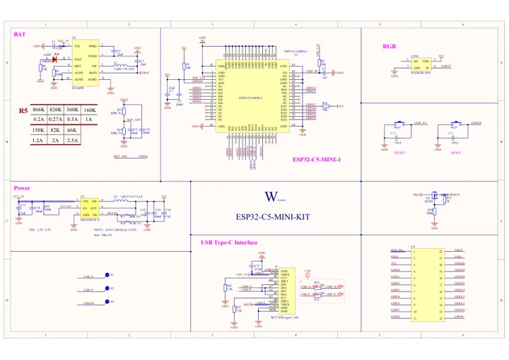
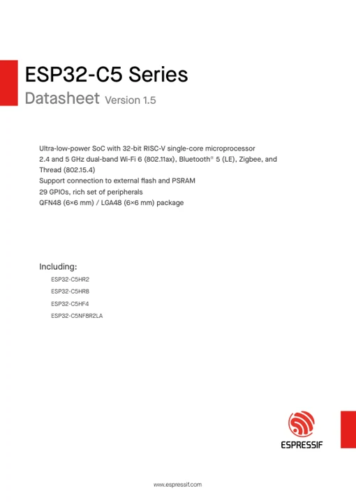

# ESP32-C5-MINI-KIT

**Waveshare** · ESP32-C5

Revision: Not identified

Coverage: Manufacturer references available; physical pinout and complete connector review are tracked separately

[Browse all manufacturers](../../../../BROWSE.md) · [Devices & IoT](../../../../DEVICES.md) · [Open in the browser guide](https://valleytech-black-wire-guide.pages.dev/?board=waveshare-esp32-esp32-c5-mini-kit)

## Datasheets and original documentation

Board datasheet: **not yet recorded**. Visual reference: **available**.

[Manufacturer hardware documentation](https://docs.waveshare.com/ESP32-C5-MINI-KIT)

- **schematic / board**: [ESP32-C5-MINI-KIT schematic](https://raw.githubusercontent.com/waveshareteam/ESP32-C5-MINI-KIT/9eb18f4282e2e464b34b911ed6ba63cf28f22c9f/schematic/ESP32-C5-MINI-KIT.pdf) · [saved document](../../../../library/media/4e35ae74ae22f2cee2cb22f399d63d49bc2362b772e6a74d2b7fd7b9c3e2ca90.pdf)
- **hardware-guide / board**: [Manufacturer specifications and hardware documentation](https://docs.waveshare.com/ESP32-C5-MINI-KIT) · online
- **datasheet / component**: [ESP32-C5 component datasheet V1.5](https://documentation.espressif.com/esp32-c5_datasheet_en.pdf) · [saved document](../../../../library/media/e3cb7ad57b6fdf165ded30bdb75b4972c92fbe0a9159666eb553999032f1dc22.pdf)

Manufacturer lists onboard/external-antenna and soldered-header variants together. Match antenna/header variant and PCB revision. Board schematics and component datasheets have different scopes.

[Documentation coverage and remaining gaps](../../../../DOCUMENTATION.md)

## Pinout

**pinout image** · Reviewed source · JPG

[Open original reference](../../../../library/media/2aca193a406c1f53cf8df507c4610040db0117199793ab3544b7d20fe07a4d79.jpg)

**Credit and rights:** Not recorded; retain original attribution. Source/manufacturer: Waveshare.

[Source 1](https://www.waveshare.com/img/devkit/ESP32-C5-MINI-KIT/ESP32-C5-MINI-KIT-details-inter.jpg) · [Source 2](https://www.waveshare.com/esp32-c5-mini-kit.htm)

Image revision: Not identified

SHA-256: `2aca193a406c1f53cf8df507c4610040db0117199793ab3544b7d20fe07a4d79`

## Pinout

**pinout image** · Reviewed source · WEBP

[Open original reference](../../../../library/media/408f5f8285d35d617de18edf194bfd10c32b36a060b30a4cd3b0e61a80eca747.webp)

**Credit and rights:** Not recorded; retain original attribution. Source/manufacturer: Waveshare.

[Source 1](https://docs.waveshare.com/assets/images/ESP32-C5-MINI-KIT-size-7f310511b392c2224568de3e279d5849.webp) · [Source 2](https://docs.waveshare.com/ESP32-C5-MINI-KIT)

Image revision: Not identified

SHA-256: `408f5f8285d35d617de18edf194bfd10c32b36a060b30a4cd3b0e61a80eca747`

## ESP32-C5-MINI-KIT schematic

**reference PDF** · Visually reviewed for identity and reference scope; independent electrical and all-connector review pending · PDF

[Open original reference](../../../../library/media/4e35ae74ae22f2cee2cb22f399d63d49bc2362b772e6a74d2b7fd7b9c3e2ca90.pdf)

**Credit and rights:** Manufacturer artwork; reuse and print rights not established. Inclusion does not relicense the original.. Source/manufacturer: Waveshare.

[Source 1](https://raw.githubusercontent.com/waveshareteam/ESP32-C5-MINI-KIT/9eb18f4282e2e464b34b911ed6ba63cf28f22c9f/schematic/ESP32-C5-MINI-KIT.pdf) · [Source 2](https://docs.waveshare.com/ESP32-C5-MINI-KIT)

Original single-page board schematic, pinned to manufacturer repository commit.

Image revision: Not identified

SHA-256: `4e35ae74ae22f2cee2cb22f399d63d49bc2362b772e6a74d2b7fd7b9c3e2ca90`

## ESP32-C5 component datasheet V1.5

**reference PDF** · Source model/link and PDF signature/title checked; individual pin assignments and electrical validation pending · PDF

[Open original reference](../../../../library/media/e3cb7ad57b6fdf165ded30bdb75b4972c92fbe0a9159666eb553999032f1dc22.pdf)

**Credit and rights:** Original publisher/manufacturer artwork; redistribution and print rights not established. Attribution is not a license grant.. Source/manufacturer: Waveshare.

[Source 1](https://documentation.espressif.com/esp32-c5_datasheet_en.pdf) · [Source 2](https://documentation.espressif.com/esp32-c5_datasheet_en.html)

Chip electrical/peripheral data only. Board supply limits and connector routing must come from the exact board documentation.

Image revision: Use the revision printed in the original document; do not assume all hardware revisions are interchangeable

SHA-256: `e3cb7ad57b6fdf165ded30bdb75b4972c92fbe0a9159666eb553999032f1dc22`

Pin assignments have not been independently electrically verified. Check board revision before wiring.
