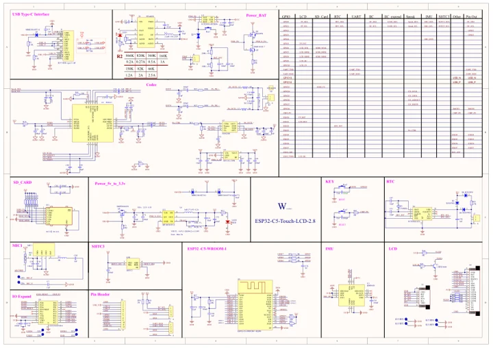

# ESP32-C5-Touch-LCD-2.8

**Waveshare** · ESP32-C5

Revision: Not identified

Coverage: Manufacturer references available; physical pinout and complete connector review are tracked separately

[Browse all manufacturers](../../../../BROWSE.md) · [Devices & IoT](../../../../DEVICES.md) · [Open in the browser guide](https://valleytech-black-wire-guide.pages.dev/?board=waveshare-esp32-esp32-c5-touch-lcd-2-8)

## Datasheets and original documentation

Board datasheet: **not yet recorded**. Visual reference: **available**.

[Manufacturer model documentation](https://docs.waveshare.com/ESP32-C5-Touch-LCD-2.8/Resources-And-Documents)

- **schematic / board**: [ESP32-C5-Touch-LCD-2.8 Schematic Diagram — schematic](https://github.com/waveshareteam/ESP32-C5-Touch-LCD-2.8/raw/refs/heads/main/schematic/ESP32-C5-Touch-LCD-2.8.pdf) · [saved document](../../../../library/media/22e6ff67d7a5892789acbc362cc3cd4c8d8ddae29fabac16d753ccb83ed501ae.pdf)

A chip datasheet, schematic and board datasheet have different scopes. Match the exact hardware revision.

[Documentation coverage and remaining gaps](../../../../DOCUMENTATION.md)

## Pinout

**pinout image** · Reviewed source · JPG

[Open original reference](../../../../library/media/73b21df2980608cfd535ffb2979e90949d99678b6620d2f00bbf93cb277fe0be.jpg)

**Credit and rights:** Not recorded; retain original attribution. Source/manufacturer: Waveshare.

[Source 1](https://www.waveshare.com/img/devkit/ESP32-C5-Touch-LCD-2.8/ESP32-C5-Touch-LCD-2.8-details-7.jpg) · [Source 2](https://www.waveshare.com/esp32-c5-touch-lcd-2.8.htm)

Image revision: Not identified

SHA-256: `73b21df2980608cfd535ffb2979e90949d99678b6620d2f00bbf93cb277fe0be`

## Pinout

**pinout image** · Reviewed source · WEBP

[Open original reference](../../../../library/media/23df9c9e8d03761bf4e7eb35b5487afe2a7dc307d6fce50a45fbd4e3f341f9ab.webp)

**Credit and rights:** Not recorded; retain original attribution. Source/manufacturer: Waveshare.

[Source 1](https://docs.waveshare.com/assets/images/2.8-3-abeb2d8b6bbe1c205ccc87b71f9df2b7.webp) · [Source 2](https://docs.waveshare.com/ESP32-C5-Touch-LCD-2.8)

Image revision: Not identified

SHA-256: `23df9c9e8d03761bf4e7eb35b5487afe2a7dc307d6fce50a45fbd4e3f341f9ab`

## ESP32-C5-Touch-LCD-2.8 Schematic Diagram — schematic

**reference PDF** · Source model/link and PDF signature/title checked; individual pin assignments and electrical validation pending · PDF

[Open original reference](../../../../library/media/22e6ff67d7a5892789acbc362cc3cd4c8d8ddae29fabac16d753ccb83ed501ae.pdf)

**Credit and rights:** Original publisher/manufacturer artwork; redistribution and print rights not established. Attribution is not a license grant.. Source/manufacturer: Waveshare.

[Source 1](https://github.com/waveshareteam/ESP32-C5-Touch-LCD-2.8/raw/refs/heads/main/schematic/ESP32-C5-Touch-LCD-2.8.pdf) · [Source 2](https://docs.waveshare.com/ESP32-C5-Touch-LCD-2.8/Resources-And-Documents)

Original document linked from this model’s manufacturer page. Preserve the document’s exact revision and named subassembly scope; a linked accessory schematic is not a whole-device pinout. This is a circuit schematic, not a physical board pinout.

Image revision: Use the revision printed in the original document; do not assume all hardware revisions are interchangeable

SHA-256: `22e6ff67d7a5892789acbc362cc3cd4c8d8ddae29fabac16d753ccb83ed501ae`

Pin assignments have not been independently electrically verified. Check board revision before wiring.
