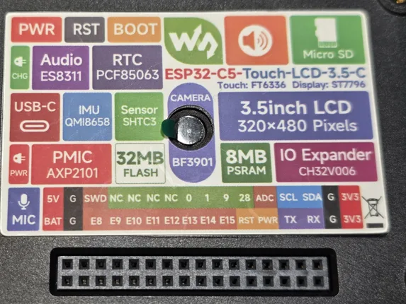
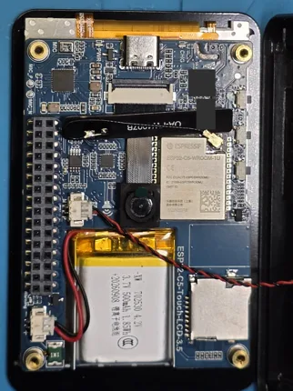
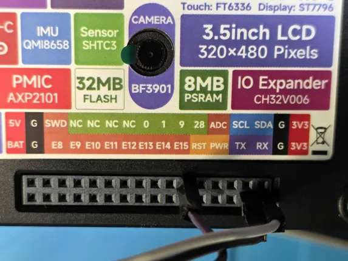
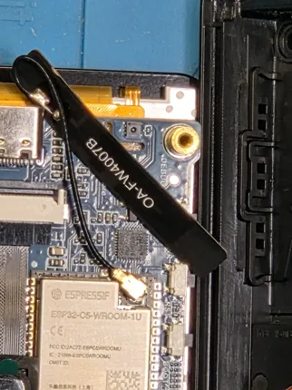

# ESP32-C5-Touch-LCD-3.5

**Waveshare** · ESP32-C5

Revision: Not identified; contributor specimen ESP32-C5-Touch-LCD-3.5-C, SKU 35419

Coverage: J3 schematic-numbered functions and contributor-tested continuity, supply, reset, power-button, BOOT and receive-only GPS observations for SKU 35419; physical mating-face map and electrical limits remain unqualified

[Browse all manufacturers](../../../../BROWSE.md) · [Devices & IoT](../../../../DEVICES.md) · [Open in the browser guide](https://valleytech-black-wire-guide.pages.dev/?board=waveshare-esp32-esp32-c5-touch-lcd-3-5)

## Datasheets and original documentation

Board datasheet: **not yet recorded**. Visual reference: **available**.

[Manufacturer hardware documentation](https://docs.waveshare.com/ESP32-C5-Touch-LCD-3.5)

- **schematic / board**: [ESP32-C5-Touch-LCD-3.5 Schematic](https://github.com/waveshareteam/ESP32-C5-Touch-LCD-3.5/raw/main/schematic/ESP32-C5-Touch-LCD-3.5.pdf) · [saved document](../../../../library/media/b2140f11620022301fe3c92d5c003e6d6b9e1db9cb111cd54f892eeb7a840485.pdf)
- **hardware-guide / board**: [Manufacturer pin and hardware documentation](https://docs.waveshare.com/ESP32-C5-Touch-LCD-3.5) · online
- **hardware-guide / board**: [Contributor assembly observations and J3 reference](https://github.com/JimGat/CYM/blob/dd7f20759c00b15b0537f0e11649a2fde1b6ed19/docs/hardware/waveshare-c5-touch-lcd-35.md) · online

Contributor @jimgat: tests apply to one camera/battery specimen, SKU 35419; PCB revision unknown. Camera/battery specimen SKU 35419: @jimgat confirmed by unpowered continuity from the J3 contact to the unconnected 0-ohm selector pad that the labeled GPIO0, GPIO1, GPIO9, U0TXD/GPIO11 and U0RXD/GPIO12 routes are not connected through to their native ESP32 GPIOs on this specimen. Camera routes (GPIO0/1/11/12) and SDCS (GPIO9) are selected instead per the schematic selector matrix. Disabling the camera in firmware does not reconnect an unpopulated hardware route. Do not assume the same routing on every camera-model board or revision. GPIO4/R60 is an additional onboard selector, not another numbered spare J3 GPIO. ATGM336H GPS: @jimgat reports working receive-only GPS with UART1 RX=GPIO28, ESP32 UART TX disabled, 9600 baud and common ground. GPIO28 also shares the BOOT button: continuity confirmed by @jimgat. Holding GPIO28 to GND during reset/power-up for more than 100 ms entered boot mode in the contributor test; this is an observed test condition, not a specified minimum timing. A connected external device must tolerate that line being pulled to GND. Do not press BOOT against an actively driven GPS TX/push-pull output; isolate or disconnect the driver first. GPIO28 cannot be treated as an independent input while BOOT is used; application input and BOOT operation are not simultaneously independent. Power and controls: VBUS/5V, VBAT1, GND, RST/CHIP_PU and PWR/PWRON tests and unknown power limits are recorded in their individual Pin names & purpose rows. The supplied 500 mAh battery capacity is not a header-current or charger rating.

[Documentation coverage and remaining gaps](../../../../DOCUMENTATION.md)

## Onboard Resources ​

**board labeling image** · Source identity and visual scope inspected; PDF review covers first-page preview. Independent electrical and all-connector completeness review pending. · WEBP

[Open original reference](../../../../library/media/a1520f3a56024749346c3a096453ec1f62e5caaca8a3fb7bfe8aa12cb100bf74.webp)

**Credit and rights:** Manufacturer artwork; reuse and print rights not established. Inclusion does not relicense the original.. Source/manufacturer: Waveshare.

[Source 1](https://docs.waveshare.com/assets/images/C5-3.5-Resources-5edc8d0466e806fc6354d6a45cf89a97.webp) · [Source 2](https://docs.waveshare.com/ESP32-C5-Touch-LCD-3.5)

Manufacturer source retained unchanged. Source identity and visual scope inspected; PDF review covers first-page preview. Independent electrical and all-connector completeness review pending. See the linked manufacturer page for the numbered component legend. This is not a complete physical pinout.

Image revision: As supplied in the original; match exact board revision

SHA-256: `a1520f3a56024749346c3a096453ec1f62e5caaca8a3fb7bfe8aa12cb100bf74`

## Interface Introduction ​

**board labeling image** · Source identity and visual scope inspected; PDF review covers first-page preview. Independent electrical and all-connector completeness review pending. · WEBP

[Open original reference](../../../../library/media/0a6253977a8864d582f7c9c5abb79e4cda7adbe0840fdc77807163ddfb65fb9c.webp)

**Credit and rights:** Manufacturer artwork; reuse and print rights not established. Inclusion does not relicense the original.. Source/manufacturer: Waveshare.

[Source 1](https://docs.waveshare.com/assets/images/C5-3.5-Interfaces-96950f2d84457f0b7c957e3c5f278dd3.webp) · [Source 2](https://docs.waveshare.com/ESP32-C5-Touch-LCD-3.5)

Manufacturer source retained unchanged. Source identity and visual scope inspected; PDF review covers first-page preview. Independent electrical and all-connector completeness review pending. See the linked manufacturer page for the numbered component legend. This is not a complete physical pinout.

Image revision: As supplied in the original; match exact board revision

SHA-256: `0a6253977a8864d582f7c9c5abb79e4cda7adbe0840fdc77807163ddfb65fb9c`

## ESP32-C5-Touch-LCD-3.5 Schematic

**original reference PDF** · Source identity and visual scope inspected; PDF review covers first-page preview. Independent electrical and all-connector completeness review pending. · PDF

[Open original reference](../../../../library/media/b2140f11620022301fe3c92d5c003e6d6b9e1db9cb111cd54f892eeb7a840485.pdf)

**Credit and rights:** Manufacturer artwork; reuse and print rights not established. Inclusion does not relicense the original.. Source/manufacturer: Waveshare.

[Source 1](https://github.com/waveshareteam/ESP32-C5-Touch-LCD-3.5/raw/main/schematic/ESP32-C5-Touch-LCD-3.5.pdf) · [Source 2](https://docs.waveshare.com/ESP32-C5-Touch-LCD-3.5/Resources-And-Documents)

Manufacturer source retained unchanged. Source identity and visual scope inspected; PDF review covers first-page preview. Independent electrical and all-connector completeness review pending.

Image revision: As supplied in the original; match exact board revision

SHA-256: `b2140f11620022301fe3c92d5c003e6d6b9e1db9cb111cd54f892eeb7a840485`

## J3 header and assembly identification

**board photograph** · Contributor photograph; not an electrical or complete physical pinout validation · JPG

[Open original reference](../../../../library/media/7f1d8b9c90feab6a92200a9ba369aa5d5bf085d9460ec4a673c56aba73f73a8a.jpg)

**Credit and rights:** Photograph contributed by @jimgat. Explicit permission to publish and reframe/resize/rotate/mark up for this contribution; no blanket photo license or print clearance asserted.. Source/manufacturer: Waveshare.

[Source 1](https://github.com/jimgat) · [Source 2](https://github.com/JimGat/CYM/blob/dd7f20759c00b15b0537f0e11649a2fde1b6ed19/docs/hardware/waveshare-c5-touch-lcd-35.md)

J3 header and rear sticker on contributor specimen SKU 35419. Sticker aliases confirmed by @jimgat: VBUS=5V, CHIP_PU=RST, PWRON=PWR. Continuity and functional results, disconnected native GPIO routes, and power limits are in Documentation and Pin names & purpose. This photograph alone is not an oriented physical pin map.

Image revision: Not identified; SKU 35419 contributor specimen

SHA-256: `7f1d8b9c90feab6a92200a9ba369aa5d5bf085d9460ec4a673c56aba73f73a8a`

## Camera and battery assembly

**board photograph** · Contributor photograph; not an electrical or complete physical pinout validation · JPG

[Open original reference](../../../../library/media/77013a1a662bf6ea62af54aa5a64e4ccda094967c515abc03c10e9c7bfd3af13.jpg)

**Credit and rights:** Photograph contributed by @jimgat. Explicit permission to publish and reframe/resize/rotate/mark up for this contribution; no blanket photo license or print clearance asserted.. Source/manufacturer: Waveshare.

[Source 1](https://github.com/jimgat) · [Source 2](https://github.com/JimGat/CYM/blob/dd7f20759c00b15b0537f0e11649a2fde1b6ed19/docs/hardware/waveshare-c5-touch-lcd-35.md)

Contributor specimen after disassembly for battery installation. Battery secured with double-sided tape. Exact PCB revision unknown. Factory code and serial area masked for privacy; no connector labels altered.

Image revision: Not identified; SKU 35419 contributor specimen

SHA-256: `77013a1a662bf6ea62af54aa5a64e4ccda094967c515abc03c10e9c7bfd3af13`

## ATGM336H GPS receive connection

**board photograph** · Contributor photograph; not an electrical or complete physical pinout validation · JPG

[Open original reference](../../../../library/media/24d71c2d3c33905c1449ce7e4a16b7613b60f186a39ad12ea0e70b0a606c3bbd.jpg)

**Credit and rights:** Photograph contributed by @jimgat. Explicit permission to publish and reframe/resize/rotate/mark up for this contribution; no blanket photo license or print clearance asserted.. Source/manufacturer: Waveshare.

[Source 1](https://github.com/jimgat) · [Source 2](https://github.com/JimGat/CYM/blob/dd7f20759c00b15b0537f0e11649a2fde1b6ed19/docs/hardware/waveshare-c5-touch-lcd-35.md)

ATGM336H GPS: @jimgat reports working receive-only GPS with UART1 RX=GPIO28, ESP32 UART TX disabled, 9600 baud and common ground. GPIO28 also shares the BOOT button: continuity confirmed by @jimgat. Holding GPIO28 to GND during reset/power-up for more than 100 ms entered boot mode in the contributor test; this is an observed test condition, not a specified minimum timing. A connected external device must tolerate that line being pulled to GND. Do not press BOOT against an actively driven GPS TX/push-pull output; isolate or disconnect the driver first. GPIO28 cannot be treated as an independent input while BOOT is used; application input and BOOT operation are not simultaneously independent. Schematic pin 21 is source numbering, not an independently oriented physical contact map.

Image revision: Not identified; SKU 35419 contributor specimen

SHA-256: `24d71c2d3c33905c1449ce7e4a16b7613b60f186a39ad12ea0e70b0a606c3bbd`

## FPC Wi-Fi antenna and coax connection

**board photograph** · Contributor photograph; not an electrical or complete physical pinout validation · JPG

[Open original reference](../../../../library/media/5bf77ff4a627bf8252a8331828dcc2d22143eb00fe375bf542a108b2c76ec4ef.jpg)

**Credit and rights:** Photograph contributed by @jimgat. Explicit permission to publish and reframe/resize/rotate/mark up for this contribution; no blanket photo license or print clearance asserted.. Source/manufacturer: Waveshare.

[Source 1](https://github.com/jimgat) · [Source 2](https://github.com/JimGat/CYM/blob/dd7f20759c00b15b0537f0e11649a2fde1b6ed19/docs/hardware/waveshare-c5-touch-lcd-35.md)

Waveshare describes IPEX Gen 1 and an FPC dual-band Wi-Fi antenna. External antenna/back-plate modification is not qualified: confirm connector, RF cable, antenna suitability, strain relief and enclosure clearance. Factory code and serial area masked for privacy.

Image revision: Not identified; SKU 35419 contributor specimen

SHA-256: `5bf77ff4a627bf8252a8331828dcc2d22143eb00fe375bf542a108b2c76ec4ef`

Pin assignments have not been independently electrically verified. Check board revision before wiring.
