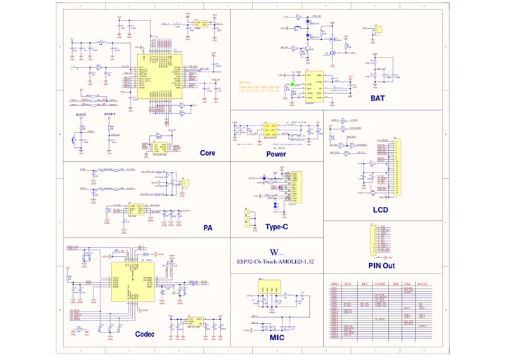

# ESP32-C6-Touch-AMOLED-1.32

**Waveshare** · ESP32-C6

Revision: Not identified

Coverage: Manufacturer references available; physical pinout and complete connector review are tracked separately

[Browse all manufacturers](../../../../BROWSE.md) · [Devices & IoT](../../../../DEVICES.md) · [Open in the browser guide](https://valleytech-black-wire-guide.pages.dev/?board=waveshare-esp32-esp32-c6-touch-amoled-1-32)

## Datasheets and original documentation

Board datasheet: **not yet recorded**. Visual reference: **available**.

[Manufacturer model documentation](https://www.waveshare.com/wiki/ESP32-C6-Touch-AMOLED-1.32)

- **schematic / board**: [ESP32-C6-Touch-AMOLED-1.32 Schematic — schematic](https://files.waveshare.com/wiki/ESP32-C6-Touch-AMOLED-1.32/ESP32-C6-Touch-AMOLED-1.32-Schematic.pdf) · [saved document](../../../../library/media/47d8228722e17e00e87175eb210603be9793d8b7392cdb90330f86e5d8894d9b.pdf)

A chip datasheet, schematic and board datasheet have different scopes. Match the exact hardware revision.

[Documentation coverage and remaining gaps](../../../../DOCUMENTATION.md)

## Pinout

**pinout image** · Reviewed source · JPG

[Open original reference](../../../../library/media/994f1893d6eb9fc902826f9bfe2c75e00fc6a563aceff6ebe9ab8f2e6411cc83.jpg)

**Credit and rights:** Not recorded; retain original attribution. Source/manufacturer: Waveshare.

[Source 1](https://www.waveshare.com/img/devkit/ESP32-C6-Touch-AMOLED-1.32/ESP32-C6-Touch-AMOLED-1.32-details-25.jpg) · [Source 2](https://www.waveshare.com/esp32-c6-touch-amoled-1.32.htm)

Image revision: Not identified

SHA-256: `994f1893d6eb9fc902826f9bfe2c75e00fc6a563aceff6ebe9ab8f2e6411cc83`

## ESP32-C6-Touch-AMOLED-1.32 Schematic — schematic

**reference PDF** · Source model/link and PDF signature/title checked; individual pin assignments and electrical validation pending · PDF

[Open original reference](../../../../library/media/47d8228722e17e00e87175eb210603be9793d8b7392cdb90330f86e5d8894d9b.pdf)

**Credit and rights:** Original publisher/manufacturer artwork; redistribution and print rights not established. Attribution is not a license grant.. Source/manufacturer: Waveshare.

[Source 1](https://files.waveshare.com/wiki/ESP32-C6-Touch-AMOLED-1.32/ESP32-C6-Touch-AMOLED-1.32-Schematic.pdf) · [Source 2](https://www.waveshare.com/wiki/ESP32-C6-Touch-AMOLED-1.32)

Original document linked from this model’s manufacturer page. Preserve the document’s exact revision and named subassembly scope; a linked accessory schematic is not a whole-device pinout. This is a circuit schematic, not a physical board pinout.

Image revision: Use the revision printed in the original document; do not assume all hardware revisions are interchangeable

SHA-256: `47d8228722e17e00e87175eb210603be9793d8b7392cdb90330f86e5d8894d9b`

Pin assignments have not been independently electrically verified. Check board revision before wiring.
