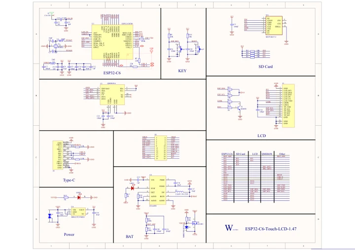

# ESP32-C6-Touch-LCD-1.47

**Waveshare** · ESP32-C6

Revision: Not identified

Coverage: Manufacturer references available; physical pinout and complete connector review are tracked separately

[Browse all manufacturers](../../../../BROWSE.md) · [Devices & IoT](../../../../DEVICES.md) · [Open in the browser guide](https://valleytech-black-wire-guide.pages.dev/?board=waveshare-esp32-esp32-c6-touch-lcd-1-47)

## Datasheets and original documentation

Board datasheet: **not yet recorded**. Visual reference: **available**.

[Manufacturer model documentation](https://www.waveshare.com/wiki/ESP32-C6-Touch-LCD-1.47)

- **schematic / board**: [ESP32-C6-Touch-LCD-1.47 Schematic diagram — schematic](https://files.waveshare.com/wiki/ESP32-C6-Touch-LCD-1.47/ESP32-C6-Touch-LCD-1.47-Schematic.pdf) · [saved document](../../../../library/media/b679d1a6198ece26992c72a1b93a97ed2db6cc5f0066d041cb49150c5759c480.pdf)

A chip datasheet, schematic and board datasheet have different scopes. Match the exact hardware revision.

[Documentation coverage and remaining gaps](../../../../DOCUMENTATION.md)

## Pinout

**pinout image** · Reviewed source · JPG

[Open original reference](../../../../library/media/0c75f3489bd60d240dbe1bd37de9fa6866023a206404ccac359890cd392d83e1.jpg)

**Credit and rights:** Not recorded; retain original attribution. Source/manufacturer: Waveshare.

[Source 1](https://www.waveshare.com/img/devkit/ESP32-C6-Touch-LCD-1.47/ESP32-C6-Touch-LCD-1.47-details-inter.jpg) · [Source 2](https://www.waveshare.com/esp32-c6-touch-lcd-1.47.htm)

Image revision: Not identified

SHA-256: `0c75f3489bd60d240dbe1bd37de9fa6866023a206404ccac359890cd392d83e1`

## Pinout

**pinout image** · Reviewed source · WEBP

[Open original reference](../../../../library/media/a0b584e7221aeae6c85f0fa23d0367059e8c5443e50b1b5e8979c2a9bd20a704.webp)

**Credit and rights:** Not recorded; retain original attribution. Source/manufacturer: Waveshare.

[Source 1](https://docs.waveshare.com/assets/images/ESP32-C6-Touch-LCD-1.47-details-inter-27f8f0c6d70114f21e2fee2ea079c0c7.webp) · [Source 2](https://docs.waveshare.com/ESP32-C6-Touch-LCD-1.47)

Image revision: Not identified

SHA-256: `a0b584e7221aeae6c85f0fa23d0367059e8c5443e50b1b5e8979c2a9bd20a704`

## Pinout

**pinout image** · Reviewed source · JPG

[Open original reference](../../../../library/media/271b6b53a5a9b589feb5ebdc8e707220dd2ee787932a0fccb499dbf5df85842f.jpg)

**Credit and rights:** Not recorded; retain original attribution. Source/manufacturer: Waveshare.

[Source 1](https://www.waveshare.com/w/upload/7/71/ESP32-C6-Touch-LCD-1.47-details-inter.jpg) · [Source 2](https://www.waveshare.com/wiki/ESP32-C6-Touch-LCD-1.47)

Image revision: Not identified

SHA-256: `271b6b53a5a9b589feb5ebdc8e707220dd2ee787932a0fccb499dbf5df85842f`

## ESP32-C6-Touch-LCD-1.47 Schematic diagram — schematic

**reference PDF** · Source model/link and PDF signature/title checked; individual pin assignments and electrical validation pending · PDF

[Open original reference](../../../../library/media/b679d1a6198ece26992c72a1b93a97ed2db6cc5f0066d041cb49150c5759c480.pdf)

**Credit and rights:** Original publisher/manufacturer artwork; redistribution and print rights not established. Attribution is not a license grant.. Source/manufacturer: Waveshare.

[Source 1](https://files.waveshare.com/wiki/ESP32-C6-Touch-LCD-1.47/ESP32-C6-Touch-LCD-1.47-Schematic.pdf) · [Source 2](https://www.waveshare.com/wiki/ESP32-C6-Touch-LCD-1.47)

Original document linked from this model’s manufacturer page. Preserve the document’s exact revision and named subassembly scope; a linked accessory schematic is not a whole-device pinout. This is a circuit schematic, not a physical board pinout.

Image revision: Use the revision printed in the original document; do not assume all hardware revisions are interchangeable

SHA-256: `b679d1a6198ece26992c72a1b93a97ed2db6cc5f0066d041cb49150c5759c480`

Pin assignments have not been independently electrically verified. Check board revision before wiring.
