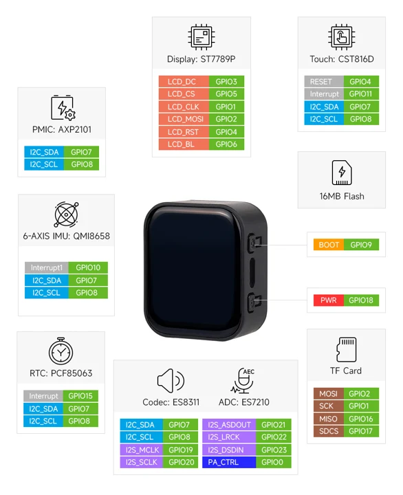
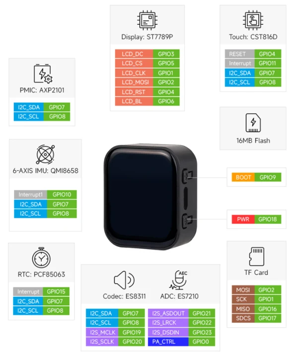

# ESP32-C6-Touch-LCD-1.83

**Waveshare** · ESP32-C6

Revision: Not identified

Coverage: Manufacturer references available; physical pinout and complete connector review are tracked separately

[Browse all manufacturers](../../../../BROWSE.md) · [Devices & IoT](../../../../DEVICES.md) · [Open in the browser guide](https://valleytech-black-wire-guide.pages.dev/?board=waveshare-esp32-esp32-c6-touch-lcd-1-83)

## Datasheets and original documentation

Board datasheet: **not yet recorded**. Visual reference: **available**.

[Manufacturer model documentation](https://www.waveshare.com/wiki/ESP32-C6-Touch-LCD-1.83)

A chip datasheet, schematic and board datasheet have different scopes. Match the exact hardware revision.

[Documentation coverage and remaining gaps](../../../../DOCUMENTATION.md)

## GPIO peripheral assignments

**GPIO reference image** · Reviewed source · WEBP

[Open original reference](../../../../library/media/baedbe467290e37ce407264a15d2854938f7e6e3884c979cb07b161a406eddec.webp)

**Credit and rights:** Not established; source attribution retained. Source/manufacturer: Waveshare.

[Source 1](https://docs.waveshare.com/assets/images/ESP32-C6-Touch-LCD-1.83-details-inter-45bc6d53faf0180c8923cdafb59c3ed7.webp) · [Source 2](https://docs.waveshare.com/ESP32-C6-Touch-LCD-1.83)

Official reference image. This is useful for board peripherals but must not be treated as a physical header/pad pinout. Board remains in the pinout research queue.

Image revision: Not identified

SHA-256: `baedbe467290e37ce407264a15d2854938f7e6e3884c979cb07b161a406eddec`

## ESP32-C6-Touch-LCD-1.83 peripheral assignments (product page)

**GPIO reference image** · Visually reviewed for identity and reference scope; independent electrical review pending · JPG

[Open original reference](../../../../library/media/dca0e9683322789e6f0f062b07cb4324d8bb79539f55be4ae75e7cea3b854dde.jpg)

**Credit and rights:** Original publisher/manufacturer artwork; redistribution and print rights not established. Attribution is not a license grant.. Source/manufacturer: Waveshare.

[Source 1](https://www.waveshare.com/img/devkit/ESP32-C6-Touch-LCD-1.83/ESP32-C6-Touch-LCD-1.83-details-inter.jpg) · [Source 2](https://www.waveshare.com/esp32-c6-touch-lcd-1.83.htm)

Function/block diagram. Manufacturer wiki and product-page diagrams differ; match the board revision and schematic.

Image revision: Use the revision printed in the original document; do not assume all hardware revisions are interchangeable

SHA-256: `dca0e9683322789e6f0f062b07cb4324d8bb79539f55be4ae75e7cea3b854dde`

## ESP32-C6-Touch-LCD-1.83 peripheral assignments (wiki)

**GPIO reference image** · Visually reviewed for identity and reference scope; independent electrical review pending · PNG

[Open original reference](../../../../library/media/60090e30c22cc2edb1edb4ed67730c24eb0429c1dfd4eaec859b95bb3f1630a0.png)

**Credit and rights:** Original publisher/manufacturer artwork; redistribution and print rights not established. Attribution is not a license grant.. Source/manufacturer: Waveshare.

[Source 1](https://www.waveshare.com/w/upload/thumb/f/fa/ESP32-C6-Touch-LCD-1.83-pinout.png/700px-ESP32-C6-Touch-LCD-1.83-pinout.png) · [Source 2](https://www.waveshare.com/wiki/ESP32-C6-Touch-LCD-1.83)

Function/block diagram including TF assignments. Product-page diagram differs; verify revision before wiring.

Image revision: Use the revision printed in the original document; do not assume all hardware revisions are interchangeable

SHA-256: `60090e30c22cc2edb1edb4ed67730c24eb0429c1dfd4eaec859b95bb3f1630a0`

Pin assignments have not been independently electrically verified. Check board revision before wiring.
