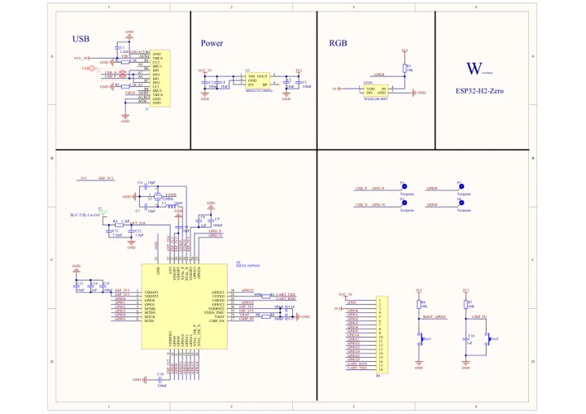

# ESP32-H2-Zero

**Waveshare** · ESP32-H2

Revision: Not identified

Coverage: Manufacturer references available; physical pinout and complete connector review are tracked separately

[Browse all manufacturers](../../../../BROWSE.md) · [Devices & IoT](../../../../DEVICES.md) · [Open in the browser guide](https://valleytech-black-wire-guide.pages.dev/?board=waveshare-esp32-esp32-h2-zero)

## Datasheets and original documentation

Board datasheet: **not yet recorded**. Visual reference: **available**.

[Manufacturer model documentation](https://docs.waveshare.com/ESP32-H2-Zero/Resources-And-Documents)

- **schematic / board**: [ESP32-H2-Zero Schematic Diagram — schematic](https://files.waveshare.com/wiki/ESP32-H2-Zero/ESP32-H2-Zero-Schematic.pdf) · [saved document](../../../../library/media/37a40ab59def84c34e55fb01911f0b31aba5adbd9f3c76fadc2702b2294da6db.pdf)

A chip datasheet, schematic and board datasheet have different scopes. Match the exact hardware revision.

[Documentation coverage and remaining gaps](../../../../DOCUMENTATION.md)

## Pinout

**pinout image** · Reviewed source · JPG

[Open original reference](../../../../library/media/b00ad9622a7c18ffbe76cd068b6944bf57235693e3a98fa5fd596e0f9cf7b4a6.jpg)

**Credit and rights:** Not recorded; retain original attribution. Source/manufacturer: Waveshare.

[Source 1](https://www.waveshare.com/img/devkit/ESP32-H2-Zero/ESP32-H2-Zero-details-inter.jpg) · [Source 2](https://www.waveshare.com/esp32-h2-zero.htm)

Image revision: Not identified

SHA-256: `b00ad9622a7c18ffbe76cd068b6944bf57235693e3a98fa5fd596e0f9cf7b4a6`

## Pinout

**pinout image** · Reviewed source · WEBP

[Open original reference](../../../../library/media/4429f98a85b062179df70ebc873556f83949bf01afd4026f0009b0851d29afeb.webp)

**Credit and rights:** Not recorded; retain original attribution. Source/manufacturer: Waveshare.

[Source 1](https://docs.waveshare.com/assets/images/ESP32-H2-Zero-details-inter-cb0ed656ebc63b6579927811d3310a60.webp) · [Source 2](https://docs.waveshare.com/ESP32-H2-Zero)

Image revision: Not identified

SHA-256: `4429f98a85b062179df70ebc873556f83949bf01afd4026f0009b0851d29afeb`

## Pinout

**pinout image** · Reviewed source · JPG

[Open original reference](../../../../library/media/0c7b5cb42377e83957853f6568aa948ec151d749578efd20e50e217344656749.jpg)

**Credit and rights:** Not recorded; retain original attribution. Source/manufacturer: Waveshare.

[Source 1](https://www.waveshare.com/w/upload/4/4f/ESP32-H2-Zero-details-inter.jpg) · [Source 2](https://www.waveshare.com/wiki/ESP32-H2-Zero)

Image revision: Not identified

SHA-256: `0c7b5cb42377e83957853f6568aa948ec151d749578efd20e50e217344656749`

## ESP32-H2-Zero Schematic Diagram — schematic

**reference PDF** · Source model/link and PDF signature/title checked; individual pin assignments and electrical validation pending · PDF

[Open original reference](../../../../library/media/37a40ab59def84c34e55fb01911f0b31aba5adbd9f3c76fadc2702b2294da6db.pdf)

**Credit and rights:** Original publisher/manufacturer artwork; redistribution and print rights not established. Attribution is not a license grant.. Source/manufacturer: Waveshare.

[Source 1](https://files.waveshare.com/wiki/ESP32-H2-Zero/ESP32-H2-Zero-Schematic.pdf) · [Source 2](https://docs.waveshare.com/ESP32-H2-Zero/Resources-And-Documents)

Original document linked from this model’s manufacturer page. Preserve the document’s exact revision and named subassembly scope; a linked accessory schematic is not a whole-device pinout. This is a circuit schematic, not a physical board pinout.

Image revision: Use the revision printed in the original document; do not assume all hardware revisions are interchangeable

SHA-256: `37a40ab59def84c34e55fb01911f0b31aba5adbd9f3c76fadc2702b2294da6db`

Pin assignments have not been independently electrically verified. Check board revision before wiring.
