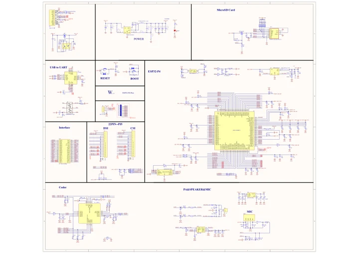

# ESP32-P4-Pico

**Waveshare** · ESP32-P4

Revision: Not identified

Coverage: Manufacturer references available; physical pinout and complete connector review are tracked separately

[Browse all manufacturers](../../../../BROWSE.md) · [Devices & IoT](../../../../DEVICES.md) · [Open in the browser guide](https://valleytech-black-wire-guide.pages.dev/?board=waveshare-esp32-esp32-p4-pico)

## Datasheets and original documentation

Board datasheet: **not yet recorded**. Visual reference: **available**.

[Manufacturer model documentation](https://www.waveshare.com/wiki/ESP32-P4-Pico)

- **schematic / board**: [ESP32-P4-Pico Schematic diagram — schematic](https://files.waveshare.com/wiki/ESP32-P4-Pico/ESP32-P4-Pico-datasheet.pdf) · [saved document](../../../../library/media/5b09b7a09b31500b96373c66acc39289d875da6f90a267fca0c199cd0a0e840b.pdf)

A chip datasheet, schematic and board datasheet have different scopes. Match the exact hardware revision.

[Documentation coverage and remaining gaps](../../../../DOCUMENTATION.md)

## Pinout

**pinout image** · Reviewed source · WEBP

[Open original reference](../../../../library/media/256350363eeb6c3042a42c214cc281c8a422bf80242628c5e73e53b773017cf8.webp)

**Credit and rights:** Not recorded; retain original attribution. Source/manufacturer: Waveshare.

[Source 1](https://docs.waveshare.com/assets/images/ESP32-P4-Pico-details-inter-c1e693aeee12aeb03a9a2fc1c44510f5.webp) · [Source 2](https://docs.waveshare.com/ESP32-P4-Pico)

Image revision: Not identified

SHA-256: `256350363eeb6c3042a42c214cc281c8a422bf80242628c5e73e53b773017cf8`

## Pinout

**pinout image** · Reviewed source · JPG

[Open original reference](../../../../library/media/9603333efd112d12daa8254cef44b96a346987b388acf32cca407ae4b7b1c236.jpg)

**Credit and rights:** Not recorded; retain original attribution. Source/manufacturer: Waveshare.

[Source 1](https://www.waveshare.com/w/upload/9/9b/ESP32-P4-Pico-details-inter.jpg) · [Source 2](https://www.waveshare.com/wiki/ESP32-P4-Pico) · [Source 3](https://www.waveshare.com/esp32-p4-pico.htm)

Image revision: Not identified

SHA-256: `9603333efd112d12daa8254cef44b96a346987b388acf32cca407ae4b7b1c236`

## ESP32-P4-Pico Schematic diagram — schematic

**reference PDF** · Source model/link and PDF signature/title checked; individual pin assignments and electrical validation pending · PDF

[Open original reference](../../../../library/media/5b09b7a09b31500b96373c66acc39289d875da6f90a267fca0c199cd0a0e840b.pdf)

**Credit and rights:** Original publisher/manufacturer artwork; redistribution and print rights not established. Attribution is not a license grant.. Source/manufacturer: Waveshare.

[Source 1](https://files.waveshare.com/wiki/ESP32-P4-Pico/ESP32-P4-Pico-datasheet.pdf) · [Source 2](https://www.waveshare.com/wiki/ESP32-P4-Pico)

Original document linked from this model’s manufacturer page. Preserve the document’s exact revision and named subassembly scope; a linked accessory schematic is not a whole-device pinout. This is a circuit schematic, not a physical board pinout.

Image revision: Use the revision printed in the original document; do not assume all hardware revisions are interchangeable

SHA-256: `5b09b7a09b31500b96373c66acc39289d875da6f90a267fca0c199cd0a0e840b`

Pin assignments have not been independently electrically verified. Check board revision before wiring.
