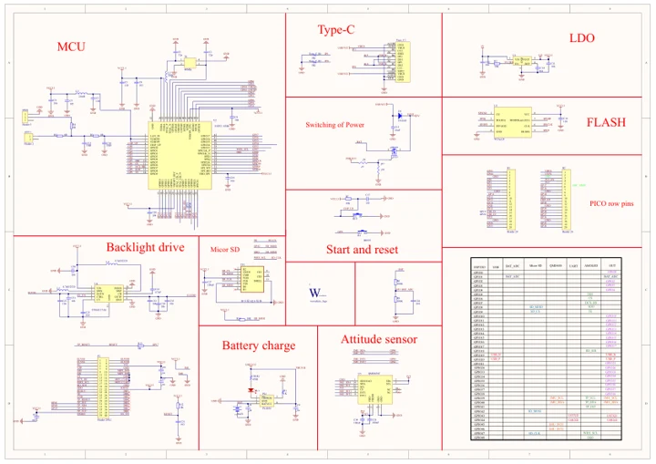

# ESP32-S3-AMOLED-1.91

**Waveshare** · ESP32-S3

Revision: Not identified

Coverage: Manufacturer references available; physical pinout and complete connector review are tracked separately

[Browse all manufacturers](../../../../BROWSE.md) · [Devices & IoT](../../../../DEVICES.md) · [Open in the browser guide](https://valleytech-black-wire-guide.pages.dev/?board=waveshare-esp32-esp32-s3-amoled-1-91)

## Datasheets and original documentation

Board datasheet: **not yet recorded**. Visual reference: **available**.

[Manufacturer model documentation](https://docs.waveshare.com/ESP32-S3-AMOLED-1.91/Resources-And-Documents)

- **schematic / board**: [ESP32-S3-AMOLED-1.91 Schematic — schematic](https://files.waveshare.com/wiki/ESP32-S3-AMOLED-1.91/ESP32-S3-AMOLED-1.91.pdf) · [saved document](../../../../library/media/5a43ca6ce13cb69713b771da2e0d235b8a004efac1014e1dd6ee32e35ed0c003.pdf)

A chip datasheet, schematic and board datasheet have different scopes. Match the exact hardware revision.

[Documentation coverage and remaining gaps](../../../../DOCUMENTATION.md)

## Pinout

**pinout image** · Reviewed source · JPG

[Open original reference](../../../../library/media/359160149cfbd55333f77212adede2a300dfcc474e6ed67defcd298255a18394.jpg)

**Credit and rights:** Not recorded; retain original attribution. Source/manufacturer: Waveshare.

[Source 1](https://www.waveshare.com/img/devkit/ESP32-S3-Touch-AMOLED-1.91/ESP32-S3-Touch-AMOLED-1.91-details-inter.jpg) · [Source 2](https://www.waveshare.com/esp32-s3-amoled-1.91.htm)

Image revision: Not identified

SHA-256: `359160149cfbd55333f77212adede2a300dfcc474e6ed67defcd298255a18394`

## Pinout

**pinout image** · Reviewed source · WEBP

[Open original reference](../../../../library/media/1d4ba4dfaf474a171d0ccfaaa61d42b5338fa36f2ecb9145bd5034e8fd848e23.webp)

**Credit and rights:** Not recorded; retain original attribution. Source/manufacturer: Waveshare.

[Source 1](https://docs.waveshare.com/assets/images/ESP32-S3-AMOLED-1.91-IntfIntro-1-346a608040ccb7f851b5fde0b1bb34a4.webp) · [Source 2](https://docs.waveshare.com/ESP32-S3-AMOLED-1.91)

Image revision: Not identified

SHA-256: `1d4ba4dfaf474a171d0ccfaaa61d42b5338fa36f2ecb9145bd5034e8fd848e23`

## ESP32-S3-AMOLED-1.91 Schematic — schematic

**reference PDF** · Source model/link and PDF signature/title checked; individual pin assignments and electrical validation pending · PDF

[Open original reference](../../../../library/media/5a43ca6ce13cb69713b771da2e0d235b8a004efac1014e1dd6ee32e35ed0c003.pdf)

**Credit and rights:** Original publisher/manufacturer artwork; redistribution and print rights not established. Attribution is not a license grant.. Source/manufacturer: Waveshare.

[Source 1](https://files.waveshare.com/wiki/ESP32-S3-AMOLED-1.91/ESP32-S3-AMOLED-1.91.pdf) · [Source 2](https://docs.waveshare.com/ESP32-S3-AMOLED-1.91/Resources-And-Documents)

Original document linked from this model’s manufacturer page. Preserve the document’s exact revision and named subassembly scope; a linked accessory schematic is not a whole-device pinout. This is a circuit schematic, not a physical board pinout.

Image revision: Use the revision printed in the original document; do not assume all hardware revisions are interchangeable

SHA-256: `5a43ca6ce13cb69713b771da2e0d235b8a004efac1014e1dd6ee32e35ed0c003`

Pin assignments have not been independently electrically verified. Check board revision before wiring.
