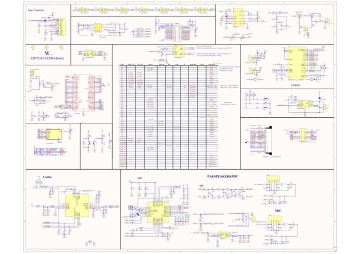

# ESP32-S3-AUDIO-Board

**Waveshare** · ESP32-S3

Revision: Not identified

Coverage: Manufacturer references available; physical pinout and complete connector review are tracked separately

[Browse all manufacturers](../../../../BROWSE.md) · [Devices & IoT](../../../../DEVICES.md) · [Open in the browser guide](https://valleytech-black-wire-guide.pages.dev/?board=waveshare-esp32-esp32-s3-audio-board)

## Datasheets and original documentation

Board datasheet: **not yet recorded**. Visual reference: **available**.

[Manufacturer model documentation](https://docs.waveshare.com/ESP32-S3-AUDIO-Board/Resources-And-Documents)

- **schematic / board**: [ESP32-S3-AUDIO-Board Schematic Diagram — schematic](https://files.waveshare.com/wiki/ESP32-S3-AUDIO-Board/ESP32-S3-AUDIO-Board_1.1.pdf) · [saved document](../../../../library/media/234b8800137fd56355fbb208a555893fe009cdff353707ccd564f7a82069cc09.pdf)

A chip datasheet, schematic and board datasheet have different scopes. Match the exact hardware revision.

[Documentation coverage and remaining gaps](../../../../DOCUMENTATION.md)

## Pinout

**pinout image** · Reviewed source · JPG

[Open original reference](../../../../library/media/ee9654fff77abf30975b14503b34daf817ad9c76d0c15d09a33c88772a68c335.jpg)

**Credit and rights:** Not recorded; retain original attribution. Source/manufacturer: Waveshare.

[Source 1](https://www.waveshare.com/img/devkit/ESP32-S3-AUDIO-Board/ESP32-S3-AUDIO-Board-details-inter.jpg) · [Source 2](https://www.waveshare.com/esp32-s3-audio-board.htm)

Image revision: Not identified

SHA-256: `ee9654fff77abf30975b14503b34daf817ad9c76d0c15d09a33c88772a68c335`

## Pinout

**pinout image** · Reviewed source · WEBP

[Open original reference](../../../../library/media/5862efe903fa2a3218c7282986f4d8d2f958dfdc9bd19d4946d7df2d22e53167.webp)

**Credit and rights:** Not recorded; retain original attribution. Source/manufacturer: Waveshare.

[Source 1](https://docs.waveshare.com/assets/images/Esp32s3_audio_boarddetails-inter-1.1-b330d016d3bccfbfea585aaf6c95600c.webp) · [Source 2](https://docs.waveshare.com/ESP32-S3-AUDIO-Board)

Image revision: Not identified

SHA-256: `5862efe903fa2a3218c7282986f4d8d2f958dfdc9bd19d4946d7df2d22e53167`

## Pinout

**pinout image** · Reviewed source · JPG

[Open original reference](../../../../library/media/59d761bd08822c57de76293563e2abb6d5a662bbc2254347deae70b84107e0f9.jpg)

**Credit and rights:** Not recorded; retain original attribution. Source/manufacturer: Waveshare.

[Source 1](https://www.waveshare.com/w/upload/7/73/Esp32s3_audio_boarddetails-inter-1.1.jpg) · [Source 2](https://www.waveshare.com/wiki/ESP32-S3-AUDIO-Board)

Image revision: Not identified

SHA-256: `59d761bd08822c57de76293563e2abb6d5a662bbc2254347deae70b84107e0f9`

## ESP32-S3-AUDIO-Board Schematic Diagram — schematic

**reference PDF** · Source model/link and PDF signature/title checked; individual pin assignments and electrical validation pending · PDF

[Open original reference](../../../../library/media/234b8800137fd56355fbb208a555893fe009cdff353707ccd564f7a82069cc09.pdf)

**Credit and rights:** Original publisher/manufacturer artwork; redistribution and print rights not established. Attribution is not a license grant.. Source/manufacturer: Waveshare.

[Source 1](https://files.waveshare.com/wiki/ESP32-S3-AUDIO-Board/ESP32-S3-AUDIO-Board_1.1.pdf) · [Source 2](https://docs.waveshare.com/ESP32-S3-AUDIO-Board/Resources-And-Documents)

Original document linked from this model’s manufacturer page. Preserve the document’s exact revision and named subassembly scope; a linked accessory schematic is not a whole-device pinout. This is a circuit schematic, not a physical board pinout.

Image revision: Use the revision printed in the original document; do not assume all hardware revisions are interchangeable

SHA-256: `234b8800137fd56355fbb208a555893fe009cdff353707ccd564f7a82069cc09`

Pin assignments have not been independently electrically verified. Check board revision before wiring.
