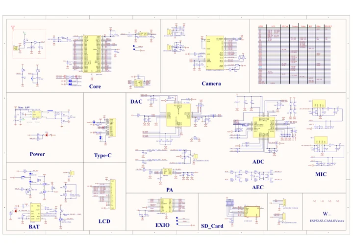
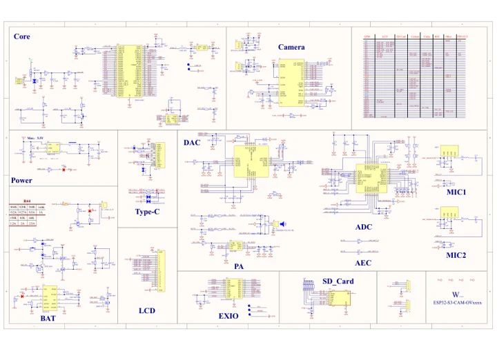

# ESP32-S3-CAM-OVxxxx

**Waveshare** · ESP32-S3

Revision: Not identified

Coverage: Manufacturer references available; physical pinout and complete connector review are tracked separately

[Browse all manufacturers](../../../../BROWSE.md) · [Devices & IoT](../../../../DEVICES.md) · [Open in the browser guide](https://valleytech-black-wire-guide.pages.dev/?board=waveshare-esp32-esp32-s3-cam-ovxxxx)

## Datasheets and original documentation

Board datasheet: **not yet recorded**. Visual reference: **available**.

[Manufacturer model documentation](https://docs.waveshare.com/ESP32-S3-CAM-OVxxxx/Resources-And-Documents)

- **schematic / board**: [ESP32-S3-CAM-OVxxxx V1 Schematic — schematic](https://files.waveshare.com/wiki/ESP32-S3-CAM-OVxxxx/ESP32-S3-CAM-XXXX-schematic.pdf) · [saved document](../../../../library/media/fab4de042457257753cd919b1bd57753308ec81edd0e8e993b127c24125fa4de.pdf)
- **schematic / board**: [ESP32-S3-CAM-OVxxxx V1.1 Schematic — schematic](https://files.waveshare.com/wiki/ESP32-S3-CAM-OVxxxx/ESP32-S3-CAM-OVxxxx_Rev1.1.pdf) · [saved document](../../../../library/media/0dff4feb161de492762f161c1172b362b342f9243a068842c9f712883d35edbc.pdf)

A chip datasheet, schematic and board datasheet have different scopes. Match the exact hardware revision.

[Documentation coverage and remaining gaps](../../../../DOCUMENTATION.md)

## Pinout

**pinout image** · Reviewed source · JPG

[Open original reference](../../../../library/media/453863863741b243a1dc41b22e96dcb22bd287b25125323c7f335b9f712fe70a.jpg)

**Credit and rights:** Not recorded; retain original attribution. Source/manufacturer: Waveshare.

[Source 1](https://www.waveshare.com/img/devkit/ESP32-S3-CAM-OVxxxx/ESP32-S3-CAM-OVxxxx-details-inter.jpg) · [Source 2](https://www.waveshare.com/esp32-s3-cam-ov5640.htm)

Image revision: Not identified

SHA-256: `453863863741b243a1dc41b22e96dcb22bd287b25125323c7f335b9f712fe70a`

## ESP32-S3-CAM-OVxxxx V1 Schematic — schematic

**reference PDF** · Source model/link and PDF signature/title checked; individual pin assignments and electrical validation pending · PDF

[Open original reference](../../../../library/media/fab4de042457257753cd919b1bd57753308ec81edd0e8e993b127c24125fa4de.pdf)

**Credit and rights:** Original publisher/manufacturer artwork; redistribution and print rights not established. Attribution is not a license grant.. Source/manufacturer: Waveshare.

[Source 1](https://files.waveshare.com/wiki/ESP32-S3-CAM-OVxxxx/ESP32-S3-CAM-XXXX-schematic.pdf) · [Source 2](https://docs.waveshare.com/ESP32-S3-CAM-OVxxxx/Resources-And-Documents)

Original document linked from this model’s manufacturer page. Preserve the document’s exact revision and named subassembly scope; a linked accessory schematic is not a whole-device pinout. This is a circuit schematic, not a physical board pinout.

Image revision: Use the revision printed in the original document; do not assume all hardware revisions are interchangeable

SHA-256: `fab4de042457257753cd919b1bd57753308ec81edd0e8e993b127c24125fa4de`

## ESP32-S3-CAM-OVxxxx V1.1 Schematic — schematic

**reference PDF** · Source model/link and PDF signature/title checked; individual pin assignments and electrical validation pending · PDF

[Open original reference](../../../../library/media/0dff4feb161de492762f161c1172b362b342f9243a068842c9f712883d35edbc.pdf)

**Credit and rights:** Original publisher/manufacturer artwork; redistribution and print rights not established. Attribution is not a license grant.. Source/manufacturer: Waveshare.

[Source 1](https://files.waveshare.com/wiki/ESP32-S3-CAM-OVxxxx/ESP32-S3-CAM-OVxxxx_Rev1.1.pdf) · [Source 2](https://docs.waveshare.com/ESP32-S3-CAM-OVxxxx/Resources-And-Documents)

Original document linked from this model’s manufacturer page. Preserve the document’s exact revision and named subassembly scope; a linked accessory schematic is not a whole-device pinout. This is a circuit schematic, not a physical board pinout.

Image revision: Use the revision printed in the original document; do not assume all hardware revisions are interchangeable

SHA-256: `0dff4feb161de492762f161c1172b362b342f9243a068842c9f712883d35edbc`

Pin assignments have not been independently electrically verified. Check board revision before wiring.
