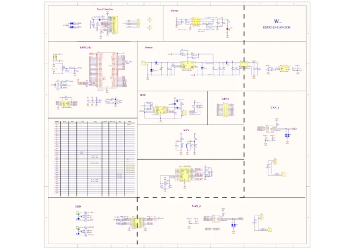

# ESP32-S3-CAN-2CH

**Waveshare** · ESP32-S3

Revision: Not identified

Coverage: Manufacturer references available; physical pinout and complete connector review are tracked separately

[Browse all manufacturers](../../../../BROWSE.md) · [Devices & IoT](../../../../DEVICES.md) · [Open in the browser guide](https://valleytech-black-wire-guide.pages.dev/?board=waveshare-esp32-esp32-s3-can-2ch)

## Datasheets and original documentation

Board datasheet: **not yet recorded**. Visual reference: **available**.

[Manufacturer model documentation](https://docs.waveshare.com/ESP32-S3-CAN-2CH/Resources-And-Documents)

- **schematic / board**: [ESP32-S3-CAN-2CH Schematic — schematic](https://github.com/waveshareteam/ESP32-S3-CAN-2CH/raw/refs/heads/main/hardware/schematics/ESP32-S3-CAN-2CH.pdf) · [saved document](../../../../library/media/4f4f46fd6976447ab4fab6c6e8dfe42cfcadcfd3fcaaaaa85c86c807d79da180.pdf)

A chip datasheet, schematic and board datasheet have different scopes. Match the exact hardware revision.

[Documentation coverage and remaining gaps](../../../../DOCUMENTATION.md)

## Pinout

**pinout image** · Reviewed source · JPG

[Open original reference](../../../../library/media/934cc5fac8c0d3c7dee973d0c92b055fcc3f724b25ad98f01b9851a83d35afc8.jpg)

**Credit and rights:** Not recorded; retain original attribution. Source/manufacturer: Waveshare.

[Source 1](https://www.waveshare.com/img/devkit/accBoard/ESP32-S3-CAN-2CH/ESP32-S3-CAN-2CH-details-15.jpg) · [Source 2](https://www.waveshare.com/esp32-s3-can-2ch.htm)

Image revision: Not identified

SHA-256: `934cc5fac8c0d3c7dee973d0c92b055fcc3f724b25ad98f01b9851a83d35afc8`

## Pinout

**pinout image** · Reviewed source · WEBP

[Open original reference](../../../../library/media/6f50a97d8b7b49b3d428f39c4668f568541759b7b32f7e2cc64c2212cce9e27a.webp)

**Credit and rights:** Not recorded; retain original attribution. Source/manufacturer: Waveshare.

[Source 1](https://docs.waveshare.com/assets/images/ESP32-S3-CAN-2CH-details-15-e1965af6facfd0a6bb5b953bbd74d45d.webp) · [Source 2](https://docs.waveshare.com/ESP32-S3-CAN-2CH)

Image revision: Not identified

SHA-256: `6f50a97d8b7b49b3d428f39c4668f568541759b7b32f7e2cc64c2212cce9e27a`

## ESP32-S3-CAN-2CH Schematic — schematic

**reference PDF** · Source model/link and PDF signature/title checked; individual pin assignments and electrical validation pending · PDF

[Open original reference](../../../../library/media/4f4f46fd6976447ab4fab6c6e8dfe42cfcadcfd3fcaaaaa85c86c807d79da180.pdf)

**Credit and rights:** Original publisher/manufacturer artwork; redistribution and print rights not established. Attribution is not a license grant.. Source/manufacturer: Waveshare.

[Source 1](https://github.com/waveshareteam/ESP32-S3-CAN-2CH/raw/refs/heads/main/hardware/schematics/ESP32-S3-CAN-2CH.pdf) · [Source 2](https://docs.waveshare.com/ESP32-S3-CAN-2CH/Resources-And-Documents)

Original document linked from this model’s manufacturer page. Preserve the document’s exact revision and named subassembly scope; a linked accessory schematic is not a whole-device pinout. This is a circuit schematic, not a physical board pinout.

Image revision: Use the revision printed in the original document; do not assume all hardware revisions are interchangeable

SHA-256: `4f4f46fd6976447ab4fab6c6e8dfe42cfcadcfd3fcaaaaa85c86c807d79da180`

Pin assignments have not been independently electrically verified. Check board revision before wiring.
