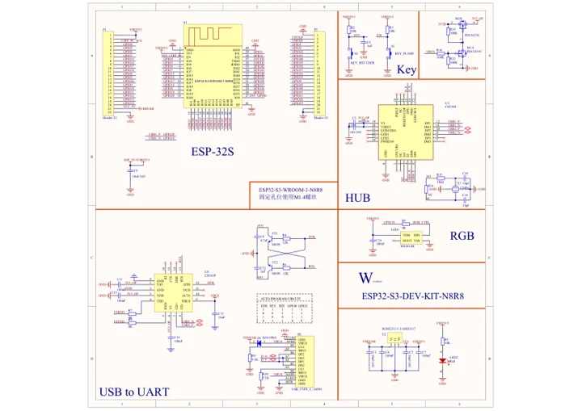

# ESP32-S3-DEV-KIT-N8R8

**Waveshare** · ESP32-S3

Revision: Not identified

Coverage: Manufacturer references available; physical pinout and complete connector review are tracked separately

[Browse all manufacturers](../../../../BROWSE.md) · [Devices & IoT](../../../../DEVICES.md) · [Open in the browser guide](https://valleytech-black-wire-guide.pages.dev/?board=waveshare-esp32-esp32-s3-dev-kit-n8r8)

## Datasheets and original documentation

Board datasheet: **not yet recorded**. Visual reference: **available**.

[Manufacturer model documentation](https://docs.waveshare.com/ESP32-S3-DEV-KIT-N8R8/Resources-And-Documents)

- **schematic / board**: [ESP32-S3-DEV-KIT-N8R8 Schematic Diagram — schematic](https://files.waveshare.com/wiki/ESP32-S3-DEV-KIT-N8R8/ESP32-S3-DEV-KIT-N8R8-schematic.pdf) · [saved document](../../../../library/media/73285a0b5c8f3603b73a6cb07be95146f5bb9f707fbea6d5aafb04d410ceb7b8.pdf)

A chip datasheet, schematic and board datasheet have different scopes. Match the exact hardware revision.

[Documentation coverage and remaining gaps](../../../../DOCUMENTATION.md)

## Pinout

**pinout image** · Reviewed source · JPG

[Open original reference](../../../../library/media/c9fc91695237142b1161e77c8c7d98552cf04fbe4249a43d570d90b71d363965.jpg)

**Credit and rights:** Not recorded; retain original attribution. Source/manufacturer: Waveshare.

[Source 1](https://www.waveshare.com/img/devkit/ESP32-S3-DEV-KIT-N8R8/ESP32-S3-DEV-KIT-N8R8-details-13.jpg) · [Source 2](https://www.waveshare.com/esp32-s3-dev-kit-n8r8.htm)

Image revision: Not identified

SHA-256: `c9fc91695237142b1161e77c8c7d98552cf04fbe4249a43d570d90b71d363965`

## Pinout

**pinout image** · Reviewed source · PNG

[Open original reference](../../../../library/media/6f3faf62b22a0a675de5fb4a566609c58a0ec76ac2a485c92fe6a46825777cd3.png)

**Credit and rights:** Not recorded; retain original attribution. Source/manufacturer: Waveshare.

[Source 1](https://www.waveshare.com/w/upload/c/c6/ESP32-S3-DEV-KIT-N8R8-details-13.png) · [Source 2](https://www.waveshare.com/wiki/ESP32-S3-DEV-KIT-N8R8)

Image revision: Not identified

SHA-256: `6f3faf62b22a0a675de5fb4a566609c58a0ec76ac2a485c92fe6a46825777cd3`

## Pinout

**pinout image** · Reviewed source · WEBP

[Open original reference](../../../../library/media/3f0e168281bed7f365d2dfb657500d92ee134c6f322b5376e97dac5519c27ab7.webp)

**Credit and rights:** Not recorded; retain original attribution. Source/manufacturer: Waveshare.

[Source 1](https://docs.waveshare.com/assets/images/ESP32-S3-DEV-KIT-N8R8-details-13-d6828c78fd0babb4a15b7ebb6b6872ff.webp) · [Source 2](https://docs.waveshare.com/ESP32-S3-DEV-KIT-N8R8)

Image revision: Not identified

SHA-256: `3f0e168281bed7f365d2dfb657500d92ee134c6f322b5376e97dac5519c27ab7`

## ESP32-S3-DEV-KIT-N8R8 Schematic Diagram — schematic

**reference PDF** · Source model/link and PDF signature/title checked; individual pin assignments and electrical validation pending · PDF

[Open original reference](../../../../library/media/73285a0b5c8f3603b73a6cb07be95146f5bb9f707fbea6d5aafb04d410ceb7b8.pdf)

**Credit and rights:** Original publisher/manufacturer artwork; redistribution and print rights not established. Attribution is not a license grant.. Source/manufacturer: Waveshare.

[Source 1](https://files.waveshare.com/wiki/ESP32-S3-DEV-KIT-N8R8/ESP32-S3-DEV-KIT-N8R8-schematic.pdf) · [Source 2](https://docs.waveshare.com/ESP32-S3-DEV-KIT-N8R8/Resources-And-Documents)

Original document linked from this model’s manufacturer page. Preserve the document’s exact revision and named subassembly scope; a linked accessory schematic is not a whole-device pinout. This is a circuit schematic, not a physical board pinout.

Image revision: Use the revision printed in the original document; do not assume all hardware revisions are interchangeable

SHA-256: `73285a0b5c8f3603b73a6cb07be95146f5bb9f707fbea6d5aafb04d410ceb7b8`

Pin assignments have not been independently electrically verified. Check board revision before wiring.
