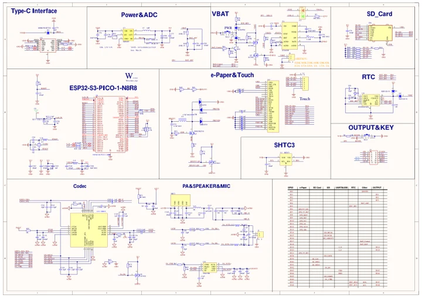

# ESP32-S3-ePaper-1.54

**Waveshare** · ESP32-S3

Revision: Not identified

Coverage: Manufacturer references available; physical pinout and complete connector review are tracked separately

[Browse all manufacturers](../../../../BROWSE.md) · [Devices & IoT](../../../../DEVICES.md) · [Open in the browser guide](https://valleytech-black-wire-guide.pages.dev/?board=waveshare-esp32-esp32-s3-epaper-1-54)

## Datasheets and original documentation

Board datasheet: **not yet recorded**. Visual reference: **available**.

[Manufacturer model documentation](https://docs.waveshare.com/ESP32-S3-ePaper-1.54/Resources-And-Documents)

- **schematic / board**: [ESP32-S3-ePaper-1.54 and ESP32-S3-Touch-ePaper-1.54 Schematic (GitHub) — schematic](https://github.com/waveshareteam/ESP32-S3-ePaper-1.54/raw/main/04_Hardware/Schematics/ESP32-S3-Touch-ePaper-1.54-Schematic.pdf) · [saved document](../../../../library/media/be6871527a397606189fff060750326003197ac828e2f0e499ad1206104aee2e.pdf)

A chip datasheet, schematic and board datasheet have different scopes. Match the exact hardware revision.

[Documentation coverage and remaining gaps](../../../../DOCUMENTATION.md)

## ESP32-S3-ePaper-1.54 and ESP32-S3-Touch-ePaper-1.54 Schematic (GitHub) — schematic

**reference PDF** · Source model/link and PDF signature/title checked; individual pin assignments and electrical validation pending · PDF

[Open original reference](../../../../library/media/be6871527a397606189fff060750326003197ac828e2f0e499ad1206104aee2e.pdf)

**Credit and rights:** Original publisher/manufacturer artwork; redistribution and print rights not established. Attribution is not a license grant.. Source/manufacturer: Waveshare.

[Source 1](https://github.com/waveshareteam/ESP32-S3-ePaper-1.54/raw/main/04_Hardware/Schematics/ESP32-S3-Touch-ePaper-1.54-Schematic.pdf) · [Source 2](https://docs.waveshare.com/ESP32-S3-ePaper-1.54/Resources-And-Documents)

Original document linked from this model’s manufacturer page. Preserve the document’s exact revision and named subassembly scope; a linked accessory schematic is not a whole-device pinout. This is a circuit schematic, not a physical board pinout.

Image revision: Use the revision printed in the original document; do not assume all hardware revisions are interchangeable

SHA-256: `be6871527a397606189fff060750326003197ac828e2f0e499ad1206104aee2e`

Pin assignments have not been independently electrically verified. Check board revision before wiring.
