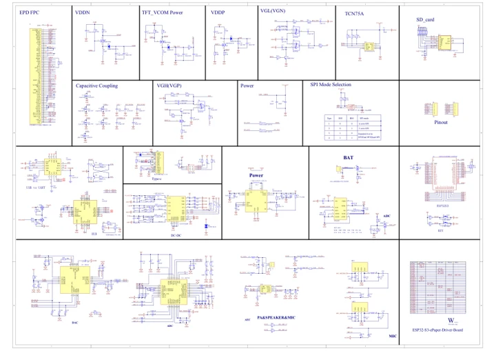

# ESP32-S3-ePaper-13.3E6

**Waveshare** · ESP32-S3

Revision: Not identified

Coverage: Manufacturer references available; physical pinout and complete connector review are tracked separately

[Browse all manufacturers](../../../../BROWSE.md) · [Devices & IoT](../../../../DEVICES.md) · [Open in the browser guide](https://valleytech-black-wire-guide.pages.dev/?board=waveshare-esp32-esp32-s3-epaper-13-3e6)

## Datasheets and original documentation

Board datasheet: **not yet recorded**. Visual reference: **available**.

[Manufacturer model documentation](https://docs.waveshare.com/ESP32-S3-ePaper-13.3E6/Resources-And-Documents)

- **schematic / board**: [ESP32-S3-ePaper-13.3E6 Schematic — schematic](https://files.waveshare.com/wiki/ESP32-S3-ePaper-13.3E6/ESP32-S3-ePaper-Driver-Board.pdf) · [saved document](../../../../library/media/4d5962d9b617bcf90653feb2a974bd66241a5bc27c2ee62951c226a7f9cb4f4d.pdf)

A chip datasheet, schematic and board datasheet have different scopes. Match the exact hardware revision.

[Documentation coverage and remaining gaps](../../../../DOCUMENTATION.md)

## GPIO peripheral assignments

**GPIO reference image** · Reviewed source · WEBP

[Open original reference](../../../../library/media/a6554bf68519e9991ab31e7cac7985e1cd2114a9c489d4fddccd022e3d22e195.webp)

**Credit and rights:** Not established; source attribution retained. Source/manufacturer: Waveshare.

[Source 1](https://docs.waveshare.com/assets/images/ESP32-S3-ePaper-13.3E6-details-gpio-f9450aefc4a71765baf1b9092a84fae7.webp) · [Source 2](https://docs.waveshare.com/ESP32-S3-ePaper-13.3E6)

Official reference image. This is useful for board peripherals but must not be treated as a physical header/pad pinout. Board remains in the pinout research queue.

Image revision: Not identified

SHA-256: `a6554bf68519e9991ab31e7cac7985e1cd2114a9c489d4fddccd022e3d22e195`

## ESP32-S3-ePaper-13.3E6 Schematic — schematic

**reference PDF** · Source model/link and PDF signature/title checked; individual pin assignments and electrical validation pending · PDF

[Open original reference](../../../../library/media/4d5962d9b617bcf90653feb2a974bd66241a5bc27c2ee62951c226a7f9cb4f4d.pdf)

**Credit and rights:** Original publisher/manufacturer artwork; redistribution and print rights not established. Attribution is not a license grant.. Source/manufacturer: Waveshare.

[Source 1](https://files.waveshare.com/wiki/ESP32-S3-ePaper-13.3E6/ESP32-S3-ePaper-Driver-Board.pdf) · [Source 2](https://docs.waveshare.com/ESP32-S3-ePaper-13.3E6/Resources-And-Documents)

Original document linked from this model’s manufacturer page. Preserve the document’s exact revision and named subassembly scope; a linked accessory schematic is not a whole-device pinout. This is a circuit schematic, not a physical board pinout.

Image revision: Use the revision printed in the original document; do not assume all hardware revisions are interchangeable

SHA-256: `4d5962d9b617bcf90653feb2a974bd66241a5bc27c2ee62951c226a7f9cb4f4d`

Pin assignments have not been independently electrically verified. Check board revision before wiring.
