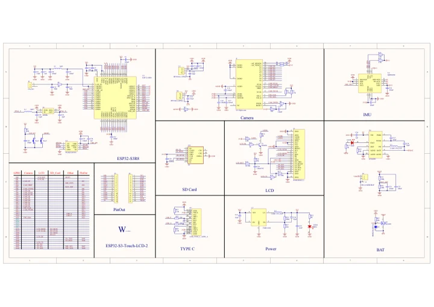

# ESP32-S3-LCD-2

**Waveshare** · ESP32-S3

Revision: Not identified

Coverage: Manufacturer references available; physical pinout and complete connector review are tracked separately

[Browse all manufacturers](../../../../BROWSE.md) · [Devices & IoT](../../../../DEVICES.md) · [Open in the browser guide](https://valleytech-black-wire-guide.pages.dev/?board=waveshare-esp32-esp32-s3-lcd-2)

## Datasheets and original documentation

Board datasheet: **not yet recorded**. Visual reference: **available**.

[Manufacturer model documentation](https://docs.waveshare.com/ESP32-S3-LCD-2/Resources-And-Documents)

- **schematic / board**: [ESP32-S3-LCD-2 Schematic Diagram — schematic](https://files.waveshare.com/wiki/ESP32-S3-LCD-2/ESP32-S3-Touch-LCD-2-SchDoc.pdf) · [saved document](../../../../library/media/384b689a77fb89d26edc770a4194ba556349b753f7fad103a41ec6b73c8879a6.pdf)

A chip datasheet, schematic and board datasheet have different scopes. Match the exact hardware revision.

[Documentation coverage and remaining gaps](../../../../DOCUMENTATION.md)

## Pinout

**pinout image** · Reviewed source · JPG

[Open original reference](../../../../library/media/f9a6a5b4cdc493f7abd966497b9b9eb3323bf6dc770ea76fcf71683a882b65a7.jpg)

**Credit and rights:** Not recorded; retain original attribution. Source/manufacturer: Waveshare.

[Source 1](https://www.waveshare.com/img/devkit/ESP32-S3-LCD-2/ESP32-S3-LCD-2-details-inter.jpg) · [Source 2](https://www.waveshare.com/esp32-s3-lcd-2.htm)

Image revision: Not identified

SHA-256: `f9a6a5b4cdc493f7abd966497b9b9eb3323bf6dc770ea76fcf71683a882b65a7`

## Pinout

**pinout image** · Reviewed source · WEBP

[Open original reference](../../../../library/media/8d60e522d17fd4ff229bd49117acca31b61e198e17afda69b9cdd7ae168f47ee.webp)

**Credit and rights:** Not recorded; retain original attribution. Source/manufacturer: Waveshare.

[Source 1](https://docs.waveshare.com/assets/images/ESP32-S3-LCD-2-details-inter-39c4313136c66a1cb1a3c1ca4265a332.webp) · [Source 2](https://docs.waveshare.com/ESP32-S3-LCD-2)

Image revision: Not identified

SHA-256: `8d60e522d17fd4ff229bd49117acca31b61e198e17afda69b9cdd7ae168f47ee`

## Pinout

**pinout image** · Reviewed source · PNG

[Open original reference](../../../../library/media/27e6bde491d5d14bc9c2265525f71f3985f2765a5bf15a586027be4d25d5f684.png)

**Credit and rights:** Not recorded; retain original attribution. Source/manufacturer: Waveshare.

[Source 1](https://www.waveshare.com/w/upload/e/e3/ESP32-S3-LCD-2-details-inter.png) · [Source 2](https://www.waveshare.com/wiki/ESP32-S3-LCD-2)

Image revision: Not identified

SHA-256: `27e6bde491d5d14bc9c2265525f71f3985f2765a5bf15a586027be4d25d5f684`

## ESP32-S3-LCD-2 Schematic Diagram — schematic

**reference PDF** · Source model/link and PDF signature/title checked; individual pin assignments and electrical validation pending · PDF

[Open original reference](../../../../library/media/384b689a77fb89d26edc770a4194ba556349b753f7fad103a41ec6b73c8879a6.pdf)

**Credit and rights:** Original publisher/manufacturer artwork; redistribution and print rights not established. Attribution is not a license grant.. Source/manufacturer: Waveshare.

[Source 1](https://files.waveshare.com/wiki/ESP32-S3-LCD-2/ESP32-S3-Touch-LCD-2-SchDoc.pdf) · [Source 2](https://docs.waveshare.com/ESP32-S3-LCD-2/Resources-And-Documents)

Original document linked from this model’s manufacturer page. Preserve the document’s exact revision and named subassembly scope; a linked accessory schematic is not a whole-device pinout. This is a circuit schematic, not a physical board pinout.

Image revision: Use the revision printed in the original document; do not assume all hardware revisions are interchangeable

SHA-256: `384b689a77fb89d26edc770a4194ba556349b753f7fad103a41ec6b73c8879a6`

Pin assignments have not been independently electrically verified. Check board revision before wiring.
