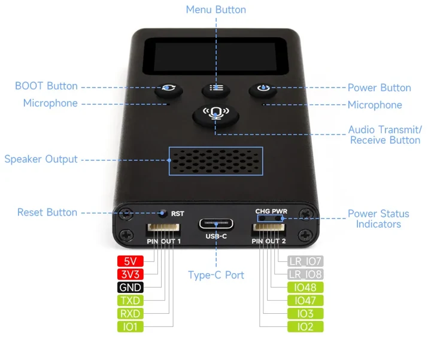
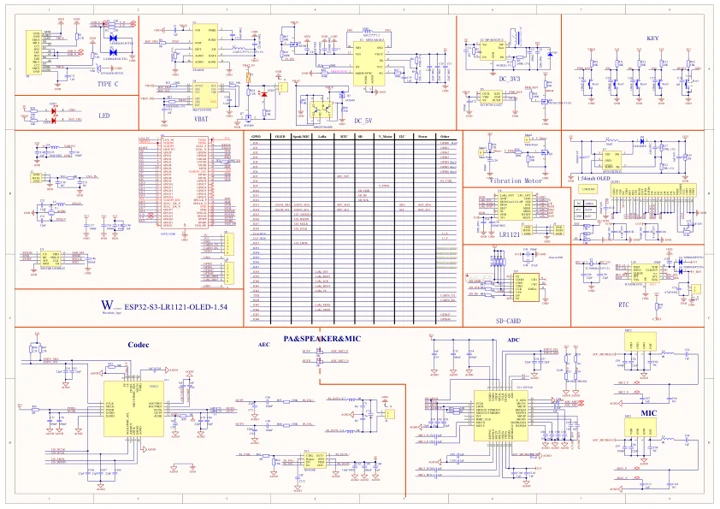

# ESP32-S3-LR1121-OLED-1.54

**Waveshare** · ESP32-S3

Revision: Match the original board revision

Coverage: Partial manufacturer references; all-connector review pending

[Browse all manufacturers](../../../../BROWSE.md) · [Devices & IoT](../../../../DEVICES.md) · [Open in the browser guide](https://valleytech-black-wire-guide.pages.dev/?board=waveshare-esp32-s3-lr1121-oled-1-54)

Device category: **Radio nodes & LoRa**

HF (850–930 MHz) and LF (410–510 MHz), with EN and non-EN product variants. Verify the exact radio SKU and revision; the diagram covers only the two exposed pin headers.

## Datasheets and original documentation

Board datasheet: **not yet recorded**. Visual reference: **available**.

[Manufacturer hardware documentation](https://docs.waveshare.com/ESP32-S3-LR1121-OLED-1.54)

- **hardware-guide / board**: [Manufacturer specifications and hardware documentation](https://docs.waveshare.com/ESP32-S3-LR1121-OLED-1.54) · online
- **schematic / board**: [ESP32-S3-LR1121-OLED-1.54 schematic](https://raw.githubusercontent.com/waveshareteam/esp32-s3-lr1121-oled-1.54/de469df0b7157b0b02bd9048d8e80b7abc07f5dc/hardware/schematics/esp32-s3-lr1121-oled-1_54_schematics.pdf) · [saved document](../../../../library/media/6d351a8893c71686602c1b53ddbcee1ea32d2ea7760d35855ae09bf03664eb19.pdf)

A chip datasheet, schematic and board datasheet have different scopes. Match the exact hardware revision.

[Documentation coverage and remaining gaps](../../../../DOCUMENTATION.md)

## External PIN OUT 1 / PIN OUT 2 and control labels

**pinout image** · Visually reviewed for identity and reference scope; independent electrical and all-connector review pending · WEBP

[Open original reference](../../../../library/media/e575b4314134681525cd904cf52b2cddf35e726966203dbce972e2046924ed73.webp)

**Credit and rights:** Manufacturer artwork; reuse and print rights not established. Inclusion does not relicense the original.. Source/manufacturer: Waveshare.

[Source 1](https://docs.waveshare.com/assets/images/ESP32-S3-LR1121-OLED-1.54-HW-0f03f534c8d76303e5fc55b861de373d.webp) · [Source 2](https://docs.waveshare.com/ESP32-S3-LR1121-OLED-1.54)

Partial physical pinout: two external headers and controls only. LR_IO7/LR_IO8 belong to the radio and must not be read as ESP32 GPIO7/GPIO8.

Image revision: Match the original board revision

SHA-256: `e575b4314134681525cd904cf52b2cddf35e726966203dbce972e2046924ed73`

## ESP32-S3-LR1121-OLED-1.54 schematic

**reference PDF** · Visually reviewed for identity and reference scope; independent electrical and all-connector review pending · PDF

[Open original reference](../../../../library/media/6d351a8893c71686602c1b53ddbcee1ea32d2ea7760d35855ae09bf03664eb19.pdf)

**Credit and rights:** Manufacturer artwork; reuse and print rights not established. Inclusion does not relicense the original.. Source/manufacturer: Waveshare.

[Source 1](https://raw.githubusercontent.com/waveshareteam/esp32-s3-lr1121-oled-1.54/de469df0b7157b0b02bd9048d8e80b7abc07f5dc/hardware/schematics/esp32-s3-lr1121-oled-1_54_schematics.pdf) · [Source 2](https://docs.waveshare.com/ESP32-S3-LR1121-OLED-1.54)

Three-page original hardware schematic from the board hardware directory. Bundled third-party example schematics are excluded.

Image revision: Match the original board revision

SHA-256: `6d351a8893c71686602c1b53ddbcee1ea32d2ea7760d35855ae09bf03664eb19`

Pin assignments have not been independently electrically verified. Check board revision before wiring.
